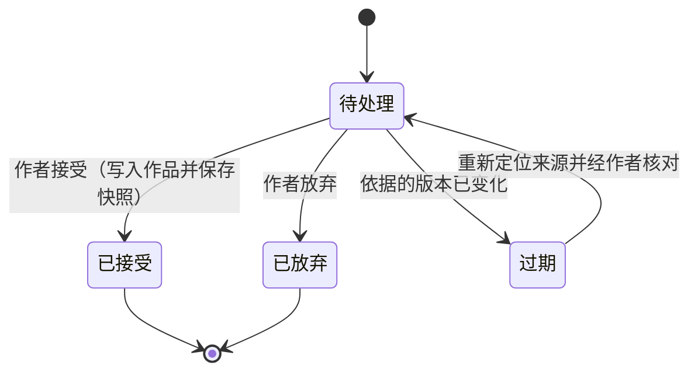

# 设计模式

版本：v0.1  
更新日期：2026年10月6日  
对应需求：[REQUIREMENTS.md](REQUIREMENTS.md) v0.7  
配套文档：[IMPLEMENTATION_PLAN.md](IMPLEMENTATION_PLAN.md)

本文说明项目采用的设计模式：每个模式解决什么问题、怎样落地、对应哪些需求，以及使用时的注意事项。代码均为示意，用来说明结构，不是最终接口。术语沿用需求文档第三章。

## 一 总体原则

| 原则 | 含义 | 主要落点 |
| --- | --- | --- |
| 确定性内核，模型在边缘 | 状态变化由纯函数计算；模型只产生提案、语义判断与文字，结果经校验后才进入状态 | 领域内核、裁决管线 |
| 信息权限靠结构保证 | 角色只能拿到由角色视图构建的输入，泄露由测试检查，不依赖提示词约束 | 认知透镜、金丝雀测试 |
| 派生物都有来源 | 事实、分析、候选稿、事件都记录依据与依据的版本 | 来源关系、依赖失效传播 |
| 记录优先于重算 | 推演的每一步写入只追加的记录；回放与恢复不请求模型 | 事件溯源、幂等步骤 |
| 作者确认是显式状态 | 待处理、已接受、待复核等状态写在数据里，由状态机约束转换 | 候选物生命周期、推演草案 |
| 外部依赖可替换 | 模型服务、存储、运行环境通过端口接入 | 端口与适配器 |

## 二 架构模式

### 端口与适配器

**问题**：同一套推演引擎要在 M0 命令行、自动化测试与 Tauri 桌面应用中运行；模型服务与存储方式也会更换。

**做法**：引擎与应用服务只依赖端口接口（`SqlPort`、`EventStore`、`LlmPort`、`Clock`、`Rng`、`FilePort`），每个运行环境提供各自的适配器。

```ts
interface LlmPort {
  // 取消通过 AbortSignal；已收到的文本与已知用量照常返回，结果为 cancelled。
  complete(req: LlmRequest, options?: { signal?: AbortSignal; onEvent?: (e: LlmStreamEvent) => void }):
    Promise<Result<LlmResult, LlmError>>;
}

// 桌面：TauriLlmAdapter    M0：NodeHttpLlmAdapter    测试：ReplayLlmAdapter
const engine = createEngine({ llm, events, clock, rng });
```

**注意**：端口按引擎的需要来定义，不照搬某个模型服务的接口。服务特有的字段由适配器转换，不能泄露到引擎中。

### 函数式内核，命令式外壳

**问题**：推演要求同轮行动与到达顺序无关、回放可复现、属性测试可行。只要状态变化掺入 IO 或隐式随机，这些要求都难以保证。

**做法**：领域内核只包含纯函数，即“状态加输入得到新状态与事件”。模型调用、存储与计时放在外壳（引擎编排层）。

```ts
// 纯函数：相同输入永远得到相同输出
function adjudicate(state: SimState, proposals: Proposal[], rulings: SemanticRuling[]): AdjudicationResult;
function apply(state: SimState, event: SimEvent): SimState;

// 外壳：负责取得 proposals 与 rulings（可能来自模型），然后调用纯函数
```

**落点**：`packages/domain` 全部、裁决管线、感知计算。需求：同轮行动、世界状态一致、B26、B27。

### 事件溯源与快照

**问题**：需求要求回放不调用模型、从任意回合建立分支、中断后恢复不重复裁决，并能追问因果。

**做法**：推演状态的每次变化都写成一条只追加的事件，当前状态由事件归约得到；定期保存快照以加快加载。

```ts
const state = events.reduce(apply, snapshot ?? initialState(scene));
```

**落点**：`sim_event`、`sim_snapshot`、作品事实的变更记录。需求：B28、B30、B31、B53。

**注意**：
- 事件一经写入不修改。作者介入也是一条事件，不是改写历史。
- 事件格式变更时为旧版本事件写升级函数，读取时转换。
- 正文不使用事件溯源：逐次按键记录的代价过高，正文采用段落级版本与章节快照。

### 读模型投影

**问题**：界面需要“当前局面、某角色此刻的认知、某条信息何时到达谁”等多种视角，每次都从头重放代价高、代码也分散。

**做法**：从事件流派生专用的读模型（投影），按需增量更新。写入只通过追加事件，读取只读投影。

| 投影 | 用途 |
| --- | --- |
| 当前局面 | 推演工作区的全局局面 |
| 角色认知时间线 | “角色所见”视图、信息到达时间线（B51） |
| 因果索引 | 由认知条目与行动提案的引用关系建立，用于因果追问（B53） |
| 走向摘要 | 批量推演的归类（B48） |

## 三 推演引擎模式

### 认知透镜

这是本项目最核心的模式。

**问题**：信息隔离是产品的基础。如果把完整世界状态交给角色代理，再用提示词要求它“忽略不该知道的信息”，隔离只能依赖模型自觉，无法验证。

**做法**：
1. 角色代理的唯一输入是角色视图，由 `buildCharacterView` 从状态中按信息权限构建。
2. 角色视图是带品牌的类型，只能由构建函数生成；角色提示词模板的参数类型是角色视图，在类型层面拿不到世界状态。
3. 读者代理（I06）、导演代理与正文生成使用同样的模式，各有各的透镜：读者透镜限于截至某章的正文，单视角正文透镜限于该角色当时的认知。

```ts
declare const lens: unique symbol;

type CharacterView = {
  readonly actorId: ActorId;
  readonly self: SelfState;                    // 自身位置、伤势、持有物
  readonly visible: VisibleScene;              // 按区域图可见的对象与角色
  readonly knowledge: readonly KnowledgeItem[];
  readonly [lens]: 'character';
};

function buildCharacterView(state: SimState, actor: ActorId): CharacterView;

// 模板只接受视图，不接受 SimState
function renderActionPrompt(view: CharacterView, card: CharacterCard): PromptInput;
```

**验证**：金丝雀测试。测试场景中每个秘密条目嵌入唯一标记，测试用的模型适配器检查每个发出的请求，出现无权限的标记即判定失败。透镜构建时同时产出上下文清单，作者在“角色所见”中看到的就是实际发送的内容。

**需求**：B24、B44、私有信息边界、正文视角、I06。

### 回合状态机

**问题**：一个回合包含构建视图、收集提案、校验、裁决、等待作者、提交、分发、更新认知等阶段，还要支持暂停、断点、恢复与两种运行模式。散落在各处的布尔标志很快会失控。

**做法**：回合阶段是显式的状态机，每次转换写入一条事件。允许的转换集中定义，非法转换直接报错。状态图见施工文档第五章。

**落点**：`packages/engine`。需求：B28、B30、交互模式与自动模式。

### 策略：回合协议、裁决器与运行模式

**问题**：同时行动与轮流对话的流程不同；裁决有程序裁决与模型裁决两种来源；交互模式与自动模式对待核实裁决的处理不同。

**做法**：用策略对象封装这些差异，回合主流程保持一致。

```ts
interface TurnProtocol {
  nextActors(state: SimState): ActorId[];      // 同时行动：全部角色；轮流对话：持有发言权者与听者
  collect(state: SimState, proposals: Proposal[]): CollectedTurn;
}

interface ReviewPolicy {
  onPendingRulings(rulings: SemanticRuling[]): Promise<ConfirmedRuling[]>;
}
// InteractiveReview：等待作者确认    AutoReview：自动接受并标记“待复核”
```

**需求**：B40、B26、B48、自动模式。

### 责任链：行动前提检查

**问题**：行动前提来自多种规则原语（持有、消耗、位置、视线、伤势、机关），规则还会随场景模板增加。

**做法**：每条规则原语实现同一个检查接口，按声明顺序组成检查链。每个检查器只返回通过、拒绝或失败尝试三种结果之一，并说明原因。

```ts
interface RuleCheck {
  check(state: SimState, p: Proposal): CheckResult;  // pass | reject(reason) | failAttempt(reason)
}
const checks: RuleCheck[] = scene.rules.map(compileRule);
```

**需求**：B26、B41、行动前提验收。

### 规约：条件的组合

**问题**：结束条件、条件断点（B52）、僵局检测、机关触发与监视项，本质上都是“对状态的判断”。

**做法**：把判断写成可组合的谓词，以数据形式保存在场景配置中，运行时编译为函数。

```ts
type Spec = (s: SimState) => boolean;
const and = (...xs: Spec[]): Spec => s => xs.every(x => x(s));

const breakpoint = knows('protagonist', secret('south_gate_tripwire'));
const endWhen = or(holds('antagonist', item('letter')), withdrew('protagonist'), roundAtLeast(8));
```

**注意**：规约只读取状态，不产生副作用；以数据保存，便于序列化与在界面中编辑。

### 命令与备忘录：作者介入

**问题**：作者可以修改目标与认知、替换行动、安排外部事件，需要保留介入前的快照、记录原因，并能追溯哪些变化来自作者。

**做法**：每种介入是一个命令对象，执行时先保存快照（备忘录），再追加 `AuthorIntervened` 事件。介入后的运行以新版本保存，原记录不动。

**需求**：B30、介入与回放验收。

### 可记录的随机数

**问题**：含随机因素的规则需要在回放时得到同样的结果。

**做法**：随机数生成器的状态是推演状态的一部分，每次抽取都推进该状态，并在事件中记录抽取结果。回放直接使用记录的结果。

### 幂等步骤与流程恢复

**问题**：应用可能在任一阶段崩溃或被关闭；恢复时不能重复裁决，也不能重复计费。

**做法**：每个需要模型的步骤有确定的步骤键，调用结果按步骤键存入 `llm_call`。恢复时重放事件得到最后的阶段，从该阶段重新执行；遇到已完成的步骤键，直接复用结果。

```ts
const key = stepKey(runId, round, phase, actorId, attempt);
const done = await calls.findCompleted(key);
const result = done ?? await callModel({ ...request, stepKey: key });
```

**需求**：停止与恢复验收、B28。

## 四 模型集成模式

### 适配器与凭据代理

**问题**：各模型服务的接口、结构化输出能力、错误码与用量字段各不相同；凭据不能进入 WebView；同一套模型接入代码还要在 M0 的 Node 环境中运行。

**做法**：分成两层。
- 防腐层在 TypeScript（`packages/llm`）：每个服务一个适配器，把各家的请求与响应转换成内部统一格式，负责结构化输出、重试、用量与拒答处理。Anthropic 适配器直接使用官方 TypeScript SDK。服务的差异不越过适配器。
- 凭据代理在 Rust：只转发字节，不理解协议。它校验目标主机、注入凭据、流式回传、执行取消与并发上限。桌面端把 SDK 的 `fetch` 替换为调用代理的函数，M0 与测试则直接用 Node 的 fetch。

这样适配器只写一份，凭据也始终留在 Rust 进程中。

**需求**：B15、B19、凭据与日志验收。

### 能力描述与按能力路由

**问题**：用户可以接入多家服务的任意模型，各模型对结构化输出、提示词缓存、思考深度控制的支持程度不同；把某个模型硬编码进业务代码，或者假设所有模型能力相同，都会在用户换模型时出错。

**做法**：
1. 每个模型有一份能力描述，来源依次为服务返回的信息、内置能力表、用户覆盖；没有记录时按保守能力处理。
2. 每类任务声明自己的能力要求，例如角色行动要求“结构化输出已自检通过”。
3. 任务分配只在满足要求的模型中选择；适配器按能力描述决定传哪些参数，例如不支持思考深度控制的模型不传 effort。

```ts
type ModelCapabilities = {
  structuredOutput: 'native' | 'json_object' | 'prompt' | 'none';
  promptCaching: boolean;
  reasoningControl: 'effort' | 'none';
  refusalFallback: 'server_default' | 'none';   // 拒答时由服务端改用其他模型重试
  contextWindow: number;
  maxOutputTokens: number;
  selfTestPassed: boolean;
};

const requirements: Record<TaskKind, (c: ModelCapabilities) => boolean> = {
  characterAction: c => c.selfTestPassed && c.structuredOutput !== 'none',
  rewrite: () => true,
};
```

**需求**：B15、B56、B57、B58。

### 结构化输出管线

**问题**：模型输出可能格式错误、缺少字段或超长；本地模型尤其不稳定。

**做法**：固定的管线依次执行解析、修复、校验、带错误信息重试，超过次数上限则暂停任务并说明原因。管线之外的代码拿到的一定是通过校验的数据。

```ts
async function structured<T>(schema: z.ZodType<T>, req: LlmRequest): Promise<Result<T, StructuredError>>;
```

**需求**：B35、结构化输出验收。

### 提示词作为版本化制品

**问题**：提示词改动会改变推演行为；如果不记录版本，旧结果无法解释，比较实验也无从谈起。

**做法**：提示词模板是独立文件，带有 id、版本、输入字段类型与输出 schema。每次调用记录模板 id 与版本；修改模板必须提升版本号，并更新录制回放样本。

**需求**：B36。

### 上下文清单

**问题**：作者需要知道这次请求用了哪些内容（B18）；“角色所见”需要可信；泄露问题需要可排查。

**做法**：上下文构建管线（收集、权限过滤、排序、预算裁剪、渲染）同时产出清单，记录每个条目被纳入或排除及其原因。清单与调用记录一起保存。一份数据同时服务于界面展示、调试与审计。

### 录制回放

**问题**：持续集成不能联网调用模型，但需要完整运行推演来验证引擎。

**做法**：录制适配器把真实请求与响应按请求哈希保存为样本；回放适配器按哈希返回样本，找不到时报错，不会悄悄联网。

**需求**：回放验收、测试策略。

### 预算守卫

**问题**：批量推演与动机检验的采样会迅速消耗费用。

**做法**：每次调用前按输入规模与价格表估算费用，累计值将超过任务预算时停止发起新调用，保留已完成结果。价格未知时按 Token 数设预算上限。

**需求**：B19、B28、批量推演的预算约束。

## 五 数据与版本模式

### 稳定标识与锚点重定位

**问题**：用字符偏移定位原文，正文一改就全部失效。

**做法**：段落使用稳定标识；锚点由段落标识、段落版本、段内位置与原文摘录组成。段落变化后用摘录在段内重新定位，失败才标为待复核。拆分与合并的继承规则见施工文档第四章。

**需求**：B10、B12、B33、事实来源验收。

### 依赖图与失效传播

**问题**：设定、事实、分析与推演之间相互依赖；上游变化后，下游结论需要被识别为可能过期。

**做法**：来源关系同时是依赖图，每条边记录依赖时的版本。上游版本递增时，沿依赖边做广度优先遍历，把下游标为待复核并记录原因。这与构建系统的增量失效是同一思路。

**需求**：B12、并行编辑验收、I01。

### 草案沙盒与乐观并发

**问题**：推演与分析需要在不影响作品的前提下运行；作者可能在等待结果期间继续修改正文。

**做法**：推演与分析的结果写入推演草案或候选物，并记录产生时依据的作品版本。采纳时比较依据版本与当前版本：一致则直接写入；不一致则先重新定位来源、展示差异，再由作者确认。

**需求**：推演隔离、草案采纳、并行编辑验收。

### 候选物生命周期

**问题**：候选稿、候选事实、待核实裁决、角色批注都有“待处理、接受、放弃、过期”的流转，各自实现容易出现不一致。

**做法**：统一的候选物状态机：



接受是唯一能修改作品的转换。

**需求**：B17、B29、B10。

### 分数索引排序

**问题**：章节与段落频繁插入和移动，整数序号需要大量重排。

**做法**：排序键使用分数索引字符串，在两个键之间总能生成新键；只有键长度过长时才批量重新分配。

## 六 前端模式

### 应用服务层

**问题**：如果界面组件直接调用仓储与模型，业务规则会散落在组件里，难以测试，也难以在 M0 与桌面端之间复用。

**做法**：每个用户操作对应一个用例函数（例如“接受候选稿”“运行一回合”），由用例协调仓储、引擎与端口。界面组件只调用用例、订阅状态。

### 编辑器扩展

**问题**：段落标识、来源标记、实体高亮、锚点与批注都需要接入编辑器，若混在一起会难以维护。

**做法**：每项能力是独立的 TipTap 扩展：段落标识扩展负责分配与继承标识；来源扩展维护来源属性；实体高亮与批注只使用装饰层，不改动文档内容。

### 任务中心

**问题**：模型调用、批量推演、导出与备份都是耗时任务，需要统一显示进度、支持取消，并在应用重启后可见。

**做法**：任务注册在任务中心，状态持久化；界面以订阅方式接收进度。取消操作向对应端口发出取消信号，保留部分结果与已知用量。

**需求**：B16、B19、B28。

## 七 禁止的做法

| 做法 | 问题 | 替代 |
| --- | --- | --- |
| 把完整世界状态交给角色代理，再要求它忽略某些信息 | 隔离无法验证，模型会利用 | 认知透镜 |
| 让模型直接修改状态 | 不可复现，违反规则时难以发现 | 模型提出，纯函数裁决 |
| 回放时重新请求模型 | 结果不同，产生费用 | 读取事件记录 |
| 用全文字符偏移作为锚点 | 前文一改全部失效 | 段落标识加摘录 |
| 在组件或业务代码中拼接提示词 | 无法版本化与审计 | 提示词模板 |
| 在结构化输出管线之外解析模型输出 | 绕过校验 | 结构化输出管线（`packages/llm`） |
| 改写或删除已写入的推演事件 | 破坏回放与因果追问 | 追加介入事件 |
| 保存派生结论而不保存依据与版本 | 无法判断是否过期 | 来源关系与依赖图 |
| 在日志中输出凭据或完整正文 | 泄露风险 | 凭据代理与调用记录集中脱敏 |
| 用布尔标志组合表示流程阶段 | 状态组合失控 | 显式状态机 |
| 在业务代码中写死模型名称或假定模型能力 | 用户换模型后出错 | 能力描述与按能力路由 |
| 复用官方命令行工具的登录流程或令牌 | 违反服务条款，用户可能被封号，随时失效 | 用户自填 API Key |

## 八 模式与需求对照

| 模式 | 主要需求与验收项 |
| --- | --- |
| 端口与适配器 | M0 引擎沿用、B15、测试策略 |
| 函数式内核 | B26、B27、同轮行动、世界状态一致 |
| 事件溯源与快照 | B28、B30、B31、介入与回放 |
| 读模型投影 | B48、B51、B53 |
| 认知透镜 | B24、B44、私有信息边界、正文视角、I06 |
| 回合状态机 | B28、交互模式与自动模式 |
| 策略 | B40、B26、B48 |
| 责任链 | B26、B41、行动前提 |
| 规约 | B52、结束条件、僵局检测 |
| 命令与备忘录 | B30 |
| 可记录的随机数 | 回放验收 |
| 幂等步骤与流程恢复 | 停止与恢复 |
| 适配器与凭据代理 | B15、B19、凭据与日志、多模型服务 |
| 能力描述与按能力路由 | B15、B56、B57、B58 |
| 结构化输出管线 | B35 |
| 提示词作为版本化制品 | B36 |
| 上下文清单 | B18、“角色所见” |
| 录制回放 | 测试策略 |
| 预算守卫 | B19、B28、B48 |
| 稳定标识与锚点重定位 | B10、B12、B33 |
| 依赖图与失效传播 | B12、I01、并行编辑 |
| 草案沙盒与乐观并发 | 推演隔离、草案采纳 |
| 候选物生命周期 | B17、B29、B10 |
| 应用服务层、编辑器扩展、任务中心 | B04、B05、B16 |
