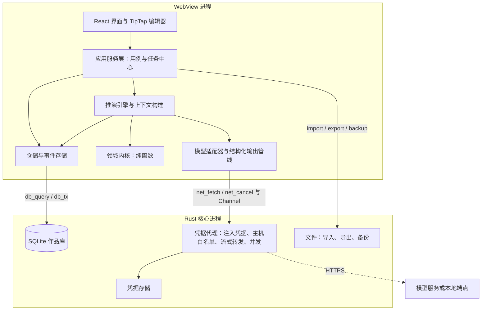
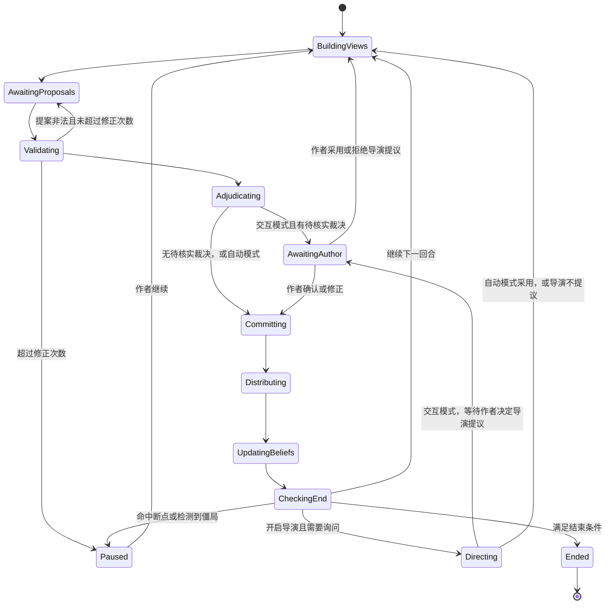

# 施工文档

版本：v0.4  
更新日期：2026年10月9日  
对应需求：[REQUIREMENTS.md](REQUIREMENTS.md) v0.8  
配套文档：[DESIGN_PATTERNS.md](DESIGN_PATTERNS.md)  
状态：草案。技术选型已按“运行性能与开发效率优先”确定，结论与理由见第十一章；M0 实测后按数据修正模型配置与费用估算。

本文把需求文档转为可执行的工程计划，覆盖 M0 至 M4。文中的需求编号（B、I、C）与验收项均引用需求文档；术语沿用需求文档第三章的术语表。设计模式的动机与写法见配套文档，本文只说明在哪里使用。

## 一 施工原则

1. 先验证风险最高的假设。M0 只做推演核心与实验工具，不做编辑器与存储界面；推演核心按正式代码的标准编写，M4 直接沿用。
2. 确定性在程序里，判断交给模型。位置、持有、消耗、视线、感知受众由程序计算；模型只提出行动、语义裁决与文字。
3. 信息隔离靠结构保证。角色请求只能由角色视图构建，测试用金丝雀标记检查泄露，不依赖提示词里的“请忽略你不该知道的信息”。
4. 记录优先于重算。推演的每一步都写入只追加的事件记录；回放、恢复、因果追问都从记录得到，不再请求模型。
5. 作者确认是显式状态。候选稿、待核实裁决、推演草案、候选事实都有明确的生命周期，未确认的内容不进入作品。写手代理写入草稿章节的正文是例外（需求 B60）：不经候选稿，但写入前保存快照、段落带来源标记，作者可直接修改或一键回退。
6. 外部依赖可替换。模型服务、存储、运行环境（Tauri 或 Node）都通过端口接口接入，同一套引擎可在 M0 命令行、自动化测试与桌面应用中运行。

## 二 技术选型

| 层 | 选型 | 理由 | 备选 |
| --- | --- | --- | --- |
| 桌面壳 | Tauri 2 | 需求既定；Windows 上使用 WebView2（Chromium 内核） | — |
| 前端 | React 19 + React Compiler + TypeScript（strict）+ Vite | 编译期自动记忆化，省去手写 memo；生态与编辑器绑定最完善 | Svelte 5、Solid |
| 正文编辑器 | TipTap 3（基于 ProseMirror），关闭按事务重渲染 | 以块为基本结构，便于为段落分配稳定标识；Chromium 下中文输入法组合输入成熟；编辑状态不经过 React 渲染 | 直接使用 ProseMirror、CodeMirror 6 |
| 前端状态 | Zustand | 轻量，便于与应用服务层分离 | Redux Toolkit |
| 数据校验 | Zod | 同一份定义用于运行时校验、类型推导与生成模型结构化输出所需的 JSON Schema | Valibot |
| 本地数据库 | SQLite（WAL 模式），每部作品一个数据库文件 | 事务、单文件备份、FTS5 全文检索 | — |
| 数据库访问 | 桌面端由 Rust（rusqlite）提供查询与事务命令：一个写连接加一个只读连接池（WAL 模式下读写互不阻塞）；Node 端（M0 与测试）用 better-sqlite3；两端共用迁移 SQL 与仓储代码 | 自建命令可保证一次事务在同一连接内完成；全文查找不会阻塞自动保存 | tauri-plugin-sql（需确认其跨调用事务语义） |
| 全文检索 | FTS5 trigram 分词；1 至 2 字的查询退化为逐章扫描 | 中文无需额外分词器 | Rust 侧 Tantivy 加中文分词 |
| 模型适配器 | TypeScript：Anthropic 官方 SDK；OpenAI 官方 SDK（OpenAI 用 Responses API，Gemini、兼容接口与本地端点用 Chat Completions） | 三个适配器覆盖五类服务；M0 与桌面端共用同一份代码；直接使用官方 SDK 的结构化输出、流式与错误类型 | 在 Rust 中重写各服务的适配器 |
| 模型认证 | 用户自填 API Key（本地端点可免密钥） | 各服务通用、合规；不实现订阅账户登录 | 开源后可增加 OpenAI 官方的 Sign in with ChatGPT |
| 凭据代理 | Rust（reqwest）：为发往模型服务的请求注入凭据、限定目标主机、流式转发、取消、并发上限 | 凭据不进入 WebView；代理只转发字节，不理解各服务协议 | — |
| 凭据存储 | keyring crate（Windows 凭据管理器） | B15 | — |
| 文本编码识别 | chardetng 与 encoding_rs（Rust） | TXT 导入常见 GB18030、GBK 与 UTF-8 | — |
| 标识 | ULID | 可排序、离线生成 | UUIDv7 |
| 段落与章节排序 | 分数索引（fractional indexing） | 插入与移动不需要重排其他行 | 整数序号加批量重排 |
| 包管理 | pnpm workspace | 多包单仓库 | — |
| 测试 | Vitest、fast-check（属性测试）、cargo test；少量 Playwright 冒烟测试 | 引擎以属性测试与录制回放测试为主 | — |
| 依赖边界检查 | dependency-cruiser | 强制领域层不依赖 IO | ESLint boundaries 插件 |

正文模型暂按“段落化纯文本”设计：每段是一个纯文本节点，首版不支持行内样式。网文正文以纯文本为主，这一选择让段落标识、锚点、来源标记与导出都保持简单。若需求第十一章最终选择富文本，需要调整段落模型与导出。

## 三 系统架构

### 运行时结构



推演引擎运行在 WebView 中。一个回合的程序计算（视图构建、规则检查、裁决、感知分发）在毫秒级，而一次模型调用需要数秒到数十秒，引擎所在的语言对推演速度几乎没有影响；真正决定速度的是模型调用的并行度、提示词缓存与思考深度（见第六章）。确实耗费 CPU 或 IO 的部分放在 Rust：数据库与全文检索、编码识别、备份、网络转发。应用关闭时若有运行中的任务，提示作者；任务状态已写入事件记录，重新打开后可以继续。

### 代码仓库结构

```text
fudiao/
├─ apps/
│  ├─ desktop/                 Tauri 应用
│  │  ├─ src/                  React 界面、应用服务层、Tauri 适配器
│  │  └─ src-tauri/            Rust：db、凭据代理、凭据存储、文件、迁移执行
│  └─ m0-cli/                  M0 命令行：运行场景、对照组、生成评估材料
├─ packages/
│  ├─ shared/                  标识、时间、Result、错误类型、工具函数
│  ├─ domain/                  领域内核：世界状态、认知、区域图、规则原语、感知、裁决、事件归约（无 IO）
│  ├─ engine/                  推演编排：回合状态机、运行模式、批量推演、介入、恢复
│  ├─ context/                 上下文构建：信息权限过滤、预算裁剪、上下文清单
│  ├─ writing/                 写手与审核的纯函数：章节计划、伏笔账本规则、技能组合、审核的程序检查（无 IO，只依赖 shared）
│  ├─ prompts/                 提示词模板、输出 schema、模板版本
│  ├─ llm/                     模型端口接口、Anthropic 与 OpenAI 兼容适配器、结构化输出管线、预算守卫、录制回放适配器
│  ├─ store/                   SQL 迁移、仓储、事件存储、投影、SQL 端口接口
│  └─ editor/                  TipTap 扩展：段落标识、来源标记、锚点、实体高亮
├─ m0/                         M0 场景文件、实验配置、评估材料与结论
├─ docs/                       设计补充文档
├─ REQUIREMENTS.md
├─ IMPLEMENTATION_PLAN.md
└─ DESIGN_PATTERNS.md
```

依赖方向只能向内：`apps → engine / context / writing / store / llm → domain → shared`。`domain` 不得导入任何 IO 模块，由 dependency-cruiser 在持续集成中检查。

### 端口接口

引擎与应用服务只依赖以下接口，各运行环境提供各自的实现：

| 端口 | 职责 | 桌面实现 | Node 实现（M0 与测试） |
| --- | --- | --- | --- |
| `SqlPort` | 执行查询与事务。事务是一批语句一次提交，不提供跨调用的交互式事务；先读后写用影响行数守卫（`expectChanges`）表达乐观并发。两端行为由 `packages/store/contract/sql-cases.json` 的契约用例保证一致 | Tauri 命令 `db_open`、`db_query`、`db_tx`、`db_close` | better-sqlite3 |
| `EventStore` | 按批次追加与读取推演事件，序号冲突检查 | `sqlEventStore`（`packages/store/src/sql-event-store.ts`，基于 `SqlPort`，一批事件一个事务） | 内存版（测试）与 JSONL 文件版（`packages/store/src/node`） |
| `LlmPort` | 发起模型调用、流式接收、取消 | 同一套 TypeScript 适配器，网络请求经 Rust 凭据代理 | 同一套适配器直连 HTTP；录制回放 |
| `Clock` / `Rng` | 时间与可记录的随机数 | 系统时钟、带种子的随机数 | 固定时钟、固定种子 |
| `FilePort` | 导入、导出、备份 | Tauri 命令 | Node fs |

## 四 数据模型

每部作品一个项目文件夹，包含 `project.sqlite` 与 `backups/`。新建作品默认放在“文档\复调\作品名”（作品库位置可更改），也可打开其他位置的已有作品；作品列表保存在应用数据目录的 `library.json`（版本、作品库位置，以及每部作品的标识、路径、标题缓存、是否归档与上次打开时间），写入时先写临时文件再改名。归档只是从列表中收起，文件不动；应用内不提供删除作品。应用级配置（模型服务、价格表、界面偏好）保存在应用数据目录，凭据保存在系统凭据管理器。项目文件夹位于 OneDrive 等同步目录时提示风险：同步程序可能在写入过程中复制数据库文件，导致备份不一致。

### 主要数据表

以下为首版表结构的要点；M1-03 已建的表以 `packages/store/migrations/0001_init.sql` 为准，其余表在各自的任务中加迁移。全部表为 `STRICT`；标识为 ULID 文本，系统时间为 UTC ISO 文本；可变记录带 `version`（乐观并发与来源版本）、`created_at`、`updated_at`。故事时间存为标签与可选排序键两列（见第五章“领域对象”）。表的清单与列由 `packages/store/src/schema.ts` 维护，测试校验它与实际结构一致。

| 表 | 关键字段 | 相关需求 |
| --- | --- | --- |
| `project` | id、title、genre、synopsis、outline、goals、avoid_phrases（规避词表，为空时用默认词表；迁移 0005）；每个作品库只有一行，结构版本记录在 `schema_migrations` | B01、B37 |
| `chapter` | id、order_key、title、summary、notes、status（正常、回收站）、trashed_at | B02 |
| `paragraph` | id、chapter_id、order_key（章内唯一）、text、version、source_kind（手写、AI 生成、AI 生成后修改、混合）、source_spans、ai_origin_text、split_from | B04、B33 |
| `chapter_snapshot` | id、chapter_id、reason（手动、恢复前、接受候选稿、导入、写手写入）、title、created_at、paragraphs（JSON） | B06、B17 |
| `entity` | id、kind（人物、地点、组织、物品、规则）、name、aliases、data、locked、version | B09 |
| `fact` | id、kind（世界事实、角色认知、人物说法；后两者必须有持有者）、holder_id、subject_ids、content、modality（观察、听闻、推测、说法）、confidence、适用章节范围（valid_from/to_chapter_id）、适用故事时间范围（valid_from/to 的标签与排序键）、status（候选、已确认、待复核、已驳回）、review_reason、version | B11 |
| `source_ref` | from_type、from_id、to_type、to_id、to_version、anchor | B12、来源定位 |
| `story_event` | id、故事时间（标签与排序键）、summary、participants、location_id、perceptions、origin_run_id、origin_seq | B55、I07 |
| `event_paragraph_link` | event_id、paragraph_id、mode（正面叙述、回忆、转述、暗示） | B55 |
| `sim_scene` | id、chapter_id、title、config（场景配置 JSON）、config_version（配置每改一次加一）、protocol、max_rounds、first_speaker、version；迁移 0006 | B22、B39 至 B41 |
| `sim_run` | id、scene_id、scene_config 与 scene_config_version（开始时的场景配置：场景之后再改，这次运行仍按当时的配置继续与回放）、mode（交互、自动）、batch_id、parent_run_id、branch_from_seq；status、end_reason、pause_reason、round、last_seq 是由事件得出的缓存，以事件为准；迁移 0006 | B28、B48 |
| `sim_event` | run_id、seq、batch_first / batch_index / batch_size（同一次追加为一批，与 M0 的 JSONL 记录一一对应）、type 与 actor（取自事件内容，便于查询）、payload、created_at；主键 (run_id, seq)；只追加，表上的触发器拒绝修改与删除。回合与阶段由回放得到，不另存列；迁移 0006 | B28、B30 |
| `sim_snapshot` | run_id、seq、state（JSON）、state_hash、created_at；在等待作者、暂停与结束处记下，用来校验回放；迁移 0006 | B30 |
| `llm_call` | id、step_key（一次性调用为空）、task_kind、provider、model、served_model、params、template_id、template_version、request_hash、status、input_tokens、output_tokens、cache_read_tokens、cache_write_tokens、cost（未知为空）、response、error、started_at、finished_at；迁移 0003，随作品导出 | B19、B36 |
| `candidate` | id、chapter_id、operation、target（起止段落标识与段内下标）、base_text 与 base_versions（生成时的原文与相关段落版本）、generated（生成原文）、content（作者可修改）、status（待处理、已接受、已放弃、过期）、status_reason、llm_call_id；迁移 0004，随作品导出 | B17 |
| `beat_sheet` | id、run_id、pov_actor_id、beats（JSON） | B45 |
| `chapter_plan` | chapter_id、goal、cast_ids（出场人物的设定标识）、beats（要写的情节点）、foreshadow_plant / foreshadow_payoff（伏笔标识）、treatment（详略说明）、target_words、status（待写、写作中、已写、已审核）、progress（写手的进度 JSON：这次写作的标识、情节点的分段与每段字数、已写入的段数、写入前快照的标识；没让写手写过时为空）、version；迁移 0005 | B65、B59 |
| `foreshadow` | id、title、content（伏笔是什么）、reveal（揭晓的内容，揭晓前不得说破）、plant_chapter_id 与 plant_anchor、payoff_chapter_id 与 payoff_anchor、status（计划、已埋、已回收、废弃）、version；迁移 0005 | B63 |
| `writing_skill` | id、key、name、instruction、enabled、builtin_version（内置技能的模板版本）、version；内置技能的文字在 `packages/prompts/templates/skills/`，作品中只存启用状态与作者的改动；迁移 0005 | B61 |
| `chapter_memory` | chapter_id、summary、cast_state（人物状态 JSON）、foreshadow_progress、based_on（段落标识与版本）、status（有效、待复核）、llm_call_id；迁移 0005 | B66 |
| `review_issue` | id、chapter_id、kind（设定冲突、时间线、视角越界、伏笔、人物言行、偏离计划、重复与节奏、AI 腔）、severity、anchor（段落标识、版本、引文）、evidence（依据：设定、事实、伏笔或段落）、description、suggestion、status（待处理、已忽略、已修改、已交写手修订、过期）、source（程序或模型）、llm_call_id；迁移 0005 | B64 |
| `evaluation` | id、run_id 或 batch_id、answers（JSON） | B46 |
| `paragraph_fts` | FTS5 trigram 虚拟表，内容来自 `paragraph.text`；rowid 取自 `paragraph_search_key` 的整数主键（`paragraph` 的隐式 rowid 在 VACUUM 后可能改变）；由触发器随段落的插入、修改与删除维护，是派生数据，不导出（迁移 0002） | B04 |

### 段落标识与锚点

- 每个段落节点在创建时获得 ULID。段落拆分时，前半段保留原标识，后半段获得新标识，并记录 `split_from`；在段首回车时前半段是空的，由带文字的一段保留原标识，锚点不因插入空行而失效。段落合并时保留前一段的标识，两段的来源按字符区间合并写入 `source_spans`。
- 合并按编辑步骤判断，不靠文本猜测：一步替换删掉了某段的开头、没删掉它的结尾，该段并入替换起点所在的段落；整段被删除的不算合并。粘贴进来的段落若带有本章已知的标识（剪切后粘贴、撤销恢复）沿用原标识，其他章节的标识重新生成；同一标识出现两次时，原位置的一段保留。实现见 `packages/editor/src/paragraph-identity.ts`。
- 事件关联（B55）随拆合继承：拆分后前后两段都保留原段落的关联；合并后保留的段落取两段关联的并集；删除段落时其关联随之删除。保存时先复制关联、后删除段落（`packages/store/src/repos/paragraph.ts`）。
- 锚点格式为 `{paragraphId, paragraphVersion, start, end, quote}`。段落版本变化后，先在该段内精确查找 `quote`，再做近似匹配；仍找不到则把依赖它的对象标为待复核。
- 全文查找（`packages/store/src/repos/search.ts`）：查询去掉两端空白后，3 字及以上作为 FTS5 短语查询走 trigram 索引，1 至 2 字扫描 `paragraph`（`instr`）。只查回收站以外的章节，按章节与段落顺序列出每一处的段内位置与前后 20 字上下文，最多 500 处。段内位置在 TypeScript 中按不区分大小写的字面匹配计算。打开查找页前先保存正在编辑的正文；点击结果打开章节并选中该处。Ctrl+F 打开查找页，正文中选中的一行文字作为查询。
- 段落来源（`packages/store/src/repos/paragraph-source.ts`）：`source_spans` 记录段内来自 AI 的字符区间，其余文字由作者写成。接受候选稿时整段为 AI 区间并写入 `ai_origin_text`（M2-06）。每次保存时由保存计划推导，不采信编辑器里已有段落的标记：
  - 文字变化：公共前缀、公共后缀与中间按最长公共子序列对齐的文字中，连续两字以上相同的保留原来源，其余新写入的文字属于作者（零散相同的单字视为巧合）。中间部分两段长度之积超过 100 万时整体视为改写。有生成原文的段落，与原文对得上（同样要求连续两字以上）的文字也算 AI 文字，删掉后撤销找回的文字不会算作作者所写。
  - 判定：没有 AI 区间为手写；有生成原文时，与原文的字符编辑距离超过原文字数的 10% 为“AI 生成后修改”，否则为“AI 生成”；没有生成原文时，整段是 AI 文字为“AI 生成后修改”，部分是为“混合”。
  - 拆分与合并：由拆分、合并关系连在一起的段落为一组，组内旧文字与新文字分别拼接后按上述规则更新区间，再按新段落切开。合并了不同来源的段落没有单一原文（“混合”）；各部分按自己的区间判定。组内带 AI 文字的旧段落都是“AI 生成”时，整段仍是 AI 文字的新段落以自身为生成原文。
  - 没有来历的新段落（接受候选稿、粘贴）采用编辑器标记。
  - AI 参与比例 = AI 区间内的字数 ÷ 总字数（字数规则同 `countWords`），按章节与全书统计，不含回收站中的章节（`source-stats.ts`）。
  - 正文左侧的来源色条是按段落标识的节点装饰（`packages/editor/src/source-marks.ts`），数据来自保存后的段落，不改动文档；手写段落不显示。开关存在作品列表文件 `library.json` 的 `preferences.showParagraphSource`，对所有作品生效，在“作品 → 段落来源”中切换。

### 依赖与待复核

`source_ref` 同时承担来源关系与依赖图：每条依据记录被依赖对象及依据当时的版本。待复核由依据记录推导，而不是在修改时触发一次性任务：已确认的事实满足以下任一条件时改为待复核并写明原因——依据的设定或事实当前版本高于记录的版本（“设定“当铺”已修改”）、依据已删除，或依据的事实本身待复核（沿依赖链传递，“依据的事实“……”需要复核”）。推导可以随时重算，每次修改设定或事实之后、打开作品时各执行一次（`reviewStaleFacts`），中途崩溃也不会漏标。候选与已驳回的事实不标记。作者复核后重新确认时，依据的版本更新为当前版本；依据的事实仍待复核时会再次标记。首版只处理设定条目、已确认事实与推演初始条件之间的依赖（B12 首版范围；推演初始条件随 M4 加入），基于正文段落锚点的依赖随 B10 在 P1 加入。

### 导出、导入与备份

- 正文导出：TXT 或 Markdown，可按章或全书导出。
- 完整项目导出：一个 zip 文件，内含 `manifest.json`（schema_version、导出时间）、`chapters/0001-章节名.md`，以及 `data/` 下每张表一个 JSONL 文件。人可以直接阅读，也可以完整导回。
- 导入：先校验 schema_version，按需执行迁移；导入后与导出前逐表比对，作为“数据迁移”验收的自动测试。
- 备份：用 SQLite 的 `VACUUM INTO` 生成一致快照，按时间命名，保留策略可配置。
- 迁移：`packages/store/migrations/NNNN_名称.sql`，桌面端由 Rust 在打开作品库时执行（编译期嵌入），Node 端由同规则的执行器执行。执行记录写入 `schema_migrations`（版本、名称、校验和、执行时间）；已执行迁移的校验和不一致、或库的版本高于程序已知的最新迁移时拒绝打开；已有数据的库在迁移前先备份到 `backups/pre-migration-v<版本>-<时间>.sqlite`。
- 导入 TXT 与 Markdown（M1-07）：文件由 Rust 弹出的对话框选择并读入，界面拿不到路径。编码：有 BOM 按 BOM，能按 UTF-8 严格解码就用 UTF-8，否则由 chardetng 猜测（GB18030、Big5 等），作者可在预览中改选。章节拆分：自动识别（`第…章/回/节/卷/集/部/篇`、序章、楔子、尾声、番外、`Chapter N`；只认 40 字以内的独立一行；“第…章”后不带分隔符时余下不超过 20 字且不以句末标点结尾）、Markdown 标题、不拆分、自定义正则；第一个标题之前的文字成为“正文前”一章。段落按行拆分，去掉全角缩进与空行。可导入为新作品，或追加到当前作品末尾；确认前只预览、不写入。
- 作品包：`manifest.json` 含格式名 `fudiao-project`、格式版本、结构版本、导出时间、作品名与章节数；`chapters/` 只收正常章节，供人阅读；导回只用 `data/`。读取 zip 时只接受这三类条目，拒绝绝对路径、反斜杠与 `..`，限制单个条目 256 MB、整包 1 GB。导入成为一部新作品；作品标识与列表中已有作品相同时换新标识。作品包的结构版本比本程序新时拒绝导入；较旧时，导出的数据依次经过各迁移登记的转换（`data-export.ts` 的 `UPGRADES`，每个迁移必须登记，只影响派生表的登记为原样保留）后导入，派生的索引随插入重建。
- 备份命名与保留：`backups/<种类>-<时间>.sqlite`，种类为 auto（打开作品时距上次自动备份超过 24 小时）、manual（立即备份）、pre-restore（恢复前）、pre-migration-v<版本>（迁移前）。只有 auto 自动清理，保留最近 30 份。从备份恢复：先建 pre-restore 备份，等进行中的操作结束后关闭连接，删除 `-wal`、`-shm`，把备份复制为临时文件再改名替换作品库，重新打开（需要时迁移）；备份名必须是备份目录中已有的文件。

## 五 推演引擎设计

### 领域对象

```ts
// packages/domain —— 示意，非最终定义
type SimState = {
  round: number;                              // 回合阶段（RoundPhase）属于引擎的运行状态，不在领域状态中
  world: WorldState;                          // 位置、持有、资源、伤势、机关、标记
  knowledge: Record<ActorId, KnowledgeItem[]>;
  claims: Record<ClaimId, Claim>;             // 人物说法，标识取台词所属“发生的事”的标识
  rng: RngState;
};

type KnowledgeItem = {
  id: KnowledgeId;                            // `${holder}:${回合}:${序号}`，由事件内容确定
  holder: ActorId;
  round: number;                              // 获得时的回合，初始认知为 0
  modality: 'observed' | 'heard' | 'inferred' | 'claimed';
  confidence: number | null;                  // 0 到 1；人物说法在认知更新评估前为 null
  order: 1 | 2;                               // 一阶认知，或“concerning 认为我……”
  concerning?: ActorId;
  about: string[];                            // 涉及的角色、区域、物品、机关
  body:                                       // 初始认知与推测为文本；观察由程序按感知生成；说法指向人物说法
    | { kind: 'text'; text: string }
    | { kind: 'observation'; observation: Observation }
    | { kind: 'claim'; claim: ClaimId };
  status: 'active' | 'retracted';
};
```

故事时间（`packages/domain/src/story-time.ts`）：`{ label, order }`，标签是作者写的说法（“第三年春”“雨夜二更”），只用于显示；可选的数值排序键用于比较与按故事时间筛选，没有排序键的不参与筛选（`compareStoryTime`、`withinStoryRange` 返回不可判断）。故事时间与系统时间不混用。

观察记录来源“发生的事”的标识与回合，因果追问由此回溯；事件序号由引擎的事件记录给出。模型只能新增推测、修改本人条目的相信程度或撤回本人条目，推测引用的对象必须出现在该角色的视图中（`planBeliefUpdate`）。

角色视图（`buildCharacterView`）包含：本人的位置、伤势、持有物与计数、去掉初始认知的角色卡；公开的区域布局；此刻看得见的角色及其手中未藏匿的物品、可见区域中的物品、未隐藏或本人知道的机关；本人有效的认知条目与听清的人物说法；以及视图中已出现的标识对应的名称（不引入新信息）。原语无法表达的规则记录在场景配置的 `rules.narrativeRules` 中，只交给裁决模型。他人的伤势与物品计数看不见，只能推测。场景标题、题材、探索问题、秘密与他人的角色卡永远不进入视图。

### 行动提案格式

```ts
const ActionProposal = z.object({
  kind: z.enum(['observe', 'move', 'probe', 'attack', 'defend', 'use_item', 'take', 'drop', 'speak', 'withdraw', 'wait', 'other']),
  // take 拾取所在区域内无人持有的物品，drop 放下；从他人手中夺取经 attack 或语义裁决
  target: z.string().optional(),
  item: z.string().optional(),
  toZone: z.string().optional(),
  utterance: z.array(z.string()).optional(),  // 台词按句切分，用于轮流对话中的打断；任何行动都可附带台词
  description: z.string().optional(),         // 旁人能看到的具体动作；other、use_item、probe、attack 须写清，交给语义裁决
  interruptAfter: z.number().optional(),      // 轮流对话中听到第几句后打断；听者在一次决策中选择
  intent: z.string(),                         // 当前目标
  rationale: z.string(),                      // 简短决策摘要
  beliefRefs: z.array(z.string()),            // 依据的认知条目标识
  innerThought: z.string(),                   // 内心片段，不参与裁决
  inferences: z.array(z.object({ about: z.string(), content: z.string(), confidence: z.number() })),
});
```

该 schema 是模型输出的格式，位于 `packages/prompts`；引擎把它转换为领域层的 `Action`（标识已解析）后交给规则检查与裁决。

场景时钟（`clock`）：场景可以写从第几回合起是什么时辰（`clockAt`），时辰是在场的人都能感知的公开信息，进入角色视图、语义裁决与导演的提示词。有期限的目标（如“天亮前凑够三十两”）因此有了时间压力。角色行动模板第 8 版要求人物先判断情绪阈值与失控条件是否被触发、不重复说过的条件、考虑不行动的代价、威胁准备兑现；提案中的 `triggered` 记录被触发的是情绪阈值还是失控条件，只记录，不参与裁决。（M0-13 第一轮评价指出推演组“僵持多、转折少”“威胁不兑现”，因而补上。）

物品可以带内容（场景中物品的 `content`，例如信上写的字）：持有者自己使用这件物品（没有指定别人作对象）时由程序结算；递给或出示给别人（指定了对象）照旧交给语义裁决。读信时旁人只看见他在用这件物品，另有一条只有他知道的“读到”（`read`），内容进入他的认知。作者的秘密（`secrets`）仍只供作者与证据链判断使用，不经此进入角色视图；信的内容由作者另外写在物品上。（M0-13 中雨夜场景的周砚读完信却什么都没得知，因而补上。）

边做事边说话：任何行动附带的台词在同一回合另生成一次“说话”（`adjudicate`），交给语义裁决的行动同样不丢台词。语义裁决看到的是 `description`（旁人能看到的动作），而不是 `intent`（人物的内心目标）：意图可能被写进旁人感知的描述，造成信息泄露。（M0-13 首轮真实实验中，雨夜场景第 7 回合阿青边放信边说的话因此丢失，裁决也因不知道具体动作而没有结果。）

内心片段与推测条目在行动提案的同一次调用中返回，不额外请求模型。`beliefRefs` 是因果追问的连接点，提交时校验其引用的条目确实存在于该角色的视图中。

### 回合状态机



每次状态转换都写入一条事件。运行状态只由事件归约得到（`reduceRun`），各阶段允许出现的事件集中定义，事件出现在不允许的阶段时归约报错。崩溃恢复时，重放事件得到最后的阶段，从该阶段继续。每个需要模型的步骤都有确定的步骤键 `runId:round:step:对象:attempt`；调用前先查 `llm_call` 中是否已有该键的完成记录，有则直接复用，因此恢复不会重复计费，也不会重复裁决。一个步骤产生的事件作为一个批次写入，读取时丢弃不完整的批次，因此写到一半崩溃不会留下半个回合。故障注入测试在每一次事件追加前后、每一次模型调用中模拟崩溃，验证恢复后的事件记录与不中断时完全一致。

校验与收集提案合并：提案提交时即按回合开始的状态检查，被拒绝时在同一对话中附上拒绝原因请求修正，超过次数暂停，由作者替换行动。认知更新只为本回合有新观察或新说法的角色请求，行动提案中的推测一并写入。

证据链提示（B44）：认知更新之后，程序筛出本回合新增、涉及某个秘密对象的推测（`screenSecretInferences`，合法知情者除外），附上该角色涉及同一对象的观察、听闻、说法与先前回合的推测（含角色卡中的初始推测；同一回合的推测不互为线索），交给命中判断。一条推测可能对照几个秘密，判断按“推测加秘密”逐对给出，引擎也按这一对记录 `EvidenceGapFlagged`。各角色的判断互不依赖，同时发出，结果按角色标识的顺序写入。（M0-13 中，旧的筛选不把先前的推测算作线索，且只按推测对应结果，导致误报与记错秘密；判断依次发出时约占轮流对话一半的等待时间。）

修正原因：结构化输出管线与语义裁决的范围校验在请求修正时，把上一次输出未通过校验的原因写在请求的 `repairOf` 中，调用记录保存为 `repairIssues`；它不计入请求哈希，录制回放样本照常匹配。

轮流对话（B40）：每回合只有持有发言权的人行动。他说话时，其余在场角色在同一回合用一次调用决定回应，并看到按句编号的台词，可以在任一句之后打断；最早的打断点决定实际说出的句数，被打断的部分不进入任何人的认知。这次回应就是该角色下一次持有发言权时的行动，不再额外调用；到时若已不合法，按规则拒绝重问。打断者获得下一回合的发言权，否则按场景中的角色顺序传递。

僵局与导演（M0-07）：检查结束时，程序先在最近 K 回合（默认 3）的窗口内判定“双方观望”（只有等待、观察或防御且世界状态不变）与“重复相同动作”（同一个人每回合提交相同的行动，说话连同内容比较）；世界状态不变但有对话时，才请求僵局判断，区分“反复拉锯”（同样的条件来回说，没有新的信息、让步或行动）、“冲突被礼貌化解”与“目标已无法达成”；后者只指局面中的事实排除了目标（人已离开、东西已毁、事已发生），目标互相冲突、要价对不上等仍可能因让步或摊牌而改变的情况不算（M0-13 中当铺场景因此被大量提前结束，僵局判断模板第 3 版收紧）。僵局判断是作者侧请求，只读窗口内的全局记录与各人的当前目标。检测到后窗口重新计数。自动模式记录并继续，目标已无法达成时以僵局结束，反复拉锯第二次出现时（`stalemate.maxCircling`，默认 2）也以僵局结束；交互模式暂停，把类型与建议交给作者。导演在回合边界提议，只读全局局面、最近两回合发生的事与作者的张力曲线，不读任何角色的认知、角色卡与内心片段；只能产生一件外部事件并设置场景已声明的标记，经 `commitExternal` 按感知规则分发。

### 事件类型

| 事件 | 主要内容 |
| --- | --- |
| `RunStarted` | 场景配置哈希、模式、随机种子、模型配置 |
| `RoundStarted` | 回合号、状态哈希 |
| `ViewBuilt` | 角色、视图哈希（上下文清单在 M2-04 加入） |
| `ProposalSubmitted` / `ProposalRejected` | 角色、提案与领域行动或拒绝原因、尝试次数、步骤键、来源（模型、作者、轮流对话中预先给出的回应）、用于哪一回合 |
| `ProposalsComplete` | 本回合提案收齐；轮流对话中最早的打断点 |
| `AdjudicationProposed` / `AdjudicationConfirmed` | 裁决条目、依据与待核实项、确认者（作者或自动）、是否待复核 |
| `Committed` | 随后的 `StateChanged` 与 `PerceptionDelivered` 来自回合提交还是作者安排的外部事件 |
| `StateChanged` | 状态差异 |
| `PerceptionDelivered` | 角色、按感知通道裁剪后的观察；归约时生成认知条目 |
| `BeliefsUpdated` / `BeliefsReviewed` | 角色、新增的推测、修改的相信程度、撤回的条目；该角色本回合的认知更新已完成 |
| `KnowledgeEdited` | 作者介入时修改的角色认知（可以是观察或听闻，不能是人物说法） |
| `DirectorProposed` / `DirectorDecided` | 回合边界上的导演提议（理由、外部事件或不提议）；作者或自动采用与否。采用时随后是 `Committed`（来源为导演）与领域事件 |
| `AuthorIntervened` | 介入类型（替换行动、修改认知、外部事件）、原因、介入前的状态哈希 |
| `EvidenceGapFlagged` / `EvidenceChecked` | 缺少证据链的命中；本回合证据链检查已完成 |
| `StalemateDetected` / `BreakpointHit` | 僵局类型（双方观望、重复相同动作、反复拉锯、冲突被礼貌化解、目标已无法达成）与说明；命中的条件 |
| `RoundEnded` / `RunEnded` | 回合结束时的状态哈希与下一位持有发言权的人；结束原因（回合上限、在场不足两人、预算、作者停止、僵局） |
| `RunPaused` / `RunResumed` | 暂停原因（作者、提案不合法、模型错误、拒答、截断、输出无效、裁决不合法、僵局） |

分支：`fork(runId, seq)` 在批次边界复制前缀生成新的运行，`RunStarted` 记录来源，原记录不动。

### 裁决管线

1. 规范化：提案按角色标识排序，与到达顺序无关。
2. 前提检查：按规则原语逐条检查能力、持有物、位置、资源与伤势限制，产生拒绝或失败尝试。
3. 冲突处理：同一物品、同一目标的冲突按规则解决；规则声明了随机对抗时，使用记录在状态里的种子随机数。
4. 语义裁决：程序无法判断的条目，连同依据交给裁决模型；交互模式下进入待核实裁决，自动模式下自动接受并标记待复核。
5. 生成结果：输出状态差异与事件，每个事件带有视觉与声音两种感知描述。

### 感知分发

区域图是带属性的无向图：边上记录是否相邻、是否可见、声音衰减等级。每个事件带有发生区域、视觉描述、声音描述与响度。受众计算：

- 视觉受众：与事件区域互相可见的区域中的角色。
- 声音受众：沿边累计衰减后，响度仍大于零的区域中的角色。
- 台词：同区域的角色听到全部已说出的句子；其他区域在衰减后的余量不低于场景的 `loudness.speechClarity`（默认 2，即正常说话）时也能听清，否则只听到“有人在说话”。看不见说话者时，听清的话不记为某人的说法（不知道是谁说的）。

只看见的角色收到视觉描述，只听见的角色收到声音描述。例如，主角踢碎瓦片时，货架后的对手只收到“货架另一侧传来碎瓦声”。只听见时，角色得到声音类别（脚步、物品碰撞、打斗、人声、机关声、噪声）与离自己最近的声源区域，不得到行动者与对象；专门用来发声的物品（如碎瓦）可以从声音认出。当事人得到全部结果，包括失败原因；旁观者只知道尝试失败。

### 上下文构建

角色请求只能通过 `buildCharacterView(state, actorId)` 得到的角色视图构建。上下文构建管线依次执行：收集候选条目、按信息权限与故事时间过滤、按相关性排序、按预算裁剪、渲染模板。管线同时产出上下文清单，记录纳入与排除的条目及原因。清单同时用于作者查看（B18）与“角色所见”视图。

选区操作（M2-05，B16）：续写、改写、扩写、缩写、润色共用 `selection_edit` 模板（纯文本，不需要通过能力自检）。上下文清单中纳入的材料放在可缓存的系统提示中，前文、选中的文字与后文放在用户消息中，作者可以附加一句要求。目标字数：续写 300 字，扩写约两倍，缩写约一半，改写与润色与原文相当；输出上限为目标字数的两倍加 1,024。结果流式显示在章节旁的“AI 写作”抽屉中，可以取消（保留已生成的部分）、重试与复制；结果是候选稿，不直接写入正文（候选稿在 M2-06）。

候选稿（M2-06，B17、B33，`apps/desktop/src/app/candidates.ts`）：选区操作完整生成（含达到输出上限）的结果存为候选稿，取消与拒答的结果只显示不保存。候选稿记下原文位置（段落标识加段内下标；续写没有光标时为本章末尾）、原文与相关段落的版本。作者可以比较（续写只显示新增的文字，其余逐字标出删除与新增，`packages/shared` 的 `textDiff`）、修改、放弃或接受。接受时先检查相关段落的版本与原位置的文字是否与生成时一致，不一致则标为过期并说明原因；一致则先建“接受候选稿”快照，再在一个事务中按范围替换（`packages/store/src/repos/paragraph-range.ts`）：首段保留标识，跨过的其余段落并入首段（事件关联取并集），多出的行成为新段落（复制首段的事件关联，记 `split_from`）；续写的位置在非空段落末尾时另起一段。插入的文字记为 AI 区间（作者改过的候选稿只有与生成原文对得上的文字算 AI 文字）；整段都是未经修改的生成文字时记为 AI 生成并以自身为生成原文，否则按区间判定。接受后删除本章草稿，编辑器重新载入。

任务中心（M2-07，B16、B19，`apps/desktop/src/app/tasks.ts`）：本次运行中的模型任务（首版为选区操作），记录标题、章节、状态、已收到的文字（部分结果）、服务返回的用量与费用（来自调用记录，价格未配置时为未知）。顶栏“任务”显示进行中的数量；任务页可以取消进行中的任务、复制结果或部分结果、清除已结束的任务。已结束的任务最多保留 50 个，关闭应用后清空；持久的调用记录在“用量与费用”。M3 的写手与审核、M4 的批量推演接入同一份任务记录。

写手与审核（M3）的设计见下一节。

写作类任务（选区操作、候选稿）的上下文（M2-04，`packages/context/src/writing-context.ts`，纯函数）：候选条目为作品信息、本章梗概与备注、选区与前后的正文（前 2,000 字、后 600 字，必需）、前面章节的梗概（从近到远）、本章出现的设定（提及次数用编辑器的设定名匹配器计算，选区前后 300 字内出现的优先）与相关事实（与出现的设定有关，适用章节包含本章；只用已确认的，待复核与未确认的列出原因）。选入顺序为必需 → 作者加入（超出预算也纳入并标明）→ 按相关性在预算内；Token 按字符数估算。预算取默认模型上下文长度的 60%，最多 32,000，没有默认模型时 8,000。章节头部的“AI 上下文”显示清单，作者可以加入或移除条目，增减在本次打开作品期间按章节保留。

桌面端的推演（M4-01，`apps/desktop/src/app/simulation.ts`）：引擎与领域内核原样使用，桌面端只做接线。事件经 `sqlEventStore` 写入作品库的 `sim_event`：一批事件一个事务，第一条插入带“最后序号仍是调用方读到的那个”的守卫，不满足时整批回滚并返回序号冲突；运行必须先登记在 `sim_run` 中。模型端口按请求里的服务标识找到桌面端的适配器（经凭据代理）；调用记录写入 `llm_call`，步骤键查重沿用 `projectCallLog`。运行配置里各类任务的模型取“模型服务”的默认模型（须通过能力自检），输出上限为任务所需加思考的余量、按模型的最大输出封顶。用例有保存场景（先经 `parseScene` 校验）、开始、单步、继续、暂停、恢复、停止、读取状态与事件、校验回放（按快照处的哈希）；每次引擎操作之后把阶段、回合与结束原因写回 `sim_run`。待核实裁决的确认、作者介入与分支在 M4-05，界面在 M4-02 至 M4-04。

场景编辑（M4-02，B22、B23、B39）：顶栏“推演”页列出推演场景。新建时作者用一段话描述局面，`scene_draft` 模板生成场景配置草稿（`draftSimScene`，不保存），或从空白开始；草稿与已有场景用同一张表单编辑（`apps/desktop/src/ui/SceneEditor.tsx`）：场景名、所属章节、回合协议、回合上限、第一个开口的角色，角色与角色卡（目标、底线、性格倾向、风险偏好、情绪阈值、失控条件、说话风格），每个角色最多五条初始认知（来源方式、相信程度、涉及的对象、二阶认知指向的角色），秘密（内容、涉及的对象、知情的角色），物品（位置、是否藏着、写着的内容）与叙述规则。校验仍由领域内核的 `parseScene` 完成，`apps/desktop/src/app/scene-editing.ts` 把出错的位置与原因写成作者看得懂的话，随时列在表单下方，全部改好才能保存。机关、消耗规则、前提条件、伤势限制、出口、场景时钟与响度表首版没有表单，在“高级”里直接编辑整份配置（JSON）；区域图的表格编辑在 M4-03。

### 写手与审核（M3）

成书流程（B65）：章节计划 → 写手成章 → 长篇记忆更新 → 审核 → 作者修改或写手修订 → 下一章。每一步都是任务中心里的一个任务，可暂停、取消，结果写入作品库，应用重启后可以接着做。作者在任何一步都可以直接修改正文、计划或账本。

成书流程看板（B65，M3-08，“计划”页的“成书进度”，`apps/desktop/src/ui/PipelineBoard.tsx`）：按章一行，显示计划（有没有、要核对的问题数）、写作（待写、写作中与已写的段数、已写、排队中）、长篇记忆（有效、待复核、没有）与审核（未审核、待处理的问题数、已审核）。操作有“写下一章”“依次写完待写的章节”与“排定第 N 章到第 M 章”，可勾选“写完后审核”；每章可以单独审核，有待处理问题的章节可以直接打开它的审核抽屉。连续处理多章时，一章的写作、长篇记忆或审核没有完成就停下并说明原因，不接着处理后面的章节；审核提出的问题留给作者处理，不挡住后面的章节。排定的队列只在本次运行中有效，各章的进度在作品库里，重启后从看板接着做。没有章节计划的手写章节只有待处理的问题数，没有“已审核”的记录。

章节计划草稿（B65，M3-04，`apps/desktop/src/app/planning.ts`）：`plan_draft` 模板读作品信息、大纲、人物设定的名字、已有章节的章名与已有的伏笔，输出每章的章名、目标、出场人物（名字）、情节点、要埋与要收的伏笔（名字）、详略说明与字数，以及新伏笔。草稿不写入作品；作者“采用”时，已有章节按顺序对应草稿的前几章（章名不改），多出的章节在末尾新建，新伏笔记入账本（计划状态，埋设与回收章节取草稿中列出它的章），账本里已有、还没有定章节的伏笔同样按草稿补上章节（作者定过的不改），人物按名字与别名对应到人物设定，对不上的名字列给作者、不新建设定。

伏笔账本的状态（B63）：伏笔有没有埋下、回收，由作者确认。埋设或回收的章节写完（章节计划为已写或已审核）而账本的状态没有跟上时，账本里提示“这一章已经写完”，带上那一章长篇记忆里这条伏笔的进展，作者点一下标为已埋或已回收（`packages/writing` 的 `suggestForeshadowStatus`）；程序不自动改账本。没有确认的伏笔到了回收章节仍会被审核的程序检查列为“到期未回收”。

写手成章（B59、B60、B61）：

- 上下文由用例 `apps/desktop/src/app/writer.ts` 按章节计划收集：本章的目标、详略说明与情节点，本章要埋与要收的伏笔（含揭晓前不得说破的内容），前面章节的梗概（优先用长篇记忆，没有时用作者写的章节梗概；从近到远选入，超出 6,000 字时去掉最远的），出场人物的设定与最近的状态（取自前面各章的长篇记忆），要回收的伏笔在前文中的进展（同样取自长篇记忆），涉及出场人物的已确认事实（最多 30 条），上一章的结尾与本章已写的结尾（各 1,500 字），规避词表。章节计划与伏笔条目必需。文风样本待 B39 实现后加入。
- 写作技能是 `packages/prompts/templates/skills/` 下带版本的模板片段（文件名为技能键，文件头声明版本、名称与顺序；`pnpm prompts:build` 一并生成并在版本锁中记为 `skill:键`，内容变了而版本没变时失败），写手模板按作品中启用的技能组合写作指令（`packages/writing` 决定顺序与冲突，如“略写”与“展开”作用于不同情节点）。作者改过的技能说明保存在作品中，调用记录写明用到的技能及其版本。
- 按章节计划的情节点分段生成（`packages/writing` 的 `planSegments`：每段约 1,500 字，情节点按顺序均分到各段），每段一次调用（`writer_chapter` 模板），流式显示；段与段之间带上已写的结尾，避免单次输出过长被截断。
- 写入（`packages/store/src/repos/writer-segment.ts`）：写第一段之前保存“写手写入”快照并在章节计划中记下进度；每写完一段，在一个事务中把段落接在章末（记为 AI 生成并以自身为生成原文）、把进度加一，全部写完时计划状态改为已写。事务以本章的段落数与段落版本之和为守卫：作者在写手运行时改了本章，写手停下并提示，不覆盖作者的修改。本章有未保存的草稿时不开始写。
- 续写与幂等：每段的步骤键为“章节 + 这次写作的标识 + 段号”。中断、取消或失败后再写同一章，已写入的段跳过，已完成而没写入的调用复用调用记录，不重复计费。
- 回退：恢复“写手写入”快照（现稿先存为恢复前快照），清除进度，计划回到待写，可以重写。
- 界面：章节页的“让写手写这一章”，计划页每章的“写这一章”“接着写”“回退到写手写入前”与“写下一章”“依次写完待写的章节”；连续写多章时一章没写完就停下，不接着写后面的章节。写手正在写的章节在编辑器中只读并显示进度。

长篇记忆（B66，`apps/desktop/src/app/memory.ts`）：

- `chapter_memory` 模板读一章的正文、人物设定的名字与未废弃的伏笔，输出本章梗概（300 字以内）、出场人物在章末的状态、有进展的伏笔。人物按名字与别名对应到人物设定，伏笔按名字对应到账本，对不上的丢弃。
- 记忆是派生结论：记录依据的段落标识与版本、调用记录。读取计划视图时先比对段落版本，正文改过（或段落增删）的记忆标为待复核；作者可以重建。待复核的记忆仍给写手用（它仍是最接近正文的梗概）；正文已经清空的章节，留下的记忆不用，改用作者写的章节梗概。
- 写手写完一章后自动生成这一章的记忆（任务中心里的一个任务）。没有生成成功时提示原因，连续写多章时不接着写后面的章节；作者可以在计划页单独生成。

审核（B64）：

- 先做程序检查（`packages/writing` 的 `runProgramChecks`，纯函数）：规避词命中、到期未回收的伏笔、在揭晓章节之前出现的揭晓内容（字面匹配，揭晓内容不少于 6 字）、章节计划中的人物未出场。锁定设定被改写需要语义判断，交给模型审核。
- 再做模型审核（`chapter_review` 模板，用例 `apps/desktop/src/app/review.ts`）：材料是本章正文、章节计划（没有计划的手写章节也能审核）、出场人物与正文中提到的设定（最多 40 条，含锁定标记与长篇记忆中最近的状态）、适用于本章的已确认事实（最多 40 条）、本章要埋、要回收与不得说破的伏笔、前文梗概。提示词中的段落与依据带标签（P1、E1、F1、S1、plan），模型输出问题列表，每条给出段落标签与引文、类型、严重程度、依据的标签与修改建议。`packages/writing` 的 `resolveModelIssues` 把标签换回段落标识、版本与依据标识：段落不存在、引文在该段中找不到、依据引用了不存在的条目的问题丢弃，丢弃的条数告诉作者（模型的原始输出保留在调用记录中）。依据可以是设定、事实、伏笔、章节计划或本章的其他段落；前面的章节以梗概给出，不作为可引用的依据。
- 模型审核没有完成（没有模型、调用失败、取消）时，程序检查的问题仍然保存，并说明原因。
- 问题记录依据的段落版本；段落修改后旧问题标为过期。重新审核时，同一来源（程序或模型）仍待处理的旧问题换成这一次的；作者处理过的问题（同一段同一版本、同一类、同一处引文）不再提出。
- 作者可忽略、自行修改后标为已修改，或交给写手修订（`writer_revise` 模板）：写手只改问题所在的段落，这一段上其他指到具体文字的待处理问题一并交给它，写入前同样保存快照；修订后的段落记为 AI 生成，随后重做程序检查。修订期间这一章只读。
- 写手写完的章节在模型审核完成后，章节计划的状态改为已审核。
- 界面：章节页的“审核”抽屉列出待处理的问题（类型、严重程度、来源、引文、依据、建议），点引文在正文中选中这一处；正文保存后抽屉重新读取问题。

评估（M3-09，`tools/m3-eval/`，`pnpm m3:eval`）：在本机用 Node 运行应用服务层的用例（作品库用 Node 的 SqlPort，网络请求经与凭据代理同样规则的模拟层，API Key 从环境变量读取、只放在内存里），把 `m3/eval/book.json` 的短篇走完“计划 → 写手成章 → 长篇记忆 → 审核”，导出全书正文，再把固定的问题文字（与锁定设定冲突、视角越界、换了说法的伏笔提前说破）插进对应章节重新审核，统计检出率，写出报告。运行前显示预计用量与费用并等待确认；运行记录在 `m3/runs/`（不入库），结果与结论记在 `m3/RESULTS.md`。审核模板为此升到版本 2：要求先从正文判断视角人物，并带上章节计划的详略说明。

信息范围：写手与审核是作者侧的代理，可以读大纲、设定、伏笔账本与全部已写章节；从角色推演写成的单视角正文（B62）仍只使用视角角色当时的认知，沿用节拍表与正文的模板约束。

## 六 模型接入与结构化输出

### 认证方式

所有模型服务统一由用户自填 API Key 接入（需求 B15），首版不实现任何订阅账户登录。不得复用官方命令行工具（Claude Code、Codex CLI、Gemini CLI 等）的登录流程或令牌：这违反各服务条款，会让用户面临封号风险，并可能随服务端识别规则升级而失效。认证在代码中抽象为 `AuthMethod`，首版只有 `ApiKey` 与 `None`（本地端点）两种实现；若日后项目开源并接入 OpenAI 官方的 Sign in with ChatGPT，只需新增一种实现，令牌的保存与刷新放在凭据代理中。

### 服务类型与适配器

| 服务类型 | 适配器 | 接口 | 说明 |
| --- | --- | --- | --- |
| Anthropic | `AnthropicAdapter` | Anthropic 官方 TypeScript SDK，Messages API | 原生支持结构化输出、提示词缓存、effort 与拒答信息 |
| OpenAI | `OpenAIAdapter` | OpenAI 官方 TypeScript SDK，Responses API | OpenAI 新模型的推理控制与结构化输出以 Responses API 为主 |
| Google Gemini | `OpenAIChatAdapter`（兼容模式） | Gemini 的 OpenAI 兼容端点，用户填写 AI Studio 的 API Key | 先以兼容模式接入；若 M2 实测发现结构化输出或缓存能力不足，再实现原生适配器 |
| OpenAI 兼容接口 | `OpenAIChatAdapter` | OpenAI 官方 SDK 的 Chat Completions，自定义 baseURL | 覆盖国内模型服务与 OpenRouter 等聚合服务 |
| 本地端点 | `OpenAIChatAdapter` | 同上，指向本机地址，可免密钥 | Ollama、LM Studio、vLLM |

三个适配器共用同一组内部类型、结构化输出管线、预算守卫与调用记录。服务之间的差异（参数名称、用量字段、错误码、拒答表示）只在适配器内部处理。

使用 OpenAI 写法（Chat Completions）的服务在细节上各不相同，`OpenAIChatAdapter` 按服务配置的写法差异（`ChatDialect`）处理：输出上限的参数名（OpenAI 官方的推理模型只接受 `max_completion_tokens`，多数兼容接口只认 `max_tokens`）、是否请求流式用量（`stream_options`）、是否去掉正文开头的 `<think>…</think>`（部分推理模型经 vLLM、Ollama 等把思考过程放在正文里）。OpenAI 官方接口与兼容接口各有默认值，作者可按服务覆盖。M0 命令行暂以 Chat Completions 接入 OpenAI 官方接口（服务种类 `openai`）；桌面端按上表用 Responses API（`OpenAIAdapter`，M2-02a）：系统提示合为 `instructions`，`store: false` 不在服务端保存对话，结构化输出用 `text.format`，推理深度用 `reasoning.effort`（高于 high 按 high 发送），用量扣除缓存命中；只处理文字、拒答、结束与失败事件。Gemini 兼容模式用兼容接口的写法默认值，但不处理思考标签。

### 分工

```text
packages/llm（TypeScript）                          src-tauri（Rust）
├─ AnthropicAdapter   ── Anthropic SDK ──┐
├─ OpenAIAdapter      ── OpenAI SDK ─────┼──► 自定义 fetch ──► net_fetch ──► 凭据代理 ──► 模型服务
├─ OpenAIChatAdapter  ── OpenAI SDK ─────┤      （桌面端）                 注入凭据、主机白名单
├─ ReplayAdapter（测试）                   │                                流式转发、取消、并发上限
└─ 结构化输出管线、预算守卫、调用记录      └──► Node 原生 fetch（M0 与测试，直连）
```

适配器只写一份。桌面端把官方 SDK 的 `fetch` 选项替换为调用 Rust 的 `net_fetch`，SDK 中的 API Key 填占位值，由凭据代理按服务配置替换为真实凭据；M0 与测试直接使用 Node 的 fetch，从环境变量读取 API Key。

### 服务、模型与任务分配的配置

模型配置属于应用级数据，保存在应用数据目录的 `app.sqlite` 中，不随作品导出；API Key 只保存在系统凭据管理器，数据库中只存凭据引用。

| 表 | 关键字段 | 相关需求 |
| --- | --- | --- |
| `provider` | id、kind（anthropic、openai、gemini、openai_compatible、local）、name、base_url、credential_ref、auth_method、concurrency、enabled | B15 |
| `model_profile` | provider_id、model_id、display_name、capabilities（结构化输出方式、提示词缓存、思考深度控制、上下文长度、最大输出）、prices（输入、输出、缓存读、缓存写）、source（服务返回、内置能力表、用户编辑）、self_test（状态、时间、失败原因） | B56、B57、B19 |
| `task_routing` | task（角色行动、语义裁决、认知更新、判断、场景配置草稿、节拍表、候选稿正文、选区操作、导演提议、读者代理、动机检验）、model_ref、params（effort 等）、fallback_model_ref | B58 |
| `routing_preset` | name（质量优先、均衡、省钱）、routes（JSON） | B58 |

- 模型列表（B56）：添加服务后调用该服务的“列出模型”接口；结果与内置能力表合并。内置能力表随应用更新发布，用户可覆盖其中任何字段；没有记录的模型按保守能力处理：结构化输出方式为“提示词约束”、不启用缓存、不传思考深度参数。
- 能力自检（B57）：对选定模型发送一个固定的结构化输出测试（含嵌套对象、枚举与数组），连续三次通过才标记为可用于结构化任务。自检结果、时间与失败原因写入 `self_test`。实现（M2-02b）：模板 `self_test`，输出结构与期望内容在 `packages/prompts/src/self-test.ts`；`packages/llm` 的 `runSelfTest` 按模型的能力描述经结构化输出管线校验（不请求修正）并比对内容，一次失败即停止。作者修改结构化输出方式后，自检结果作废、需要重测。
- 模型列表的实现（M2-02b）：三个适配器都实现 `listModels`；Anthropic 的列表带回能力（结构化输出、思考深度、上下文长度、最大输出），直接采用；OpenAI 写法的接口只有模型标识。新模型的能力按“保守能力 ← 内置能力表 ← 服务返回”合并，价格只来自内置表。内置能力与价格表在 `apps/desktop/src/app/builtin-models.ts`，条目须按服务的官方文档与价格页核实后再加入，首版为空；作者在“能力与价格”中填写的值记为用户编辑。
- 任务分配（B58，P1）：首版只设一个默认模型，所有任务共用；P1 加入按任务分配与三套预设。一个任务只能分配给满足其能力要求的模型：需要结构化输出的任务只列出自检通过的模型。
- 凭据代理的主机白名单由 `provider.base_url` 推导；本地端点只允许回环地址。删除服务时同时删除凭据管理器中的对应条目。
- 实现（M2-02）：`app.sqlite` 位于应用数据目录，迁移在 `packages/store/app-migrations`（Rust 编译期嵌入为 `APP_EMBEDDED`，命令 `app_db_open`、`app_db_query`、`app_db_tx`），仓储在 `packages/store/src/app/model-services.ts`；首版的 `task_routing` 只有 `task = 'default'` 一行，`routing_preset` 在 P1 以新迁移加入。凭据管理器中每个服务一条（目标名 `com.fudiao.desktop` 加服务标识），内容是 JSON：绑定的源、认证头写法与密钥（`src-tauri/src/credentials.rs`）；`credential_status` 只返回是否已保存、绑定的源与是否有密钥。保存服务时先写凭据，地址检查不通过则服务也不保存；源不变时可以不重新填写 API Key。服务的并发上限经 `net_set_limits` 交给凭据代理。
- 适配器在 WebView 中运行时以 `viaCredentialProxy` 开启 SDK 的浏览器模式（SDK 默认拒绝，以免 API Key 暴露在页面中；经代理时 SDK 里只有占位值）。
- 模型服务页（应用级，作品列表与作品界面都可进入）：添加、编辑、删除服务，填写 API Key，添加模型（作者填写模型标识；M2-02b 起可从服务获取列表），设默认模型，连接测试。新添加的模型按保守能力处理。

### Rust 命令

| 命令 | 说明 |
| --- | --- |
| `net_fetch(request, channel)` | 转发 HTTP 请求：校验目标主机属于已配置的模型服务，注入凭据，经 Channel 流式回传响应头与响应体字节，返回请求标识 |
| `net_cancel(requestId)` | 中断转发；已收到的内容照常交给适配器，用于保留部分结果与已知用量 |
| `credential_set` / `credential_status` / `credential_delete` | 凭据只写入、只查询是否存在，从不把明文返回给 WebView |

### 代理与适配器行为

- 主机白名单：凭据与服务的源（协议、主机、端口）一起保存、一起取出，只附加到这个源；请求目标不是这个源时拒绝，一个字节也不发。更改服务地址须重新填写 API Key，界面无法单独改写绑定的地址。需要凭据的服务必须是 https；本地端点（不需要凭据）只允许回环地址，代理不能被当作任意地址的 fetch。
- 不跟随重定向：自定义的认证头（`x-api-key`）在跨主机重定向时不会被去掉，3xx 原样交给 SDK。
- 转发时去掉界面带来的认证头（SDK 中的占位 Key）、Cookie 与逐跳头，再按服务的写法注入凭据（Anthropic 用 `x-api-key`，其余用 `Authorization: Bearer`）；响应去掉 `Set-Cookie`。TLS 用系统的 schannel（reqwest 的 native-tls），并遵循系统代理设置。
- 事件格式：`head`（状态码与响应头）、若干 `chunk`（字节）、`end`（是否被取消）或 `failed`（原因，不含 URL）。代理在发出前拒绝时 `net_fetch` 返回错误码（`unknown_provider`、`host_not_allowed`、`insecure_scheme`、`invalid_request`、`duplicate_id`），适配器归为网络错误并带上原因。请求标识由界面生成，取消在请求开始前到达同样生效。
- 实现：`src-tauri/src/net.rs`（凭据来源为 `Credentials` 接口，M2-02 由系统凭据管理器实现）；TypeScript 侧 `packages/llm/src/proxy-fetch.ts` 把事件还原成标准 Response，Tauri 传输层在 `apps/desktop/src/adapters/tauri-net.ts`。适配器契约测试的每个场景都直连与经代理各跑一遍。
- 重试只做一层：由 SDK 或适配器负责（网络错误、429、5xx，遵守 Retry-After），代理不重试，避免重复请求。
- 并发：代理按主机设置并发上限，批量推演在同一信号量下排队。
- 日志：普通日志不记录凭据与请求正文；完整的请求与响应只保存在作品库的 `llm_call` 表中。
- 用量与费用：读取服务返回的用量，包括缓存读写与思考产生的输出；价格表未配置时费用记为未知（B19）。
- 桌面端的调用（M2-03，`apps/desktop/src/app/model-runner.ts`）：用默认模型，经凭据代理发出；打开作品时每次调用都写入该作品的 `llm_call`（`withCallLog` 对没有步骤键的调用同样记录，只有带步骤键的调用才复用完成记录）。必须输出结构化数据的任务只能用通过能力自检的模型；结构化输出经管线校验，最多修正 2 次（修正提示来自 `structured_repair` 模板），仍失败则暂停并说明原因（B35）。连接测试与能力自检属于应用设置，不写入作品的调用记录。“作品 → 用量与费用”显示合计、按任务与按模型的汇总和最近的调用，费用未知的调用单独计数。
- 连接测试（B15）：发送一个最小请求（`connection_test` 模板，任务种类 `connection_test`，输出上限 64），显示延迟、实际提供服务的模型与错误原因；达到输出上限也算连接可用（`packages/llm/src/connection.ts`）。

### Anthropic 接入要点

- 结构化输出使用 `output_config.format` 传入由 Zod 生成的 JSON Schema，再由管线校验。所选的 Claude 模型不支持强制指定工具（`tool_choice` 为 `any` 或 `tool` 会被拒绝），因此不用“强制工具调用”的方式取得 JSON。
- 思考与深度：所选模型的思考无法关闭，通过 `output_config.effort` 控制深度；每类任务显式设定 effort（见下文“模型配置”），不依赖默认值。
- 拒答处理（B38）：检查 `stop_reason` 是否为 `refusal`，读取 `stop_details` 中的类别；启用服务端回退（`fallbacks: "default"`，需相应 beta 头），并把拒答记录为任务事件。暴力、黑暗题材的推演需要在 M0 中专门测试拒答率。
- 提示词缓存：请求按“通用规则与输出格式 → 场景规则与角色卡 → 本回合角色视图”排列，在第二段末尾设置缓存断点。缓存按前缀精确匹配：时间戳、随机标识等易变内容只能放在断点之后。前缀短于模型的最小可缓存长度时不会缓存，以响应中的 `cache_read_input_tokens` 核实命中。
- 流式：所有推演与生成请求都走流式，界面据此显示进度。

### OpenAI、Gemini 与兼容接口接入要点

- OpenAI：使用 Responses API；结构化输出使用其 JSON Schema 输出能力；推理深度参数按模型能力表传递。
- Gemini：经 OpenAI 兼容端点接入，结构化输出与缓存能力以 M2 实测为准，结果写入内置能力表。
- 其他兼容接口：结构化输出优先使用服务端的 JSON Schema 输出（`response_format: json_schema`，能力为 `native`）；只支持 JSON 模式的服务（例如 DeepSeek）用 `response_format: json_object`（能力为 `json_object`），字段由提示词约束，因此每个结构化输出模板都必须提到 “JSON”（模板测试检查）；都不支持时退回提示词约束（`prompt`）。后两种完全依赖结构化输出管线的校验、修复与重试。
- 推理深度：Chat Completions 的 `reasoning_effort` 只保证 low、medium、high，更高的深度按 high 发送。
- 本地模型：多数未通过结构化输出自检，按 B57 只用于选区改写、续写、摘要等纯文本任务。
- 各服务的拒答表示不同（专门的停止原因、内容过滤标记或空响应），适配器统一转换为内部的拒答结果，供 B38 使用。

### 结构化输出管线（TypeScript）

```text
请求（附 JSON Schema）→ 解析 → 修复常见格式错误 → Zod 校验
    ├─ 通过：返回结果
    └─ 失败：带错误信息请求模型修正（计入用量）→ 再次校验
           └─ 超过次数上限：暂停任务并说明原因（B35）
```

模型输出只能在 `packages/llm` 中解析，其他代码不得对模型输出直接调用 `JSON.parse`。

### 提示词管理

- 模板放在 `packages/prompts/templates/<id>.md`，文件头声明 id、版本、任务与输出 schema；正文以 `@@system`、`@@system cache`（在该段之后设置缓存断点）与 `@@user` 分段；共用的片段放在 `templates/partials/`。
- 模板用极简的变量与区块语法渲染，提示词的全部文字都在模板文件中，代码只提供数据（名称、标识、数值与布尔标志）。
- 模板输入字段有类型约束。角色提示词模板只接受角色视图，不接受世界状态；节拍表与正文的材料只能是视角人物认知中的条目，标记为省略的节拍不进入正文请求；裁决提示词以世界事实为准，但不含场景标题、探索问题与任何人物的内心。
- `pnpm prompts:build` 由模板生成 `src/generated/templates.ts` 并更新 `templates.lock.json`；模板（或其引用的局部模板）内容变了而版本没变时生成失败，测试同样检查（B36）。每次调用记录模板 id 与版本；录制回放测试的样本随模板版本更新。
- 输出 schema 的字段全部必填、可缺省的用 null 表示，由 Zod 定义生成 JSON Schema 并去掉结构化输出不支持的约束，这些约束由结构化输出管线在本地校验。

### 推荐的默认配置

以下是 M0 实验使用的配置，也是“质量优先”预设的初始内容。用户可以改用任何已配置的服务与模型。

以质量最高为前提，默认所有任务使用 Claude Opus 5.5（`claude-opus-5-5`，每百万 Token 输入 4 美元、输出 20 美元、缓存读取 0.20 美元），通过 effort 按任务调节深度。只用一个模型有两个好处：只需调一套提示词，且提示词缓存按模型隔离，同一模型的请求可以共享缓存。

| 任务 | 模型 | effort | 说明 |
| --- | --- | --- | --- |
| 角色行动提案（含内心片段与推测） | Opus 5.5 | medium | 调用最多的任务；M0 比较 low 与 medium |
| 语义裁决 | Opus 5.5 | high | 调用少，正确性最重要 |
| 认知更新、记忆摘要 | Opus 5.5 | low | 抽取型任务，深度需求低 |
| 证据链命中判断、僵局判断 | Opus 5.5 | low | 判断范围已由程序筛小 |
| 场景配置草稿（B39） | Opus 5.5 | medium | 每个场景一次 |
| 节拍表 | Opus 5.5 | medium | 每次采纳一次 |
| 候选稿正文 | Opus 5.5 | high | 调用少，直接影响作者的采纳率 |
| 选区改写、续写等（B16） | Opus 5.5 | medium | 交互任务，兼顾等待时间 |
| 写手成章与修订（B59） | Opus 5.5 | high | 直接决定成书质量 |
| 审核（B64） | Opus 5.5 | medium | 结构化输出，问题须定位到段落 |
| 长篇记忆（B66） | Opus 5.5 | low | 抽取型任务 |
| 导演提议（P1） | Opus 5.5 | low | 每回合至多一次 |

M0 在默认配置之外设三个对照条件，以数据决定是否引入第二个模型：

| 对照条件 | 目的 |
| --- | --- |
| 批量推演改用 Claude Sonnet 5.5（`claude-sonnet-5-5`，输入 2 美元、输出 10 美元）或 Claude Haiku 4.5（`claude-haiku-4-5`，输入 1 美元、输出 5 美元） | 确认便宜模型的走向分布是否与 Opus 5.5 一致，若一致则批量推演改用便宜模型 |
| 候选稿正文改用 Claude Fable 5.1（`claude-fable-5-1`，输入 10 美元、输出 50 美元） | 正文生成调用少，若作者评价明显更高，可作为“高质量正文”选项；单次请求耗时更长 |
| 候选稿正文改用一个国内模型（经 OpenAI 兼容接口，版本在 M0 开工时按服务商文档选定） | 比较中文文风与口癖 |

先测“同一模型降低 effort”，再考虑换便宜模型：较低 effort 的强模型往往不差于较高 effort 的弱模型，而且不会丢失缓存共享。

### 费用与速度

以下为单次推演（8 回合、约 60 次调用，含证据链判断、僵局判断与约一成的格式修正）的粗略估算，常数已按 M0-13 实测修正（DeepSeek flash，35 次推演、2400 次调用）：

| 项目 | 估算 |
| --- | --- |
| 输入 | 每次约 5000 Token（未计缓存），共约 30 万 Token；缓存命中可大幅降低这一项 |
| 输出（含思考） | 思考按输出计费，是主要成本；每次的中位数约 2800 Token、上四分位数约 5500 Token |
| 合计 | 按 Opus 价格约 4.5 至 8 美元一次；DeepSeek flash 实测：仓库场景（8 回合，多在 3 至 4 回合结束）约 0.03 至 0.06 美元，轮流对话 20 回合约 0.5 至 0.95 美元 |
| 等待 | 思考型模型每次调用 7 至 41 秒，回合内的步骤依次进行；轮流对话 20 回合约 30 至 40 分钟，其中证据链判断约占一半 |

降低费用与等待时间的手段，按优先顺序：

1. 提示词缓存：固定前缀命中后，输入费用显著下降，首个 Token 的等待时间也会缩短。
2. 按任务设定 effort：认知更新、判断类任务用 low，压缩思考产生的输出。
3. 并行：同一回合双方的行动提案并行发出；批量推演的各次运行并行，受并发上限约束。
4. 程序优先：感知分发、规则检查、僵局的初步筛选由程序完成，不调用模型。
5. 离线任务用批处理：I05 动机检验的采样、I06 读者代理逐章阅读不需要即时结果，可使用 Message Batches 接口，费用减半，但结果在异步完成后才返回。
6. 按数据换模型：只有 M0 证明便宜模型在某类任务上质量相当时，才为该任务换模型。

## 七 编辑器实现要点

- 文档结构为 `doc > paragraph+`。段落节点属性包括 id 与 source，首版不启用行内样式。
- 自动保存：输入停止约 800 毫秒后，按段落标识与版本比较上次保存的内容，在一个事务中写入变更。输入法组合输入期间（`view.composing`）不保存，也不改动文档。
- 保存计划只写变化的段落：顺序未变的段落保留排序键（最长递增子序列），其余在相邻保留键之间取新键；文本或来源变化时段落版本加一，只改排序键时不加。每条更新与删除以版本为守卫，任一不满足时整体回滚。
- 状态栏显示保存状态（已保存、有未保存的修改、保存中、保存失败）、本章字数（同 Word 的“字数”：汉字与全角标点各计 1，西文按词计）与撤销、重做。保存进行中又有编辑时，保存完成后再保存一次；失败后按 2、5、15、30 秒退避重试，Ctrl+S 或“重试”立即保存。
- 保存失败时保留编辑器中的内容，状态栏显示失败与重试入口，并提供复制全文与导出当前章节（B05）；导出的保存对话框由 Rust 弹出，界面不能指定任意路径。切换章节、返回作品列表、关闭窗口前先保存，保存失败时留在本章并说明原因。
- 意外退出：编辑约 1 秒后把未保存的章节内容写入作品文件夹的 `drafts/<章节标识>.json`（先写临时文件再改名），保存成功后删除。重新打开章节时若草稿与库中不同，显示“发现某时未保存的编辑”，作者可以恢复或丢弃。
- 章节快照（B06）：快照保存每段的标识、文字、来源标记（`source_kind`、`source_spans`、`ai_origin_text`）与事件关联，以及当时的章节名。建立快照与恢复前都先保存编辑器中的内容。恢复时先把现稿存为“恢复前”快照（作者可以再恢复回来），再在一个事务中换回快照的段落：沿用原标识（锚点仍指向原段落），快照之后新增的段落删除，快照之后删除的段落以原标识找回；文字或来源变化的段落版本加一。事件关联取快照中的关联（事件仍存在时）与现存段落当前关联的并集。快照不自动清理。
- 每次只加载一章；章节目录使用虚拟列表，以满足连载规模测试集的切换目标。
- 实体高亮：按设定的名称与别名构建匹配器，以装饰层显示，不写入文档（`packages/editor/src/entity-highlight.ts`）。同一位置取最长的匹配，单字的名字与别名不高亮（中文没有词间空格，单字误中太多）；输入法组合期间只映射已有装饰，组合结束后重新匹配。普通点击照常放光标，Ctrl + 点击打开正文旁的设定卡片。
- 锁定设定（B09）：锁定的条目不能修改也不能删除，不论修改来自作者还是推演、生成等自动流程；作者须先解锁（界面中字段只读）。锁定与解锁不提升版本。仍有人物认知或说法以某人物为持有者时不能删除该人物。
- 输入法手工测试清单：微软拼音、搜狗拼音、五笔；在段首、段尾、段落之间组合输入；组合中按回车；组合结束后撤销与重做；组合输入时触发自动保存。

## 八 里程碑与任务分解

工期按一名全职开发者粗略估计，仅用于排期参考，M0 结束后按实际进度修正。

| 阶段 | 粗略工期 | 前置条件 |
| --- | --- | --- |
| M0 推演验证 | 3 至 4 周 | 准备模型服务账号，确定 M0 实验预算 |
| M1 本地写作 | 4 至 6 周 | M0 结论为继续或调整 |
| M2 AI 协作 | 4 至 5 周 | M1 完成 |
| M3 写手与审核 | 4 至 6 周 | M2 完成；作者决定（2026-10-09）先于角色推演原型 |
| M4 角色推演原型 | 5 至 7 周 | M3 完成；推演核心沿用 M0，M0 第二轮评价完成 |

M1 与 M0 之间没有代码依赖。若 M0 进行中人力允许，M1 的脚手架与存储部分可以并行开工。

### M0 推演验证

目标：在不搭建工作台的前提下回答需求第八章的 M0 问题，并产出可沿用的推演核心。

| 编号 | 任务 | 产出 | 相关需求 |
| --- | --- | --- | --- |
| M0-01 | pnpm 单仓库、TypeScript 严格模式、Vitest、依赖边界检查、持续集成 | 可运行的空包结构 | — |
| M0-02 | 领域内核：世界状态、区域图、规则原语、感知计算、事件归约 | `packages/domain` 与属性测试 | B26、B27、B41 |
| M0-03 | 认知模型：认知条目、二阶认知、人物说法、角色视图构建 | 角色视图与泄露测试 | B24、B42、B44 |
| M0-04 | 模型端口、`AnthropicAdapter` 与 `OpenAIChatAdapter`（M0 的国内模型对照条件使用）、录制回放适配器、结构化输出管线、拒答处理、预算守卫 | `packages/llm` | B35、B36、B38 |
| M0-05 | 提示词模板：角色行动、语义裁决、认知更新、节拍表、正文、场景配置草稿 | `packages/prompts` | B25、B39、B43、B45 |
| M0-06 | 回合状态机、两种回合协议、自动与交互模式、恢复与幂等 | `packages/engine` | B28、B40 |
| M0-07 | 僵局分类、简化导演提议、批量推演 | 实验条件开关；导演有两种触发方式（`stalemate` 只在僵局后提议，`curve` 按张力曲线在每个回合边界提议），由配置切换，可作为两个实验条件比较 | B47、B48 的简化形式 |
| M0-08 | 事件存储：JSONL 文件实现，与 SQLite 实现共用 `EventStore` 接口 | 运行记录 | B30 |
| M0-09 | 命令行：`run`、`baseline`、`narrate`、`motive-check`、`report` | `apps/m0-cli` | — |
| M0-10 | 静态查看页：读取运行记录，显示时间线、全局局面与角色所见 | 单个 HTML 文件 | 简易查看界面 |
| M0-11 | 三个实验场景：仓库争夺密信（同时行动）、当铺谈判（轮流对话）、雨夜道歉（轮流对话） | `m0/scenes/*.yaml` | — |
| M0-12 | 评估材料：按局面与条件均衡抽样，隐藏来源，答案键单独保存 | 评估包与评分表 | M0 评估设计 |
| M0-13 | 执行实验，汇总结果，写出结论 | `m0/DECISION.md` | 继续、调整或转向 |

命令行示例：

```bash
pnpm m0 run m0/scenes/warehouse.yaml --mode auto --runs 5 --director off
```

```bash
pnpm m0 baseline m0/scenes/warehouse.yaml --runs 5
```

```bash
pnpm m0 report --experiment m0/experiments/round1.yaml --out m0/packets/round1
```

完成条件：需求第八章 I04 原型验收中与引擎相关的各项（私有信息边界、认知与事实分离、感知传播、同轮行动、行动前提、世界状态一致、言语行动、轮流对话、区域感知、证据链提示、停止与恢复、自动模式）均有自动测试并通过；M0 评估完成，结论写入 `m0/DECISION.md`。

### M1 本地写作

| 编号 | 任务 | 相关需求 |
| --- | --- | --- |
| M1-01 | Tauri 2 脚手架，接入单仓库与持续集成，生成 Windows 安装包 | — |
| M1-02 | Rust 数据库命令（一个写连接加只读连接池、事务、迁移执行），TypeScript `SqlPort` 的桌面实现 | — |
| M1-03 | 第一版迁移：作品、章节、段落、快照、设定、事实、来源关系、故事事件与事件段落关联 | B55 预留 |
| M1-04 | 作品管理与章节目录：创建、重命名、排序、回收站、恢复 | B01、B02 |
| M1-05 | 编辑器：段落标识扩展、输入法安全的自动保存、保存状态与失败处理、撤销重做、字数统计 | B04、B05 |
| M1-06 | 章节快照：创建、预览、恢复，恢复前自动保存现稿快照 | B06 |
| M1-07 | 导入导出与备份：编码识别、章节拆分规则、完整项目导出与导回、`VACUUM INTO` 备份 | B06、B07 |
| M1-08 | 设定管理：别名、锁定设定、正文实体高亮与跳转 | B09 |
| M1-09 | 事实记录：三类事实的手动录入、故事时间范围、依赖与待复核标记 | B11、B12 首版范围 |
| M1-10 | 段落来源字段与统计界面（AI 部分在 M2 生效） | B33 |
| M1-11 | 全文查找：FTS5 trigram 与短查询的退化路径 | B04 |
| M1-12 | 连载规模测试集生成器与性能基准 | 大作品操作验收 |

完成条件：需求第八章的“中文编辑、保存反馈、意外退出、大作品操作、数据迁移、事件关联、锁定设定”通过；输入法手工测试清单全部通过。

### M2 AI 协作

| 编号 | 任务 | 相关需求 |
| --- | --- | --- |
| M2-01 | Rust 凭据代理：`net_fetch` 流式转发、取消、主机白名单、并发上限；适配器接入自定义 fetch；连接测试 | B15 |
| M2-02 | 凭据存储命令；`app.sqlite` 与服务、模型、任务分配表；服务管理界面（添加、编辑、删除、填写 API Key） | B15 |
| M2-02a | `OpenAIAdapter`（Responses API）与 Gemini 兼容模式接入；五类服务各一个实例的连接测试 | B15 |
| M2-02b | 模型列表获取、内置能力与价格表、用户覆盖；结构化输出自检与结果展示 | B56、B57 |
| M2-03 | 结构化输出管线接入桌面端适配器；调用记录与复现信息；用量与费用 | B19、B35、B36 |
| M2-04 | 上下文构建与上下文清单界面，可增减上下文、查看超出预算的内容 | B18 |
| M2-05 | 选区操作：续写、改写、扩写、缩写、润色 | B16 |
| M2-06 | 候选稿：生命周期、差异预览、接受时生成快照、写入段落来源、基础版本检查 | B17、B33 |
| M2-07 | 任务中心：后台任务列表、进度、取消、部分结果与已知用量 | B16、B19 |

完成条件：“AI 候选稿、凭据与日志、多模型服务、结构化输出、段落来源、并行编辑”通过；断网时编辑、搜索、备份与导出功能正常。

### M3 写手与审核

| 编号 | 任务 | 相关需求 |
| --- | --- | --- |
| M3-01 | 数据：迁移 0005（章节计划、伏笔账本、写作技能、长篇记忆、审核问题），仓储与导出导入往返 | B61、B63 至 B66 |
| M3-02 | `packages/writing`：章节计划与伏笔账本的规则、技能组合、审核的程序检查（纯函数，先写测试） | B61、B63、B64 |
| M3-03 | 写作技能库：内置技能模板、启用与停用、作者自定义技能与管理界面；联动规避词表 | B61、B37 |
| M3-04 | 章节计划与伏笔账本界面：从大纲拆章节计划（模型生成草稿、作者修改）、计划与账本的编辑 | B63、B65 |
| M3-05 | 写手成章：上下文、按情节点分段生成、写入草稿章节（快照、来源）、后台连续写多章、暂停与取消、一键回退 | B59、B60 |
| M3-06 | 长篇记忆：章节摘要、人物状态与伏笔进展；待复核与重建 | B66 |
| M3-07 | 审核代理：程序检查加模型审核，问题定位与审核面板；忽略、修改、交给写手修订 | B64 |
| M3-08 | 成书流程看板：按章显示计划、写作、审核状态，一键“写下一章”与批量排定 | B65 |
| M3-09 | 评估：用一部 5 至 10 章的短篇走通全流程；在样章中植入设定冲突、视角越界、伏笔提前说破等问题，记录审核检出率；手工清单 | 验收“写手成章、写作技能、审核定位、伏笔账本” |

完成条件：需求第八章“写手成章、写作技能、审核定位、伏笔账本、AI 候选稿、段落来源”通过；作者可以用写手与审核连续写成一部短篇，并随时直接修改或回退。

### M4 角色推演原型

| 编号 | 任务 | 相关需求 |
| --- | --- | --- |
| M4-01 | 将 M0 引擎接入桌面端：SQLite 事件存储、桌面模型适配器 | — |
| M4-02 | 场景编辑：自然语言生成场景配置草稿、表单编辑、角色卡、初始认知与秘密 | B22、B23、B39 |
| M4-03 | 区域图编辑：区域列表与相邻、可见、声音关系的表格编辑（首版不做画布） | B41 |
| M4-04 | 推演工作区：时间线、全局局面与角色所见切换、单步、继续、暂停、停止、预算 | B28 |
| M4-05 | 待核实裁决审阅、作者介入与快照、证据链提示、内心片段查看 | B26、B30、B43、B44 |
| M4-06 | 回放与中断恢复 | B30 |
| M4-07 | 节拍表编辑；写手按指定视角把选定事件写成正文（只用视角角色当时的认知） | B29、B45、B62 |
| M4-08 | 采纳流程：选择事件、正文、事实与认知更新；版本检查；写入段落、来源与事件关联；锁定设定冲突检查 | B29、B55 |
| M4-09 | 推演评价表 | B46 |

完成条件：需求第八章“I04 原型验收”全部通过，“推演隔离、事实来源、推演等待”通过；作者可在桌面应用中完成一个有限回合场景，并由写手把选定事件写入章节。

## 九 测试策略

| 类型 | 内容 | 对应验收 |
| --- | --- | --- |
| 属性测试 | 任意打乱提案到达顺序，裁决结果相同；任意事件序列的重放结果与快照一致；同一物品任何时刻最多一个持有者；资源不为负 | 同轮行动、世界状态一致、介入与回放 |
| 金丝雀泄露测试 | 测试场景中每个秘密条目嵌入唯一标记；测试用模型适配器检查每个发出的请求，出现无权限的标记即失败 | 私有信息边界、正文视角 |
| 录制回放测试 | 录制真实模型响应作为样本，持续集成中不联网完整运行推演 | 回放、停止与恢复 |
| 故障注入 | 在任一阶段抛出异常模拟崩溃，恢复后检查无重复裁决、无重复调用 | 停止与恢复 |
| 结构化输出 | 构造格式错误、字段缺失、超长响应 | 结构化输出 |
| 适配器契约测试 | 三个适配器对同一组录制样本（正常、流式、取消、限流、拒答、用量缺失）输出一致的内部结果；凭据代理拒绝白名单以外的主机 | 多模型服务、凭据与日志 |
| 迁移往返 | 导出后导回，逐表比对 | 数据迁移、段落来源、事件关联 |
| 性能基准 | 两档测试集上的章节切换、全文查找、保存耗时（`pnpm bench`，`tools/bench`；界面部分按手工清单在真实窗口记录） | 大作品操作、保存反馈 |
| 手工清单 | 输入法、意外退出、保存失败（只读磁盘、磁盘满） | 中文编辑、意外退出、保存反馈 |

持续集成不访问任何模型服务。需要真实模型的测试只在本地或手动触发的流水线中运行，并显示预计费用。

## 十 编码约定与完成标准

### 编码约定

- TypeScript 开启 strict，禁止 `any`；领域层只写纯函数与不可变数据。
- 界面组件不直接调用仓储与模型端口，统一通过应用服务层的用例。
- 领域层以返回 Result 表达预期错误，异常只在边界处捕获。
- 标识统一使用 ULID；系统时间使用 UTC ISO 字符串；故事时间是独立的领域类型，不与系统时间混用。
- 提示词只存在于 `packages/prompts`，其他位置不拼接提示词。
- 日志不记录凭据；默认不记录提示词与正文。
- 数据库结构变更必须附带迁移脚本与迁移测试。
- 提交与合并请求注明相关的需求编号。

### 完成标准

一个任务满足以下条件才算完成：

1. 代码通过类型检查、代码检查、依赖边界检查与全部测试。
2. 对应的验收项有自动测试；无法自动化的写入手工清单并执行过一次。
3. 数据结构有变更时，迁移与导出导入往返测试已更新。
4. 涉及模型调用时，录制回放样本已更新，模板版本已提升。
5. 需求或设计与实现不一致时，已同步修改文档。

## 十一 选型结论

选型以“运行性能与开发效率优先”为准则。本应用的性能瓶颈在三处：模型调用的等待与费用、长篇作品的数据操作、编辑器的输入响应。界面框架之间的运行差异远小于这三处，因此选型集中解决这三处，其余选开发效率最高的方案。

| 事项 | 结论 | 理由 |
| --- | --- | --- |
| 前端框架 | React 19 + React Compiler | Svelte、Solid 的渲染更轻，但本应用的界面压力集中在编辑器，而编辑器状态不经过框架渲染；React 的编辑器绑定、组件库与资料最完善，开发效率最高 |
| 正文编辑器 | TipTap 3，关闭按事务重渲染 | 块结构原生支持段落标识；输入法组合输入成熟；每次只加载一章，ProseMirror 的性能在单章规模上没有压力。若后续需要更细的控制，可下沉到 ProseMirror 而不更换数据模型 |
| 推演引擎所在层 | TypeScript；CPU 与 IO 密集部分放在 Rust | 引擎计算在毫秒级，而模型调用以秒计，用 Rust 重写引擎不会让推演变快；TypeScript 让 M0 代码直接进入桌面端，并与界面、Zod 定义共用类型 |
| 正文格式 | 段落化纯文本 | 保存、比对、全文检索、锚点与导出都最简单、最快；符合网文正文以纯文本为主的习惯 |
| 模型服务与认证 | Anthropic、OpenAI、Google Gemini、OpenAI 兼容接口与本地端点，全部由用户自填 API Key | 三个适配器覆盖五类服务，在 TypeScript 中只写一份，Rust 只做凭据代理；不实现订阅账户登录，避免违反服务条款与用户封号风险 |
| M0 实验模型 | 默认全部任务使用 Claude Opus 5.5，按任务设定 effort；对照条件见第六章 | 质量优先；单一模型便于调提示词并共享缓存；是否为批量推演或正文生成换模型，由 M0 数据决定 |
| 开源与许可证 | M0 结束前保持私有仓库，之后再定 | 不影响技术实现：选用的依赖均为 MIT 或 Apache 等宽松许可证，开源与否都可使用 |

性能相关的配套措施：

- 数据库：WAL 模式，一个写连接加只读连接池，全文查找与自动保存互不阻塞。
- 编辑器：每次只加载一章；章节目录虚拟列表；输入法组合期间不保存。
- 模型：同回合并行请求、提示词缓存、按任务设定 effort、离线任务使用批处理接口。
- 进程间通信：章节整体加载一次；流式数据经 Channel 传输，不轮询。

## 十二 技术风险

| 风险 | 表现 | 应对 |
| --- | --- | --- |
| 输入法兼容 | 组合输入时丢字、光标跳动 | 组合期间不保存、不改动文档；手工清单覆盖主流输入法 |
| 本地模型结构化输出不稳定 | 推演频繁暂停 | 修复管线；能力自检未通过的模型不能用于结构化任务 |
| 各服务能力与接口差异 | 同一提示词在不同模型上效果不一；某服务接口变更导致调用失败 | 能力表与自检决定可用任务；差异封装在适配器内，契约测试覆盖；提示词按需为不同模型族准备变体 |
| 用户填错或滥用 API Key | 连接失败、费用失控 | 连接测试给出具体原因；预算守卫与运行前费用估算对所有服务生效 |
| 推演费用超出预期 | 批量推演费用过高；思考产生的输出是主要成本 | 运行前估算、预算上限、提示词缓存、按任务设定 effort；M0 证明质量相当后再为批量推演换便宜模型 |
| 题材内容触发拒答 | 暴力、黑暗情节的推演被模型拒绝 | 识别 `refusal` 并记录类别；启用服务端回退；M0 专门测试拒答率；B38 提示作者调整条件或切换模型 |
| 推演等待过长 | 单回合等待数十秒 | 双方提案并行、流式显示进度、M0 实测后设定目标 |
| 同步目录损坏数据库 | 作品存放在 OneDrive 等目录 | 检测并提示；备份用 `VACUUM INTO` |
| WebView2 缺失 | 部分 Windows 10 设备无法启动 | 安装包内置 WebView2 引导程序 |
| 短词全文查找 | trigram 无法索引 1 至 2 字 | 退化为逐章扫描，并在连载规模测试集上验证耗时 |
| 提示词修改导致行为漂移 | 回放与比较结果无法解释 | 模板版本化、调用记录、录制回放测试 |
