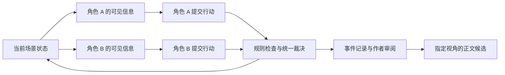

# LLM 小说编辑器基本需求与创新方向

版本：v0.16  
更新日期：2026年10月25日  
状态：产品需求草案，作为后续设计与开发的讨论基线  
配套文档：[施工文档](IMPLEMENTATION_PLAN.md)、[设计模式](DESIGN_PATTERNS.md)

本文定义基于 Tauri 的 LLM 小说编辑器应具备的基本能力、值得验证的创新方向，以及首版交付范围。建议以可靠的本地写作体验为基础，将“有限情报下的角色行为推演”作为核心创新候选：作者搭建局面，各个角色依据自己的认知、欲望与能力采取行动，系统裁决结果，作者将选定的事件发展为小说正文。

设定改动影响分析、读者视角回放、剧情分支比较与角色推演一起，构成后续的创作与修订流程。首版优先用双角色、固定场景、短回合的原型验证角色行为推演，并在搭建完整工作台前，先以低成本推演验证（M0）对照单次提示词生成，确认该方向的文学价值。

本项目区别于同类产品的基础，是“谁在什么时候知道什么”的结构化记录，以及只依据自身信息行动的角色代理。后续创新沿这条线延伸：用角色代理检验情节动机（I05），用受信息边界约束的读者代理检验悬念与伏笔（I06），将故事事件与正文讲法分开管理（I07），并从全书信息差中发掘冲突素材（I08）。

文中的功能与优先级属于本项目的设计建议。竞品能力依据此前查阅的官方文档与仓库说明整理；创新方向是待验证的产品假设。修订记录见文末附录。

## 一 产品定位

为中文长篇小说和连载作者提供一个集正文编辑、故事设定、角色行为推演和 AI 辅助于一体的桌面工作台。作者既可直接写作，也可先设置一个局面，观察不同角色如何回应，再选择值得写入小说的冲突与转折。作者掌握故事与正文的最终决定权。

为了快速成书，工作台配有写手代理与审核代理（作者决定，2026-10-09）：写手按作品大纲与章节计划，运用伏笔、详略、节奏等写作技能写出草稿章节；关键冲突场景先经角色推演，再由写手写成正文；审核代理检查设定冲突、视角越界、伏笔遗漏等问题。作者是最终的写手，可以随时直接修改任何内容，写手写入的文字带来源标记并可一键回退。

当前采用以下设计假设，后续可根据实际使用反馈调整：

- 使用 Tauri 构建桌面应用，首版优先支持 Windows。
- 主要服务个人作者，重点覆盖中文小说的构思、写作和改稿。
- 作品与创作记录默认保存于本地；作者自行配置模型服务或本地模型端点。
- 首版围绕单部作品展开，系列小说与多作者协作随后扩展。

核心价值主张：**让角色依据各自掌握的信息与驱动力作出选择，让这些选择交汇成事件，再由作者把有价值的事件写成故事。**

角色推演输出的是符合所设条件的一组可能走向。角色行为的合理性、场景的文学价值和最终采用的剧情由作者判断。

## 二 主要使用场景

| 场景 | 作者遇到的问题 | 编辑器应提供的帮助 |
| --- | --- | --- |
| 从灵感开始 | 想法零散，难以进入正文 | 整理灵感、人物与大纲，逐步形成章节和场景 |
| 持续写作 | 在正文、笔记和对话工具间频繁切换 | 在当前章节旁查阅相关设定，针对选中段落调用 AI |
| 构思人物行动 | 不确定一个角色在压力下会作何选择 | 根据目标、性格、底线和当前认知生成行动提案，观察后果 |
| 对战与博弈 | 双方掌握的信息不同，行动需要相互影响 | 独立生成双方行动，统一处理冲突、资源消耗和可见结果 |
| 误会与关系变化 | 人物欲望相近，却因隐瞒和误读陷入冲突 | 分别记录人物认知与错误信念，推演信息传递造成的转折 |
| 长篇改稿 | 前文变化后，难以找到后文依赖 | 分析改动影响，关联原文位置，逐条处理修订建议 |
| 管理连载 | 人物状态、组织关系和未回收线索逐渐增多 | 记录随剧情变化的事实与线索，提示需要核对的事项 |
| 比较剧情方案 | 想尝试另一种走向，又需要保留现稿 | 保存版本，后续支持剧情分支的试演与比较 |
| 探索可能走向 | 单次推演结果偶然性大，难以判断局面的潜力 | 对同一局面批量推演，按走向归类并展示代表性推演 |
| 发布与连载 | 需按平台格式发布，并掌握 AI 参与正文的程度 | 记录段落来源与 AI 参与比例，提供发布格式与敏感词检查 |
| 检查情节合理性 | 担心角色为推动剧情而做出不合其认知与动机的选择 | 按角色在该时点的认知与驱动力检验情节点是否可达，以角色批注说明原因 |
| 设计反转与伏笔 | 不确定反转是否过早暴露，或揭晓后是否缺少依据 | 由只读到指定章节的读者代理猜测与回看，建议线索位置并比较修改前后 |
| 构思下一章 | 人物与秘密越来越多，难以发现可利用的冲突 | 扫描全书信息差，列出可引爆的局面并生成场景配置草稿 |
| 维持战力体系 | 前文声明的境界差距被后文战斗结果打破 | 声明数值与战力规则，推演据此裁决，并检查正文中的战斗结果 |

## 三 术语与优先级约定

本文及配套文档统一使用以下术语：

| 术语 | 含义 |
| --- | --- |
| 世界事实 | 故事中实际成立的状态与事件，作为裁决与一致性检查的依据 |
| 角色认知 | 某个角色所知、所信或推测的内容，带有来源与相信程度，可与世界事实不同 |
| 人物说法 | 角色说出的内容；进入听者认知时仍是说法，经正文支持与作者确认后才可作为世界事实 |
| 代理 | 由模型扮演、只接收其信息权限内内容的逻辑参与者，包括角色代理、裁决模型、导演代理、读者代理、写手代理与审核代理 |
| 写手代理 | 替作者写正文的代理：按大纲、章节计划与选定的推演事件，运用写作技能写出草稿章节，直接写入作品并带来源标记 |
| 写作技能 | 写手可调用、可组合的一项写作方法，如伏笔埋设与回收、详略取舍、章末钩子、润色与去 AI 味；也有用于规划的方法，如雪花写作法，在生成作品骨架与章节计划时使用；作者可启用、停用与自定义 |
| 章节计划 | 由作品大纲拆出的每章安排：目标、出场人物、要埋与要收的伏笔、详略与字数 |
| 伏笔账本 | 计划中的伏笔及其埋设、回收位置与状态，写手写作时读取，审核时检查 |
| 审核代理 | 检查章节问题的代理；每条审核问题定位到段落并写明依据与修改建议 |
| 推演场景 | 作者配置的一次推演的初始条件：区域图、角色、认知、规则与结束条件 |
| 场景配置草稿 | 由自然语言描述生成、尚待作者修改确认的推演场景 |
| 推演运行 | 推演场景的一次执行，由若干回合组成，记录全部提案、裁决、观察与介入 |
| 推演草案 | 推演运行产生、尚未被作者采纳进作品的事件、认知更新与候选稿 |
| 回合协议 | 回合内行动的组织方式，首版为“同时行动”与“轮流对话” |
| 待核实裁决 | 需要语义判断、由裁决模型提出、尚待作者确认的裁决结果 |
| 批量推演 | 以自动模式对同一推演场景运行多次，并按走向归类 |
| 故事事件 | 故事层中的事件记录，含故事时间、参与者、结果与各角色的感知情况 |
| 节拍表 | 由选定事件组成的叙述计划，标明每个事件的处理方式，是讲法层的中间产物 |
| 候选稿 | AI 生成、待作者比较与处理的正文，又称正文候选；接受前不改变作品 |
| 待复核 | 所依据的正文、设定或事实已变化，结论可能失效的状态 |
| 锁定设定 | 作者标记为不可被推演或生成结果改变的设定条目 |

| 优先级 | 含义 |
| --- | --- |
| P0 | 首版必须完成，覆盖可用的写作流程与核心创新验证 |
| P1 | 在首版基础上完善长篇创作体验 |
| P2 | 待核心流程获得用户反馈后扩展 |

需求编号（B、I、C）按提出顺序分配，表格按主题归组，编号本身不代表优先级或实施顺序。

## 四 基本功能需求

### 作品与章节管理

| 编号 | 优先级 | 需求 |
| --- | --- | --- |
| B01 | P0 | 创建、打开、重命名与归档作品；管理作品简介、题材、作品大纲和写作目标 |
| B02 | P0 | 创建、重命名、排序章节；支持章节移入回收站及恢复；保存章节梗概和写作备注 |
| B03 | P1 | 支持卷、章、场景的层级组织，以及场景视角、地点和故事时间 |

作品列表、章节目录和正文应形成连续的操作流程。切换章节与关闭窗口前处理待保存内容；保存失败时保留编辑内容并提示作者。切换后保持编辑位置，并清楚显示当前正在编辑的作品和章节。

### 正文编辑与数据保存

| 编号 | 优先级 | 需求 |
| --- | --- | --- |
| B04 | P0 | 支持中文输入、选区编辑、撤销与重做、章节字数统计和全文查找 |
| B05 | P0 | 自动保存，显示保存中、已保存和保存失败状态；提供手动保存入口 |
| B06 | P0 | 创建章节版本快照，支持预览和恢复；备份完整作品并从备份恢复 |
| B07 | P0 | 导入 TXT 与 Markdown，导出正文及完整项目数据；明确编码和章节拆分方式 |
| B08 | P1 | 支持替换、专注模式、主题与排版调整，以及 DOCX 导入导出 |
| B33 | P0 | 逐段记录正文来源：手写、AI 生成、AI 生成后经作者修改；显示章节与作品的 AI 参与比例 |
| B34 | P1 | 提供连载辅助：日更目标与码字日历、发布格式（首行缩进、段间空行）、复制到平台后台、可配置敏感词检测 |
| B55 | P0 | 故事事件与正文段落分别存储并建立关联；由推演采纳的正文自动关联其对应事件，手写正文可暂不关联（参见 I07） |

自动保存失败时，应保留当前编辑内容并提供重试或导出入口。章节恢复前保存现稿快照，让作者可以再次回退。项目备份应覆盖正文、段落来源、设定、已确认事实、来源关系、推演场景、角色认知、事件记录、节拍表、推演评价和版本信息。

段落来源需从首版开始记录，事后无法补录。作者接受候选稿时，段落标记为 AI 生成，并保存生成时的原文；之后作者对该段的修改量（按字符编辑距离相对生成原文计算）超过设定比例，则标记为 AI 生成后修改。段落合并时按字符区间分别保留来源，合并了不同来源的段落标记为混合，统计按字符数加权；段落拆分时各部分按自己包含的字符区间判定来源（全是作者文字为手写，全是 AI 文字保留 AI 标记，两者都有为混合）。来源统计可帮助作者应对连载平台对 AI 内容的披露与审核要求，也便于作者了解自己的写作方式。具体平台规则需在发布前核实。

### 故事设定与事实记录

| 编号 | 优先级 | 需求 |
| --- | --- | --- |
| B09 | P0 | 管理人物、地点、组织、物品与世界规则；支持别名和正文中的关联跳转；可将设定条目标记为锁定设定 |
| B10 | P1 | 对选定章节提取候选事实，显示原文来源；由作者确认后用于后续分析 |
| B11 | P0 | 区分世界事实、人物认知和人物说法；记录事实适用的章节或故事阶段 |
| B12 | P0 | 正文或设定修改后，将依赖旧版本的事实、分析和推演标为待复核；支持作者更新初始条件并重新验证。首版覆盖设定条目、已确认事实与推演初始条件之间的依赖；基于正文段落锚点的完整依赖追踪随 B10 在 P1 完善 |
| B13 | P1 | 提供人物动态状态、关系变化、事件时间线和伏笔建立与回收记录（伏笔部分提前为 B63，P0） |
| B14 | P1 | 提供可自定义的题材字段，例如修仙境界、技能、资源与阵营 |
| B54 | P1 | 声明数值与战力体系：等级、属性、克制关系、资源消耗与越级规则；推演按该体系裁决战斗，并检查正文中的战斗结果是否与之冲突 |

例如，“甲在第三章声称钥匙已经销毁”应记录为人物说法；只有获得正文支持并经作者确认后，才能作为世界事实使用。作者可说明某处属于谎言、误解、梦境或不可靠叙述，分析时应考虑这些标注。

数值与战力体系（B54）面向修仙、系统流、末世等题材中常见的“战力崩坏”。体系由 B14 的题材字段与规则原语组合声明，例如“跨一个大境界正面取胜几乎不可能，除非动用一次性底牌”。正文检查发现冲突时，给出所依据的体系条目与正文段落，例如“第 32 章筑基中期正面击败金丹初期，与第 3 章声明的越级规则冲突”，作者可修改正文、补充底牌或奇遇说明，或调整体系声明。战斗结果的提取属于候选事实，经作者确认后参与检查。

### LLM 辅助创作

| 编号 | 优先级 | 需求 |
| --- | --- | --- |
| B15 | P0 | 用户自行添加模型服务并填写 API Key：支持 Anthropic、OpenAI、Google Gemini、OpenAI 兼容接口（国内模型服务与聚合服务）与本地端点（如 Ollama，可免密钥）；可同时配置多个服务；凭据使用系统安全存储；提供连接测试 |
| B16 | P0 | 针对选区执行续写、改写、扩写、缩写和润色；支持流式结果、取消与重试 |
| B17 | P0 | 将 AI 结果展示为候选稿，作者可比较、编辑、接受或放弃；接受时生成版本快照 |
| B18 | P0 | 展示本次使用的章节、设定和事实；允许作者增减上下文并查看超出预算的内容 |
| B19 | P0 | 展示 Token 用量；有模型价格配置时给出费用估算，实际费用未知时明确标记 |
| B20 | P1 | 支持带有作品上下文的脑暴对话、场景写作指令和可复用提示词 |
| B21 | P2 | 支持可定制的多步骤创作与审阅流程（按任务分配模型见 B58）；固定步骤的写作工作流见 B78，作者自己编排步骤仍属本项 |
| B35 | P0 | 校验模型的结构化输出，失败时自动修复或有限次重试，仍失败则暂停并说明原因；标明本地模型可用的功能范围 |
| B36 | P0 | 每次模型调用记录服务、模型名称、温度、随机种子（如支持）与提示词模板版本，用于回放解释与结果比较 |
| B37 | P1 | 维护可编辑的规避表达词表，生成时要求模型避免使用，生成后标出仍命中的表达；从作者指定章节提取文风样本，用于生成与改写 |
| B38 | P1 | 识别模型拒答或内容回避，提示作者调整条件或切换为该任务配置的备用模型 |
| B56 | P0 | 从各服务自动获取可用模型列表；维护模型能力与价格表（结构化输出、提示词缓存、思考深度控制、上下文长度、单价），用户可编辑；未知模型按保守能力处理，但保守的上下文长度与最大输出不当作真实上限：模型列表里服务自带的字段直接采用，能力自检时探测最大输出，调用被服务以超限拒绝时从报错里学到上限、记下并自动重发一次 |
| B57 | P0 | 模型能力自检：添加模型后运行结构化输出测试，未通过的模型不能用于角色行动、语义裁决等必须输出结构化数据的任务；自检前先探测模型的最大输出 |
| B58 | P1 | 按任务分配模型（角色行动、语义裁决、认知更新、正文生成等），提供“质量优先”“均衡”“省钱”三套预设，可为每个任务指定备用模型 |

正文编辑、搜索、备份和导出应能在断网或模型不可用时正常工作。模型请求失败、取消或应用退出后，现有正文保持可恢复；重试生成独立候选稿。取消任务后停止发起后续调用，保留已产生的结果与已知用量，显示已完成和未完成的分析范围。作者接受候选稿后，再按需提取新增事实。

模型服务统一采用用户自填 API Key 的方式接入，首版不提供任何订阅账户登录（如 Claude、ChatGPT、Gemini 账户）。原因是：Anthropic 不允许第三方产品提供 claude.ai 登录（事先获批的除外）；Google 没有面向第三方的订阅登录途径；复用官方命令行工具的登录令牌违反各服务条款，可能导致用户被封号，也可能随服务端识别规则升级而突然失效。OpenAI 的官方 Sign in with ChatGPT 目前对开源项目与本机运行的个人项目开放，闭源商业应用需申请；是否接入取决于项目是否开源，列为后续选择。

未通过能力自检或缺少结构化输出能力的模型（常见于部分本地模型）仍可用于选区改写、续写、摘要等纯文本任务。按任务分配模型时，界面提示不同模型之间不共享提示词缓存，混用会提高费用。

中文模型输出常带有固定口癖，例如“嘴角勾起一抹弧度”“不禁”“仿佛”、段末总结句和堆砌的排比。规避词表默认提供一组常见表达，作者可增删；文风样本仅使用作者指定的章节。

### 写手与审核

| 编号 | 优先级 | 需求 |
| --- | --- | --- |
| B59 | P0 | 写手代理：按作品大纲、章节计划、设定与已确认事实，写出整章或指定场景的草稿，直接写入草稿章节；可一次排定多章在后台连续写作，可暂停、取消，单章失败不影响已写好的章节 |
| B60 | P0 | 写手写入的段落标记为 AI 生成，写入前自动保存章节快照；作者可以直接修改任何段落，或一键回退到写入前；修改后按 B33 的规则更新来源标记 |
| B61 | P0 | 写作技能库：伏笔埋设与回收、详略取舍（展开、略写、省略、倒叙、留白）、节奏与张力、场景与感官描写、对话与人物声音、视角控制、章末钩子、润色与去 AI 味（AI 腔的句式、节奏与中文冗余，联动 B37 规避词表）、不用副词（动作用准确的动词，情绪写看得见的言行，不用程度副词撑形容词）、写作基本功（去过滤词，句内、句间与段间的关系，长短句与句式，动词的方向、快慢、力度与焦点，每段能一句话概括）；技能可单独调用、可组合，作者可启用、停用、调整说明并保存自定义技能 |
| B62 | P0 | 推演写成正文：关键冲突场景先运行角色推演（I04），写手按作者选定的事件与节拍表把结果写入草稿章节；单视角写作只使用视角角色当时的认知 |
| B63 | P0 | 伏笔账本：记录计划中的伏笔、埋设章节与位置、计划回收章节、揭晓前不得说破的内容与状态（计划、已埋、已回收、废弃）；写手写作时读取，审核时检查 |
| B64 | P0 | 审核代理：检查章节（写手所写与作者手写均可）中的设定与已确认事实冲突（含锁定设定）、时间线矛盾、视角越界与信息提前泄露、伏笔遗漏或过早说破、人物言行与此前不符、偏离章节计划、重复与节奏拖沓、AI 腔与规避词命中；每条问题定位到段落标识加锚点，写明依据与修改建议；作者可忽略、自行修改或交给写手修订。待处理的问题可以一键交给写手修订：范围是一章（审核旁）或几章、全书（成书进度），可按严重程度筛选；逐条交给写手，同一段上的问题一次修订，前一条改了段落后后面的问题在现在的正文里重新定位，定位不到或依据已经过期的跳过并写明原因，针对整章的问题（例如计划中的人物没有出场）跳过；每章改之前存一份快照，段落照常标为 AI 生成；在后台进行，登记为任务、显示进度、可以停下，写手在写的章节不修订，修订中的那一章只读；一条失败不挡住其余（连续几条同样的原因失败时停下，免得白白付费），结束时一句话说明修订、跳过、失败的条数与原因；不止一章时先显示条数与预计费用，作者确认后才开始；AI 助手也能发起（不止一章时同样先请作者确认），撤销即恢复各章的快照 |
| B65 | P0 | 章节计划与成书流程：从作品大纲拆出章节计划（每章目标、出场人物、要埋与要收的伏笔、详略与字数），作者可修改；流程为“章节计划 → 写手成章 → 审核 → 作者修改或写手修订 → 下一章”，作者可在任何一步介入或跳过 |
| B66 | P0 | 长篇记忆：为已写章节生成摘要、人物状态与伏笔进展，供写手与审核作为前文；摘要记录依据的段落版本，正文修改后标为待复核并可重建 |
| B67 | P0 | 快速成书（以写作工作流“一键成书”提供，见 B78）：一页走完“连接模型 → 由一句话的想法生成作品名、类型、简介、大纲与主要人物（作者修改后采用，人物加入设定）→ 由大纲拆出章节计划 → 写手依次写完并审核 → 导出”，每一步显示是否完成、可以回头修改；新建的作品从这一页开始，推演、事实、查找等进阶功能收在“更多”里 |
| B68 | P0 | 分卷：一部作品分若干卷，一卷有若干章；卷有卷名与本卷简介，可以新建、改名、调整顺序（卷里的章节跟着移动）与删除（卷里还有章节时不删）；章节可以在卷内调整顺序或移到别的卷，没有归卷的章节为“未分卷”；目录按卷分组；整本导出带卷名，导入时识别分卷标题；写手写某一章时参考本卷简介；由大纲生成章节计划时，章数较多的自动分卷并写出各卷梗概 |
| B69 | P0 | AI 助手：界面右侧的对话框，用作者配置的默认模型驱动；作者用平常的话说要做的事，助手理解意图并操作软件——开新书、打开作品、改作品信息，增删改查卷、章节与设定（人物卡片、地点、组织、物品、世界规则），记录候选事实，做章节计划，让写手写章、续写，打开章节与页面，回答关于作品的问题；每个动作的结果列在对话里；删除与覆盖类的动作须作者在对话里确认；助手工作期间正文只读；对话按作品保存；“新对话”另开一段，之前的对话可以在历史里切回去接着说，也可以删掉 |
| B70 | P0 | 产品化的界面：三栏布局（左侧导航与目录、中间编辑区、右侧 AI 助手），作品列表以卡片呈现并可从助手开新书，统一的视觉规范（颜色、字体、按钮层级、亮色与暗色），正文以纸面排版 |
| B71 | P0 | AI 助手的进一步能力：回复在模型输出时逐字出现，写手写章、生成计划、审核等耗时动作在对话里显示进展；作者在正文里选中文字时，对话框上方显示选中的内容与快捷说法，助手可以改写、扩写、缩写或润色选中的文字（结果为候选稿，作者对照差异后接受），作者也可以这次不带上选区；助手还能审核一章并概括问题、把一章回退到写手写入前（须作者确认）、在伏笔账本里记伏笔、保存快照、从回收站恢复章节、导出正文；还能查看各章的长篇记忆、伏笔账本（并修改伏笔与它的状态）、待处理的审核问题（标为已改好或忽略，交给写手修订那一段，或把一章、几章与全书的问题一键交给写手，见 B64）与写作技能（启用或停用），按作者的要求停下后台的写作、审核与一键修订；操作角色推演——由一段局面描述建推演场景、开始一次推演在后台推进、查看全局概要并向作者汇报、按一个角色的视角写成候选稿（只用这个角色当时的认知），待核实的裁决、导演提议与采纳仍由作者在界面上做；撤销助手一轮对作品的改动（对话框里的按钮，或对助手说“撤销”；新建的删掉、改过的改回、删掉的重建、写手写的章回退、修订恢复，之后又被改过的不动并写明；新建的章节移入回收站），再撤销一次是更早的一轮；一句话走满步数时说明停在哪里、怎样接着做；外观可选跟随系统、浅色或深色 |
| B77 | P1 | AI 助手的输入框下方：选择模型（即默认模型，所有 AI 功能都用它；列出各服务的模型，标出未通过能力自检的，可以进入模型服务）、选择助手的思考深度（低、中、高；模型不能调节时不可选；写手、审核等任务各用自己的深度）、显示上下文用量（最近一步发给模型的 Token 占模型上下文上限的比例，新对话或换作品后清零） |
| B76 | P1 | 作品封面：作者为作品上传一张图片作封面（JPG、PNG 或 WebP），可以更换或去掉；没有封面时按书名排出文字封面；作品列表的卡片与作品信息页显示封面，点卡片（包括封面）打开作品，卡片上的“更换封面”进入作品信息；封面随备份与作品包一起保存与导回 |
| B75 | P0 | 规划技能与雪花写作法：写作技能分阶段——“规划”的技能在生成作品骨架（大纲与人物）与章节计划时使用，“写章节”的技能交给写手，一项技能可以两者都用；内置一项提炼自雪花写作法的规划技能（一句话的故事、开端加三次越来越重的挫折与结局、主要人物的动机、目标、冲突与领悟、按“场景—后续”拆章并写明视角人物），默认启用；自定义与导入的技能可以选阶段（SKILL.md 的 metadata.stages）；“作者偏好”在规划时也遵守 |
| B74 | P0 | 文字体检与连贯：审核的程序检查增加确定性的文字体检——AI 常见句式（“不是……而是……”、否定排比、全知解释、章尾总结或预告、比喻过密）、生成退化（同一长句反复、相邻段落相同、最后一段没写完）与写作材料泄漏（大纲用语、模型自称、占位、英文开场白），对白不查；写手写入正文前规范标点；长篇记忆记下“章尾留给后面的事”，写手写下一章时带上；AI 助手记下作者明确说出的文风偏好与禁忌（存为“作者偏好”写作技能，写手每章遵守），并能把作者讨厌的说法加进规避词表 |
| B73 | P0 | 人物关系网：设定之间（多为人物与人物、人物与组织）的关系，含类别（亲属、情感、师承、友盟、竞争、敌对、从属、其他）、称谓（读作“甲是乙的师父”，双方相同时“甲与乙：朋友”）、说明、是否隐秘（读者还不知道）与适用的章节范围（关系会变）；关系图可以拖动人物、缩放与平移（按钮、按住 Ctrl 滚动滚轮或触控板捏合，拖动空白处平移，可以一键缩放到刚好装下显示的人物）、按章节查看、点人物看他的关系；写手写章与“AI 写作”带上出场人物的关系，隐秘的只暗示不点明；AI 助手可以建立、修改、删除关系（删除须确认）；快速成书生成骨架时一并给出主要人物的关系；设定删除时它的关系一并删除。关系与人物随剧情变化：写手写完一章、整理完长篇记忆后，从这一章的长篇记忆找出关系的新增、改变（旧的到上一章为止、新的从这一章起）与结束（到这一章为止），以及人物的出场（含写手写出来的新人物）、退场（死去、离开）与回归，存为待确认的建议（记下来源章节、依据的长篇记忆版本与调用记录），作者在关系页逐条采用、忽略或全部采用，导航上显示待确认的条数；“写完一章后自动找出关系变化”可以关掉；这一步没做成不挡住后面的写作，结束时说明；已写了很多章的作品可以“从已写的章节找出变化”，按书中顺序分批，只找还没按当前这一版长篇记忆找过的章节；人物的出场取第一次出现的章节（章节计划的出场人物、长篇记忆的人物状态），退场与回归记在设定里，作者可以改；按章节查看时只显示那一章已出场、没有退场的人物；规划下一卷与拆章时人物说明带上“第 N 章退场：…” |
| B72 | P0 | 界面的打磨：左栏与 AI 助手可以拖动分隔条调整宽度（双击恢复默认，也可以用键盘），宽度记住；左栏可以收起，专心写作；菜单与提示气泡可以用键盘操作；滚动条细而安静；窗口标题栏随外观变为浅色或深色；空白章节有起笔的提示；章节工具栏常用的几项带文字、其余只留图标 |

### 写作工作流

| 编号 | 优先级 | 需求 |
| --- | --- | --- |
| B78 | P0 | 写作工作流：作者选一个工作流，软件按固定的步骤依次做；每一步是调用现有功能或模型的一件事，结果（草稿、报告、问题列表）保存在作品里，可以查看与修改，修改后再“采用”；可选“每步停下给我看”或“一路做完”（会覆盖或删除作品内容的步骤仍停下确认）；可以停下、关掉应用后接着做、重做或跳过某一步，采用过的一步可以撤回；开始前显示预计的调用次数与费用，可以设预算上限；同一时间只推进一个工作流；AI 助手可以列出、发起、查看、继续与停下工作流。一键成书的章数（最多 2,000）、每章字数、总字数与分卷方式（自动、不分卷、指定卷数）由作者定；章数超过一次能拆的量时先定全书卷纲（作者可改各卷章数），再逐卷拆章节计划 |
| B79 | P1 | 扫榜拆书：作者粘贴或导入榜单（书名、标签、字数、简介等）与几本对标作品的样章（TXT）；榜单也可以用联网搜索（B84）填入，样章不自动抓取（别人作品的正文由作者自己提供）；逐本拆出题材、核心卖点、开篇钩子、前几章的节奏与爽点、人物的功能位、冲突模式与章末钩子，再横向对比写成对标分析（共性的套路、没被占住的空位、可以借鉴的写法与开书方向）；拆书结果只写结构与技法，每处引文不超过 30 字，程序检查结果中与样章相同的长段文字；样章原文只用于拆解，不进入作品包与导出，不交给写手、规划与 AI 助手，用完即删；对标分析可以带进一键成书的想法，或存为一项规划技能 |
| B80 | P0 | 全书体检：补齐或重建过期的长篇记忆 → 依次审核所选章节 → 核对伏笔账本（到期未回收、从没埋下、状态没跟上） → 跨章连贯检查（人物的状态与言行、时间线、设定：先由各章记忆找出可疑的两章，再读这两章的正文定位到段落，写入审核问题） → 体检报告（按严重程度与章节汇总，点一条进入那一章的审核） |
| B81 | P1 | 开篇打磨：对前几章（默认三章）按开篇的要求诊断——主角出场与处境、核心冲突与卖点亮出的位置、设定是否堆在一起交代、信息量与节奏、章末钩子——问题定位到段落，写入审核问题；作者逐条忽略、自行修改或交给写手修订；改完再诊断一次，对比前后 |
| B82 | P0 | 续写一卷：读已写章节的长篇记忆、伏笔账本与人物关系，生成下一卷的卷纲（卷名、本卷梗概、主线推进、新人物、要回收与新埋的伏笔、卷末转折）；作者修改后采用为新的一卷；只为这一卷拆章节计划，不动前面的章节；写完并审核；最后对这一卷做体检 |
| B83 | P1 | 人物小传与关系网补全：从长篇记忆中找出没有人物卡片的人物与说明为空的人物，生成人物小传草稿（身份、外貌、性格、动机与目标、说话方式、首次出场章节）与人物之间的关系（带章节范围，写明依据的章节）；作者逐项勾选、修改后采用；锁定的设定不动，已有的说明不覆盖、只在后面补充 |
| B84 | P1 | 联网搜索：作者在“模型服务”里自填 API Key 接入搜索服务（DeepSeek 搜索、Tavily、Brave Search；DeepSeek 搜索可沿用已配好的 DeepSeek 模型服务的 Key），AI 助手可以搜索公开网页并读取网页正文回答问题、找榜单与资料，扫榜拆书的榜单可以由搜索结果填入；搜索请求经凭据代理（凭据只发往该服务的源），读网页不带任何凭据、只读公网主机（本机与局域网地址一律拒绝）、只取文字，直接读不到时可经 DeepSeek 的抓取接口在服务端再试；网页内容是材料，不是对模型的指令，别人作品的正文不自动抓取、不进作品。Anthropic 与 OpenAI 官方接口的模型可以用模型自带的联网搜索作为另一种搜索服务（选一个登记了这项能力的模型，不用另外的 API Key，每次搜索记进用量与费用），不支持的模型照旧用上面的搜索服务 |

工作流是作者侧的流程，每一步只调用现有的用例，所以锁定设定、写入前快照、版本守卫与段落来源照常生效；草稿与报告是派生结论，记录依据的段落或长篇记忆的版本，依据变了标为可能过时。写手写入的正文仍按 B60 处理；事实、分析与人物小传等未经作者采用不写入作品（“一路做完”即作者预先同意采用草稿）。改写文风依赖 B37 的文风样本，日更连载依赖 B34，暂不做成工作流。

写手是作者的助手而不是作者的替身：写手写入的每一段都带来源标记，写入前有快照；作者手写与写手所写可以在同一章交替进行。写手读取作者侧的全部材料（大纲、设定、伏笔账本），因此视角越界与提前说破由审核代理检查；从角色推演写成的单视角正文仍只使用视角角色当时的认知。审核问题是派生结论，记录所依据的段落版本，正文修改后旧问题标为过期。

### 角色行为推演

| 编号 | 优先级 | 需求 |
| --- | --- | --- |
| B22 | P0 | 创建独立于作品正文的推演场景，配置地点、初始局面、参与角色、可交互对象、世界规则与结束条件 |
| B23 | P0 | 为每个角色配置独立的目标、性格倾向、底线、能力、资源和初始认知；允许记录秘密与错误信念；配置风险偏好、情绪阈值、失控条件与说话风格 |
| B24 | P0 | 分别生成角色上下文，仅纳入该角色可获取的信息；区分观察、传闻、推测及未知内容 |
| B25 | P0 | 每个角色提交结构化行动提案，包含行动对象、方式、当前目标、依据和简短决策摘要 |
| B26 | P0 | 统一检查行动前提并裁决结果，更新位置、物品归属、伤势和资源等场景状态 |
| B27 | P0 | 将裁决后的事件按感知范围分发给各角色，分别更新认知与记忆 |
| B28 | P0 | 支持逐回合运行、暂停、停止和预算限制；记录角色提案、裁决、观察与状态变化 |
| B29 | P0 | 作者选择事件并生成指定叙述视角的正文候选稿，经确认后写入章节与相关设定 |
| B30 | P0 | 回放已记录的推演过程；记录作者介入，并保留介入前的场景快照 |
| B31 | P1 | 从指定回合建立新分支，修改角色认知、行动或外部事件，比较后续走向 |
| B32 | P1 | 扩展谈判、追逐、审讯、合作与情感冲突等场景模板；逐步支持更多角色 |
| B39 | P0 | 作者用一段自然语言描述局面，系统生成包含区域图、角色、认知与规则的场景配置草稿，作者修改确认后再运行 |
| B40 | P0 | 支持“同时行动”与“轮流对话”两种回合协议；轮流对话允许打断、沉默与离场 |
| B41 | P0 | 以区域图描述场景空间：区域、相邻关系、区域间视线与声音传播；提供持有、消耗、位置、视线、伤势等级等内置规则原语，作者只需填写参数 |
| B42 | P0 | 将台词作为行动处理：内容按感知范围到达听者，记录为“人物说法”而非事实；说谎时分别保存世界事实与听者认知 |
| B43 | P0 | 每轮记录角色的内心片段，包括感受、犹豫与自我说服，作为正文素材；与提交给裁决的行动依据分开保存 |
| B44 | P0 | 角色请求中不出现场景标题、题材标签和作者设定的探索问题；角色对场景中标记为秘密的条目作出推测，而其认知中缺少相关观察或传闻时，提示作者核查 |
| B45 | P0 | 在事件记录与正文之间生成节拍表；作者为各事件标记展开、略写、省略、倒叙或留白，并指定暂不向读者揭示的信息 |
| B46 | P0 | 推演结束后提供简短评价：人物是否可信、有无可采用的转折、是否采纳及采纳的事件；批量推演在整组结束后评价一次 |
| B47 | P1 | 导演代理依据作者设定的张力曲线提议外部事件，作者批准后在回合边界注入 |
| B48 | P1 | 以自动模式对同一推演场景并行运行多次，按结局与关键转折归类，展示各类走向的次数与代表性推演 |
| B49 | P1 | 作者扮演其中一个角色，只查看该角色可见的信息并提交其行动，其余角色由代理扮演 |
| B50 | P1 | 检测角色言行与人设的偏离，标出依据并交由作者判断 |
| B51 | P1 | 以区域示意图显示各回合的角色位置，以时间线显示信息到达各角色的时间与途径 |
| B52 | P1 | 设置条件断点与监视项：满足作者设定的条件时暂停，例如“甲得知绊索位置”“双方信任降至设定值以下”；持续显示指定信息在各角色认知中的状态 |
| B53 | P1 | 对任一事件追问原因，沿事件记录列出因果链：行动依据、相关认知、认知来源及引发该认知的事件；因果链只引用已记录内容 |

首版场景可由作者手动配置，或经 B39 由自然语言描述生成后修改，并可绑定某个章节。已确认的作品设定可作为初始条件，自动从正文抽取完整场景在后续阶段完善。每个角色是独立的逻辑代理，可共用同一模型，其请求、上下文和记忆分别管理。

B47 与 B48 虽为 P1，但其简化形式应在 M0 推演验证中作为实验条件，用于判断戏剧性与可选走向是否明显提升。

B52 与 B53 构成推演的叙事调试器。按回合暂停适合逐步观察，条件断点则让作者直接停在关心的转折处。因果追问的例子：“乙放弃射击 ← 乙推测主角有同伙 ← 第 3 轮听到货架后的碎瓦声 ← 该声响由主角制造”。因果链由已保存的行动依据、认知来源与事件记录拼接而成，不请求模型事后补写解释，因此可以直接对照记录核实。

## 五 创新方向

创新方向按 I 编号的提出顺序记录。I04 是首版核心，因此置于本章最前。

### I04 有限情报下的角色行为推演

优先级：P0，首版核心原型。完整场景模板与多角色扩展为 P1。

作者设置场景中的人、物、规则与信息分布。每个角色根据自身目标与认知决定当下的行动，多个角色的行动经统一裁决形成新的局面，再分别获得反馈并继续决策。冲突可以来自利益差异，也可以来自误判、恐惧、自尊、隐瞒或错误信念。

文学价值假设：信息差与角色驱动力能够产生作者未预先安排的合理转折，并帮助作者发现“这个人物为什么会这样做”。需通过真实场景创作比较，判断结果是否贴合人物、是否有可采用的剧情，以及作者需要修正多少内容。

#### 信息与状态

| 层次 | 保存内容 | 作用 |
| --- | --- | --- |
| 世界事实 | 场景内实际的位置、物品、伤势、资源、机关与已发生事件 | 作为行动裁决的依据 |
| 角色认知 | 自己见过、听过或推测的信息，以及信息来源与相信程度 | 决定该角色如何理解局面，可与世界事实不同 |
| 对他人的认知 | 角色对他人目标、实力与所知信息的判断，以及“对方认为我知道什么”的推测 | 支撑试探、虚张声势、欺骗与反侦察 |
| 角色驱动力 | 当前目标、长期欲望、底线、关系、恐惧、行为习惯，以及风险偏好、情绪阈值与失控条件 | 决定角色愿意冒什么风险、优先保护什么、何时失去理性 |
| 行动提案 | 本轮计划采取的行动、对象、依据和预期目的；台词也作为行动提交 | 等待规则检查与统一裁决 |
| 人物说法 | 角色说出的内容、说话者、听者与听者的相信程度 | 以说法而非事实进入听者认知，可承载谎言与误导 |
| 内心片段 | 本轮的感受、犹豫、自我说服与未说出口的念头 | 作为正文素材，不参与裁决 |
| 可感知事件 | 角色能看见、听见或通过行动得知的结果 | 更新该角色下一轮的认知 |
| 正文候选 | 作者选定的事件与指定视角下的文学表达 | 经作者确认后进入作品 |

角色认知可记录“已观察”“听闻”“推测”“未知”，并允许角色相信一条错误信息。例如，对手确实只剩一支弩箭，但主角根据此前的射击频率推测其还有多支；这个误判应能影响主角的行动。

对他人的认知首版限于两层：甲对乙的判断，以及甲推测乙对甲的判断。例如，主角故意暴露伤口，是因为推测对手以为自己伤势很轻；该推测本身可以是错的。更深层的嵌套由模型在决策时自行推理，不作为结构化状态保存。

角色可使用符合世界设定的常识进行推测。推测需要保持其认知状态，即使猜中了秘密，也应与获得证据后的确认区分。短暂的冲动、犹豫和自欺可成为角色特征，行动依据应与所设人物性格相容。

模型可能凭题材套路而非角色所见“猜中”秘密，例如默认出口设有陷阱。角色请求因此不包含场景标题、题材标签和作者的探索问题。当角色的推测与隐藏的世界事实一致，而其认知中缺少可追溯的观察或传闻时，事件记录标记“缺少证据链的命中”，由作者决定保留、改为巧合或重新推演该回合。检查范围限于作者在场景中标记为秘密的条目：角色每轮的推测以结构化条目提交，先由程序按涉及的对象筛出与秘密相关的推测，再由模型判断是否命中；结果只作为提示，不作为结论。

#### 回合中的行动与反馈

首版采用离散回合，每轮代表一个明确的行动机会。对战中的时间粒度由场景规则约定，复杂动作所需时间与前提在行动检查中处理。

不同场景适合不同的回合协议。对战与追逐采用“同时行动”，以下步骤以此为准。谈判、审讯与情感冲突采用“轮流对话”：发言权依次传递，听者可选择回应、打断、沉默或离场。打断以句为单位：说话者的发言按句切分，听得清的听者在一次决策中选择完整听完，或在第几句后打断；听不清、听不到的人不拿到台词，也不参与打断。被打断的发言只传播打断点之前的句子；由于这次决策看到了没说出口的句子，一旦发生打断，各听者这次给出的回应（连同推测与内心片段）一律作废，轮到他们发言时按实际听到的再决定。没有打断时不需要额外的模型调用。场景创建时选择回合协议，同一场景内首版不切换。

1. 固定回合开始时的场景状态，分别生成各角色的可见信息。
2. 各角色独立提交行动意图；本轮另一角色的尚未执行意图仅用于后续裁决。
3. 收齐行动后检查能力、持有物、位置、资源与前置条件，按预先声明的规则处理冲突；待核实的语义裁决暂停并交由作者确认。
4. 更新世界状态，生成事件记录，并分别形成角色可感知的反馈。
5. 更新角色的认知、情绪和下一轮目标，检查结束条件，再进入下一回合。

角色提交的是尝试行动，例如“向门口冲刺并攻击阻拦者”。动作成功与否、谁受伤、物品归属和资源消耗由场景规则决定。非法动作保留提案与拒绝原因，有限次数内请求修正；达到次数上限时暂停并交由作者处理。

同轮行动使用同一回合开始状态。交换模型响应的到达顺序，应得到相同的裁决结果；先后手或速度优势只有在场景规则明确规定时才影响结果。程序裁决按角色标识的固定顺序处理行动；语义裁决请求中，各角色行动同样按固定顺序排列，不按到达顺序。含随机因素的规则应记录实际抽取结果供回放使用。

明确的世界规则优先由程序执行，例如一个物品同一时刻只有一个持有者、使用一次消耗一次资源。需要语义判断的结果可以由裁决模型提出，并附依据与待核实项。在交互模式下，这类提案交由作者接受或修正；确认后才提交该回合的状态变化、分发角色观察并开始下一轮。角色的简短决策摘要用于帮助作者理解提案依据。

推演运行分为两种模式：

| 模式 | 适用 | 待核实裁决与导演提议 |
| --- | --- | --- |
| 交互模式 | 作者逐回合观察与介入的单次推演 | 待核实裁决与导演提议均等待作者确认 |
| 自动模式 | 批量推演、I05 动机检验的决策采样、M0 实验 | 待核实裁决自动接受并标记“自动接受，待复核”；导演提议按作者预设的策略自动采用或关闭 |

自动模式的推演草案中，所有自动接受的项目在采纳进作品前必须逐项经作者复核。作者可将自动模式的某次运行转为交互模式，从任一回合继续。

#### 对战示例

场景：主角携带密信进入废仓库，需要从南门脱身；对手希望夺信，同时尽量避免受伤。货架影响视线，地面碎瓦可用于制造声响。

| 信息 | 世界事实 | 主角当前认知 | 对手当前认知 |
| --- | --- | --- | --- |
| 主角伤势 | 左肩有伤，抬臂受限 | 知道自己的伤势与限制 | 起初未得知，可在观察后形成判断 |
| 弩箭数量 | 对手只剩一支弩箭 | 看见弩，余量未知 | 知道余量，倾向于慎重使用 |
| 南门机关 | 对手提前设置了绊索 | 尚未发现 | 知道位置与触发方式 |
| 对手目标 | 夺信且保全自己 | 以为对手主要想杀死自己 | 知道自己的目标 |

一次可能的推演：主角利用碎瓦声响试探对手，再向货架后移动；对手担心最后一箭落空，选择保留弩箭并守住出口。统一裁决后，主角发现对手没有立即射击，只获得“对方可能在等待更好机会”的推测。后续观察才可能让其重新判断弩箭数量或出口危险。

作者可以在关键回合改变一项初始信息，例如让主角提前知道绊索位置，再比较行动与局面是否出现值得采用的变化。具体行动与结果属于候选推演，由当前模型、规则和作者判断共同形成。

#### 其他创作场景

| 场景 | 信息差与驱动力 | 可发现的剧情机会 |
| --- | --- | --- |
| 谈判与试探 | 买家想压价，卖家急需钱却表现从容，双方只知道部分底线 | 试探、虚张声势、错误让步和突然成交 |
| 审讯与隐瞒 | 调查者认定证人在包庇凶手，证人实际在保护另一件秘密 | 错问问题、误解加深、意外暴露线索 |
| 追逐与伏击 | 双方了解不同的地形，追逐者误判逃跑者的目的地 | 假路线、反追踪和环境造成的转折 |
| 情感冲突 | 一人想道歉却害怕被拒绝，另一人想听解释却故意冷淡 | 自尊与误读造成的升级，以及重新理解对方的机会 |
| 共同危机 | 两名互不信任的人需要合作，各掌握一部分救援条件 | 交换秘密的代价、暂时结盟和信任变化 |
| 宴席与身份试探 | 主人怀疑客人身份，客人只想平安离开 | 座次、称呼、失言与物品引起的认知变化 |

#### 空间与规则

场景空间以区域图描述：作者划分若干区域（如“南门”“货架区”“仓库中央”），设定区域间是否相邻、能否互相看见、声音能否传到。位置、移动、遮挡与感知范围由程序按区域图计算，不依赖模型理解空间。

规则由内置原语组合而成，作者只填写参数，不编写程序：

| 原语 | 作者填写的参数示例 | 程序执行的约束 |
| --- | --- | --- |
| 持有 | 密信由主角持有 | 同一时刻只有一个持有者；争夺按裁决结果转移 |
| 消耗 | 弩箭 1 支，每次射击消耗 1 | 余量为零时射击形成失败尝试或被拒绝 |
| 位置与移动 | 每回合可移动到相邻区域 | 非相邻移动需要多回合或被拒绝 |
| 视线与声音 | 货架区与南门互不可见，碎瓦声可传至全场 | 决定事件的感知受众 |
| 伤势等级 | 无伤、轻伤、重伤、失去行动力 | 伤势限制可用动作，例如左肩受伤不能拉弓 |
| 机关与条件 | 南门绊索，经过时触发 | 满足条件时自动产生事件 |

原语无法表达的规则以自然语言记录，交由裁决模型提出结果，并按待核实裁决流程由作者确认。首版原语集合以对抗场景所需为限，随场景模板扩展。

#### 戏剧性与导演层

角色各自合理地行动，并不保证事件好看。自主角色越多，情节结构越难保证，这是涌现叙事中常见的矛盾。语言模型扮演角色时还有几种已知倾向：过于理性与谨慎，带有助手式的礼貌，双方容易妥协从而消解冲突，不同角色的语气趋同。仅靠作者从结果中挑选，难以弥补这些问题。

建议从三个方面提升戏剧性，并在 M0 中分别验证效果：

1. 人物非理性参数：角色卡记录风险偏好、情绪阈值与失控条件，例如“被当面质疑出身时会失去冷静”。角色请求中明确这些倾向的优先级可高于最优策略，对抗模型的理性默认。
2. 僵局分类：区分“双方观望”“重复相同动作”“反复拉锯”“冲突被礼貌化解”和“目标已无法达成”，分别提示作者注入事件、调整目标、注入事件或结束场景、提高情绪压力、结束场景，替代笼统的“连续无进展”。反复拉锯指双方一再重申已经说过的条件，没有新的信息、让步或行动（M0-13 第一轮评价中，推演组最常被指出的问题）。
3. 导演代理：只读取全局局面与作者设定的张力曲线（如“前三轮蓄势，第五轮爆发”），在回合边界提议外部事件，例如巡夜人的脚步声逼近、火把熄灭。导演代理不改变角色的决策与认知，只改变局面；提议须经作者批准，注入后按感知规则分发，并在事件记录中标记为导演事件。

#### 批量推演与走向分布

单次推演结果偶然性大，作者难以判断一个局面的潜力。批量推演对同一局面并行运行 N 次（默认 5 次），按结局与关键转折归类，展示可能性分布，例如：

| 走向 | 次数 | 代表性转折 |
| --- | --- | --- |
| 南门突围，左肩伤势加重 | 4 | 主角触发绊索后仍强行冲出 |
| 谈判交换密信 | 3 | 对手提出以出口换取密信 |
| 反杀对手 | 2 | 主角判断对手只剩最后一箭 |
| 僵持后撤离 | 1 | 双方均不愿先暴露位置 |

作者可展开任一走向查看完整推演，或选定其中一次继续推进。批量推演可配置较便宜的模型；作者选中感兴趣的走向后，可用质量更高的模型从相同初态重新推演，结果可能与原走向不同，二者分别保存。运行前显示预计调用次数与费用，并受预算上限约束。

#### 作者控制与正文生成

作者可设置场景想探索的问题，例如“信任是否会破裂”或“主角能否发现对手的破绽”，并查看全局事实和双方的认知变化。场景希望产生的情绪与转折作为作者挑选结果的参考。

作者可以在回合边界暂停，调整角色目标或认知、替换某次行动、安排外部事件，再继续运行。介入需要记录内容、时间点和原因，保留此前快照。更改后的推演有独立版本，便于追溯哪些变化来自角色选择，哪些来自作者干预。

首版支持在当前回合提交前或裁决完成后介入，提交后的动作按该回合快照完成裁决；作者若要替换已提交动作，需明确撤销本轮提案并保存记录。选择任意历史回合重新建立分支及比较结果属于 P1。

如果行动结果与作者锁定的既有设定冲突，系统暂停并提供冲突说明，让作者修改条件或选择另一条走向。作品大纲中的未来事件可作为作者侧的选稿约束，角色请求仅使用在当前时间点已经可知的内容。

作者也可以扮演其中一个角色（P1）：只查看该角色可见的信息，在其回合提交行动或台词，其余角色由代理扮演。作者扮演的行动与代理行动经过同样的规则检查与裁决，事件记录中标记行动来源。该方式让作者从人物的有限视角体验局面，类似跑团中的玩家，与站在全局的导演式介入互为补充。

推演先输出事件时间线、角色行动、认知变化和关键转折。作者选择事件、叙述视角和文风后，系统先生成节拍表，再生成正文候选。正文中的新事件应对应已选事件记录；新增事实作为候选供作者审阅。采用主角视角时，其对对手意图的描述应遵守该时点的认知边界。

直接由事件记录生成的正文，容易读起来像流水账（“他先……然后……”）。节拍表是事件记录与正文之间的中间层：

| 节拍处理 | 含义 | 示例 |
| --- | --- | --- |
| 展开 | 细写动作、感官与心理，放慢节奏 | 主角踩上碎瓦前的犹豫 |
| 略写 | 一两句交代 | 绕到货架另一侧 |
| 省略 | 不写入正文，仅保留在事件记录中 | 对手重新检查绊索 |
| 倒叙 | 推迟到后文以回忆或揭示呈现 | 对手提前布置绊索的过程 |
| 留白 | 写出现象，不解释原因 | 对手迟迟不放箭 |

作者还可以在节拍表中指定暂不向读者揭示的信息，后续可与 I02 读者视角回放联动检查。展开的节拍优先使用角色的内心片段作为素材，并遵守所选视角的认知边界。

推演在独立场景副本中运行，事件与认知更新先保留为推演草案。作者接受时检查原作品版本，并确认要写入的正文、世界事实和角色认知。完成推演、回放或生成候选稿本身均不触发作品事实更新。

#### 首版原型范围

- 两名角色、一个固定场景、少量可交互物品，默认运行 6 至 8 回合。
- 每个角色配置一个当前目标、一条底线、若干性格倾向、一项失控条件和最多五条初始认知；可各有一项秘密或错误信念。
- 采用小型对抗场景，如争夺密信，允许观察、移动、试探、攻击、防御、使用物品、交谈和撤离等有限动作；台词按言语行动处理。
- 支持同时行动与轮流对话两种回合协议，对抗场景默认同时行动。
- 使用 4 至 6 个区域的区域图与表中的内置规则原语，先验证信息差和行动因果。
- 支持用自然语言描述生成场景配置草稿，再由作者修改。
- 作者可查看各轮事件、双方认知、简短行动依据与内心片段，暂停干预，并经节拍表选定结果生成一段正文候选。
- 通过目标完成、角色撤离、回合上限、费用预算、按类型识别的僵局或作者停止结束任务。
- 每次推演结束后收集作者评价。

回放读取已保存的行动、裁决与观察，不需要重新请求模型。重新调用模型属于重新推演，可产生不同结果。任务失败或中断时保留已提交行动及回合阶段，恢复后继续未完成步骤，避免同一裁决重复消耗资源。

### I01 设定改动影响分析

优先级：P1，角色推演与长篇改稿的配套能力。

作者提出一个具体改动，编辑器分析其与已写章节的关系，列出可能需要核对或修订的位置。重点是把“发现影响、解释依据、处理改稿”组织成完整流程。

**示例：**作者计划将第六章“主角接受盟约”改为“主角拒绝盟约”。编辑器提示第十二章援军到来可能依赖该盟约，第十八章盟友的背叛动机可能需要调整，并分别链接相关原文。

首次交付范围限定为：一项明确的设定或事件改动、一个作品、作者选定的已写章节。分析基于当前正文与已确认事实，作者可以先查看影响再决定是否提交改动。

处理流程：

1. 作者选中原文或设定，填写拟议的新内容，选择分析范围。
2. 编辑器保留当前版本，检索相关段落，并展示将发送给模型的上下文。
3. AI 列出可能受影响的位置，区分事实冲突、动机变化、时间关系和线索依赖。
4. 每项结果说明相关原文、依赖关系、可能影响和修订选择；资料不足时标记为待核实。
5. 作者逐条选择修改、保留并说明理由、稍后处理或忽略；修改建议以差异预览呈现。
6. 修订后更新相关记录，对依赖旧内容的结论标记待复核，保留可恢复的历史。

验收重点：每项影响都有可定位的原文依据；分析中途取消仍保留现稿；作者逐条确认修改；修改后的旧结论可以识别为过期。界面应说明本次覆盖了哪些章节，未发现问题的结果只代表当前分析范围内未发现候选问题。

差异化假设：相较于静态设定库和单次一致性检查，作者更需要围绕一次具体改动完成后续修订。该假设需要通过竞品试用和真实长篇改稿任务验证。

### I02 按章节回放读者视角

优先级：P1。

作者选择“读到第几章”，编辑器仅使用截至该位置的正文，整理读者已获知的信息、可能形成的猜测，以及仍等待解释的疑问。

**示例：**作者希望第十章让读者怀疑管家，第十五章才揭示真正的凶手。编辑器检查第十章之前是否已有过于明确的揭示，并显示支持这一判断的段落。

输出应区分原文已明确表达的信息与模型推测；每项结论给出原文依据。人物认知、读者认知和世界事实分别管理，便于分析信息差、悬念与多视角叙事。

差异化假设：将信息揭示与作者设定的叙事意图对照，可以帮助修改悬疑、反转和多视角小说。功能价值通过作者对实际修改建议的评价验证。

I02 整理的是读者已获知的信息；在此基础上，I06 以多位读者代理模拟不同读者的猜测与反应，并用于检验反转与伏笔。

### I03 剧情分支试演与比较

优先级：P2。

从某个场景建立备选剧情分支，保留各分支的正文、人物状态和线索变化。作者可以比较不同选择如何影响后续故事，再决定采用哪条路线。

**示例：**主角发现盟友的秘密后，分别试演“坦白、隐瞒、误导”。对比结果展示各方案可能带来的冲突、人物关系变化和需要补写的场景。

分支应与主稿明确区分。合并时展示差异与相关影响，由作者处理冲突并确认更新。剧情试演产生的后续内容标记为创作方案，并与已写正文的事实依据分开展示。

角色推演记录可作为分支的起点：从同一回合改变一项情报、目标或行动，比较后续事件。局部推演分支在 P1 验证，完整章节与全书状态的分支管理在 P2 推进。

差异化假设：同时比较剧情与故事状态，比单纯比较几段候选文字更适合较大的叙事决策。需验证分支管理是否能节省修改时间，以及是否会增加作者的维护负担。

### I05 动机可达性检验与角色批注

优先级：P1。M0 中以手动配置的方式验证可行性。

为了让剧情按计划推进，角色有时会作出与其认知和驱动力不符的选择，读者常称之为“降智”，本功能也因此俗称降智检测。界面用语避免“降智”这类评价性词汇，统一以“可达性不足”描述检验结果。编辑器以涉事角色在该时点的认知与驱动力为条件，检验大纲中的关键情节点是否可达，并将同样的检查用于已写正文。现有一致性检查侧重事实矛盾，本功能检查人物动机能否支撑情节。

**示例：**大纲写明第十五章师兄背叛主角。检验时，师兄在第十五章之前尚未得知宗门要清洗自己，多次推演中均未选择背叛。编辑器标记该情节点可达性不足，说明缺少的动机或信息，并提出调整方向：在第十二章前让师兄得知清洗计划，或为背叛设置其他动机。

处理流程：

1. 作者选定大纲情节点或正文段落，指定涉事角色与故事时点。
2. 编辑器依据该时点的已确认设定、人物认知和驱动力构建局面，展示用于检验的条件，由作者修改确认。
3. 对涉事角色进行多次推演或决策采样，统计角色自愿作出该选择的比例，保存每次的决策依据。
4. 可达性不足时，说明角色未作出该选择的主要依据，提出可补充的信息、动机或外部压力，并标明需修改的章节位置。
5. 作者选择修改前文、调整情节点、保留并说明理由（例如角色此刻失去理性），或忽略。

角色批注是该能力在正文中的呈现：在作者选定的段落旁，以角色口吻说明其为何不会如此行动，例如“我不会把钥匙交给他，我在第八章看见他与对手密谈”。批注引用所依据的事件或认知来源，作者可逐条采纳、驳回或转为待办。

验收重点：每项可达性不足的提示都能追溯到角色认知与驱动力的具体条目；作者可查看检验所用的条件；推演次数与费用在执行前显示。可达比例只描述当前条件与模型下的推演结果，不作为情节优劣的判断。

差异化假设：作者需要的不只是事实一致，还有动机成立。需验证提示中作者认同的比例，以及作者据此修改的比例。

### I06 虚拟读者群与伏笔公平性测试

优先级：P1，在 I02 读者视角回放的基础上扩展。

编辑器设置若干读者代理逐章阅读正文，每位读者只能读到当前章节为止，并记录每章读后的猜测、期待、疑问和继续阅读的意愿。读者画像可配置，例如资深读者、偏好爽点的读者和推理爱好者，使结果不只反映单一口味。

伏笔公平性测试用于评价反转。好的反转在揭晓前难以猜中，揭晓后回看前文又显得合理：

- 揭晓前：读者代理读到揭晓章之前，针对作者设定的问题（如“谁是凶手”）给出猜测，统计命中比例与依据段落。
- 揭晓后：读者代理读完揭晓章并回看前文，判断线索是否充分、反转是否有依据，并引用支持判断的段落。

伏笔布置：作者设定一个计划中的反转后，编辑器建议适合放置线索的前文位置与线索形式，再用读者代理检验线索是否可以发现但不过于明显。建议以差异预览呈现，由作者逐条处理。面向连载，读者代理还可给出章末悬念强度与可能的弃读位置。

**示例：**作者计划在第十五章揭晓管家是凶手。读到第十四章时，五位读者代理中有四位已猜中管家，依据集中在第九章的一处对白。作者弱化该对白后重新测试，揭晓前只有一位猜中，揭晓后的回看仍认为线索充分。

验收重点：读者代理的输入严格限于截至指定章节的正文；猜测与评价均引用原文；修改前后可在同一读者配置下对比。

差异化假设：读者代理不等同于真实读者，其结果用于同一作品修改前后的对比，不作为绝对评分。需验证读者代理的判断与真实读者或作者自评的一致程度。

### I07 故事与讲法分离

优先级：数据模型在首版预留（B55），编辑界面为 P2。

叙事学区分“故事”与“讲法”：前者是实际发生的事件及其时间顺序，后者是以什么顺序、视角和方式把它讲出来。现有小说编辑器只编辑讲法，即正文本身。本项目的推演事件记录已是故事层，节拍表是讲法层的雏形。二者分离并相互关联后，可以支持：

- 同一故事，多种讲法：同一组事件生成顺叙、倒叙开篇、双视角交替、书信体或不可靠叙述等正文版本。
- 修改故事，定位正文：在故事层修改或删除一个事件后，标出各讲法中依赖该事件的段落，交由作者处理；与 I01 共用影响分析流程。
- 修改正文，回写故事：作者在正文中改变了某个事件，编辑器识别后询问是否同步更新故事层。

首版不要求作者使用故事层编辑，只要求按 B55 分别存储故事事件与正文段落并建立关联。手写正文的事件关联可在后续由事实提取补充。

差异化假设：把故事层作为可编辑对象，可以降低结构性改稿与多视角写作的成本，相当于编辑源稿、再生成不同的讲法。主要风险是作者习惯直接编辑文字，需验证作者是否愿意在故事层操作，以及正文回写的识别准确度。

### I08 信息差挖掘

优先级：P1。

叙事学中，读者或部分角色知道而其他角色不知道的情形称为戏剧性反讽。全书角色认知结构化后，编辑器扫描角色认知、读者认知与人物关系，列出潜在的高张力信息差，作为后续章节的构思素材。例如：

- 甲知道乙的杀父仇人是谁，而二人将在下一章同处一室；
- 读者知道毒酒在哪只杯中，在场角色都不知道；
- 两名角色各自掌握对方需要的一半秘密，却从未同场。

每项结果说明涉及的角色、信息、来源与可能的引爆方式。作者选中后，可直接生成角色推演的场景配置草稿（参见 C09 反向搭局），或记为伏笔与待办。

验收重点：每项信息差可追溯到已确认的认知条目及其来源；只使用作者确认过的认知；结果可按角色、章节范围和信息类型筛选。

差异化假设：信息差是悬念与冲突的常见来源，自动发掘可以帮助连载作者回答“下一章写什么”。需验证作者对结果的采用比例。

### 创意储备与作者实验

以下创意围绕角色行为推演进一步展开，作为待筛选的产品假设。它们用于探索人物、关系与事件的文学价值，进入正式开发范围前需要通过作者试用评估。

| 编号 | 创意 | 作者操作与具体例子 | 可获得的创作材料 |
| --- | --- | --- | --- |
| C01 | 人物试镜 | 固定“朋友偷药救人”的局面，分别让维护规矩、害怕失去朋友、希望控制朋友的人物配置应对 | 动作、台词、选择与简短依据，帮助寻找人物辨识度 |
| C02 | 台词双面镜 | 对照说话者的意图与听者的理解；“你终于肯来了”可以被理解为欣慰，也可以被理解为审问 | 误读、潜台词和后续回应，帮助打磨冲突对白 |
| C03 | 传闻接力 | 设置消息与传播者利益；“北门黄昏关闭”经过商贩和巡卫，可能被转述为“北门已经封锁” | 消息变形的路径、由此产生的选择和可用于揭示真相的线索 |
| C04 | 关系欠账与承诺试炼 | 记录双方怎样理解一份恩情或承诺；哥哥替妹妹还债却当众羞辱她，感激与怨恨同时存在 | 长期关系的矛盾、补偿行为、拒绝与关系转折 |
| C05 | 记忆变形 | 同一段往事在不同年龄、立场和新信息下被重新讲述；童年理解为抛弃，成年后理解为牺牲 | 日记、口供、回忆片段及其差异，用于人物成长与不可靠叙述 |
| C06 | 情绪余震 | 将重大事件后的情绪与回避行为带入后续日常；逃过火灾的角色，在安全房间里仍犹豫是否关灯 | 持续的行为细节、沉默与失控，帮助情绪跨场景延续 |
| C07 | 文化误读 | 为双方配置不同的礼仪与价值解释；主人送刀表示尊重，客人却理解为断交 | 从世界观差异生长出的冲突、解释与关系修复 |
| C08 | 镜头外的行动 | 作者推进场景时间时，推演其他人物的小范围计划；主角赶路期间，债主寻人、商队改道、对手转移藏身处 | 再次登场时已有前因的局面，以及可回溯的场外事件 |
| C09 | 反向搭局 | 作者提出想探索的结果，例如“两个互相信任的人产生裂痕”，系统提出若干目标与信息分布，再交给角色推演 | 有依据的场景起点、冲突条件与不同走向，帮助构思章节 |
| C10 | 多尺度推演 | 势力层以数月为一回合推演结盟、开战、经济与情报网，结果作为人物场景的背景局面；场景中的关键事件（如刺杀成功）再回写势力层 | 权谋、战争与宗门题材中有前因的大局变化，以及大局与个人选择的相互影响 |

#### 人物试镜

作者固定世界状态、资源与可知信息，选择几套角色驱动力，让其面对同一个难题。结果按行动、台词和所付代价对照，作者可以选取其中的特征继续完善角色。

最小实验使用一个地点、两轮互动和三套人物配置。可以隐藏配置名称后让作者阅读结果，观察人物差异是否通过行为呈现。人物驱动力可包含相互冲突的欲望，例如既珍惜朋友，也渴望维护自己的威信。

该实验有助于发现角色卡中哪些描述真正影响行动，也可用于配角选型。同一场景中人物选择过于相似时，作者可以调整各自的关系、目标或底线，再观察结果。

#### 台词双面镜

作者输入一句台词，并设定说话者的表达意图。听者依据自己的前情、认知和关系作出理解与回应；界面并排显示“想表达什么”“听成了什么”和“采取什么行动”。听者上下文保留其可见线索，说话者私下的真实意图留在说话者与作者的信息范围内。

例如，一方想用“你终于肯来了”表达如释重负，另一方因隐瞒迟到原因将其听成质问，选择反击。作者可以换成“我刚才一直担心你”，再比较后续两轮互动是否出现值得采用的差异。

最小实验固定前情与人物配置，只比较三种表达方式。结果中的听者理解标记为角色推测，作者可判断是否自然，再选择台词、动作或沉默写入正文。

#### 传闻接力

作者配置原始事件、传播顺序，以及每个传播者的利益、认知与转述对象。每个角色只根据自己收到的信息决定如何转述，变化可以来自记错、省略、推测、避责或有意误导。

系统保留每次消息的来源、接收者、转述内容和变化类型，展示信息如何影响下一人的行动。作者可以修改某个中间环节，让角色追问来源或故意隐瞒一部分信息，再比较传播路径与后果。

最小实验为一条消息、三次转述和一次接收者行动。需检查每次新增或改变的信息能否追溯到传播者的认知或意图，最终角色的选择是否依据实际收到的消息。该实验可支持悬疑线索、政治谣言、江湖声望和群体误会等创作。

#### 长期影响与场景构思

关系欠账、承诺、记忆和情绪余震可以成为角色后续行动的条件。作者应能查看它们对应的事件，以及角色如何解释那些事件。例如，“哥哥帮我还债”与“哥哥让我丢脸”可以同时被妹妹相信，并在不同压力下分别影响其选择。相关行为是人物设定的文学推演，由作者审阅其连贯性。

文化误读使用作者定义的虚构文化规则与个体经历。同一文化中的角色仍可持不同态度，让礼仪、习惯和价值观通过具体互动体现。

镜头外的行动先限定为作者选定的少数角色、一个时间跨度和一个目标。跨角色发生的事件按原有感知规则传播，角色再次出场时可以回溯其经历。该方向需在时间推进和多角色状态管理成熟后评估。

多尺度推演（C10）是镜头外行动的放大版本。势力层只保存粗粒度状态，如兵力、财力、领地、盟约与情报网，其行动由代表势力决策者的代理提出，按势力层规则裁决。势力层结果以初始局面的形式进入人物场景，人物场景中被作者采纳的关键事件再转换为势力层的状态变化。两层分别保存记录，跨层变化需作者确认。该方向的成本与复杂度较高，列为 P2 远期方向。

反向搭局将作者希望探索的结果作为作者侧的场景构思条件，提出若干初态后分别运行角色推演。作者可比较哪些条件产生了合理的冲突；目标结果不作为角色输入中的预知剧情。找不到可行条件时保留其他走向供作者参考。

#### 验证与采用建议

建议先借助 I04 原型手动验证人物试镜与台词双面镜，再试验传闻接力。人物试镜可直接复用批量推演（B48）的运行与归类能力。这些实验的配置、结果和作者评价保留在创意草案中，供后续决定是否形成正式功能。

对比实验尽量固定局面与模型，一次只改变一个明确条件，并在同一配置下运行数次。单次结果差异用于发现创作线索，评价重点是人物是否可辨认、情报与行动是否有关联、作者采纳了哪些素材，以及编辑和调用成本。

创意储备沿用角色信息边界、作者确认写入、任务停止与回放等要求。当前首版交付范围仍以 I04 的双角色场景原型为基线。

## 六 首版交付范围

首版建议包含 B01、B02、B04 至 B07、B09、B11、B12（首版范围）、B15 至 B19、B22 至 B30、B33、B35、B36、B39 至 B46、B55 至 B57、B59 至 B78、B80、B82，以及 I04 的双角色限定原型。交付目标是让作者能连续完成两条流程：“拆章节计划、写手成章、审核、修改、下一章”，以及“设置场景、分配情报、运行角色行动、审阅事件、整理节拍、写手写成正文、恢复与导出”。

首版的角色认知与场景初态由作者配置，或由自然语言描述生成后由作者修改。自动事实提取、设定改动影响分析及更多场景模板在 P1 完善。

角色推演是风险最高的产品假设，因此在搭建完整工作台之前，先以 M0 验证其文学价值。M0 不追求可用的编辑与存储能力，可用脚本或简易界面实现，其中的推演核心（规则原语、区域图、信息隔离、事件记录）应设计为可沿用到 M4。

| 阶段 | 交付内容 | 完成条件 |
| --- | --- | --- |
| M0 推演验证 | 双角色推演核心、简易配置与查看界面、单次提示词对照组、导演提议与批量推演的简化实验、动机可达性检验的可行性实验 | 完成第八章的 M0 评估，并按结果决定继续、调整或转向 |
| M1 本地写作 | 作品与章节、编辑器、保存、快照、备份、导入导出、段落来源记录 | 作者可以完成一次持续写作并恢复作品 |
| M2 AI 协作 | 模型配置、选区操作、候选稿、上下文预览、取消与用量记录、结构化输出校验 | 作者能够控制输入范围与最终采纳内容 |
| M3 写手与审核 | 章节计划、伏笔账本、写作技能库、写手成章、长篇记忆、审核代理与修订 | 作者能用写手与审核连续写成一部短篇（5 至 10 章），并随时直接修改或回退 |
| M4 角色推演原型 | 双角色信息分配、行动提案、规则裁决、观察反馈、暂停与回放、节拍表、写手把推演写成正文、推演评价 | 作者能完成一个有限回合场景，并由写手把选定事件写入章节 |

M0 的结论决定后续路线：

- 继续：推演在第八章的评价维度上明显优于对照组，按 M1 至 M4 推进。
- 调整：推演只在部分场景类型或部分条件下（如加入导演提议、批量推演后）优于对照组，则收窄首版场景类型，或将对应能力提升为 P0 后重新评估。
- 转向：推演整体不优于对照组，或作者采纳率低于预设门槛，则将首版创新重心转向 I01 设定改动影响分析与 I02 读者视角回放，角色推演保留为实验功能。

P1 优先完善按任务分配模型（B58）、自动事实提取、局部推演分支、导演代理、批量推演、I01 改动分析与 I02 读者视角回放。I05 动机可达性检验与 I06 伏笔公平性测试直接对应连载作者的常见困扰，且主要复用推演核心与信息边界机制，在 P1 中优先于其他创新方向；I08 信息差挖掘、叙事调试器（B52、B53）与数值体系（B54）随后推进。I03 的完整作品分支、I07 的故事层编辑界面与 C10 多尺度推演在正文版本、事实来源和失效处理稳定后推进。

M0 第一轮的结论为“调整”。作者决定（2026-10-09）把写手与审核作为 M3、先于角色推演原型（M4）：写手与审核直接服务于“快速成书”，价值不依赖推演实验的结论；推演在第二轮评价后再进入桌面端。

I05 依赖已确认的人物认知，I06 依赖章节正文与 I02 的读者信息边界，I08 依赖全书范围的人物认知记录。首版若只有作者手动录入的认知，这些功能的覆盖范围受限于录入数量，自动事实提取（B10）是它们规模化的前提。

## 七 交互要求

默认工作区由章节目录、正文编辑区和上下文侧栏组成。正文保持主要阅读空间，设定、候选稿与影响结果按当前任务展开。选择分析结果时能够定位相关段落，并返回先前的编辑位置。

| 位置 | 主要内容 |
| --- | --- |
| 左侧 | 作品、章节、章节梗概与导航 |
| 中间 | 正文、选区操作、候选稿差异预览 |
| 右侧 | 相关设定、事实来源、改动影响与待处理事项 |
| 状态区域 | 保存状态、章节字数、AI 任务状态与用量 |

角色批注（I05）、读者代理的猜测与评价（I06）以普通批注的形式显示在正文页边，与 AI 候选稿和改动影响共用右侧栏，可按来源筛选、折叠或整体隐藏，避免干扰写作。信息差挖掘（I08）的结果列在右侧栏的构思素材中。

角色推演采用独立工作区：中间显示事件时间线与当前局面，两侧分别显示参与角色的目标、可见信息和状态。作者可切换“全局局面”和“角色所见”，查看信息在何时、通过何种事件到达角色。条件断点与监视项（B52）在推演工作区中设置，因果追问（B53）从事件记录中的任一事件发起。

每轮提供单步运行、继续、暂停与停止入口。行动记录显示简短依据，内心片段可折叠查看。事件记录区分规则结果、模型提出的待核实结果、导演事件和作者介入，并标出缺少证据链的命中。接受推演结果时，先选择事件与叙述视角，在节拍表中标记各事件的处理方式，再查看正文候选差异并确认写入。

新建场景时默认提供一个自然语言输入框，作者描述局面后查看生成的场景配置草稿，逐项修改再运行；熟悉的作者也可直接填写表单。目标是作者首次使用时在 5 分钟内看到第一回合的推演结果；回合进行中以流式方式显示各角色的进度。

推演结束后在事件记录下方显示简短评价表，作者可跳过。批量推演的结果以走向列表呈现，展开后进入单次推演视图。

AI 请求前提供可查看的上下文摘要。耗时分析在后台运行，作者可以继续编辑；应用结果前检查正文与设定版本是否变化。依赖旧版本的结果标为过期，重新分析，或在新版本中重新定位来源并由作者核对差异后，才可应用修改。

## 八 质量与验收标准

以下为首版拟定的验收目标，并非已测性能结果。性能测试统一记录设备、作品规模、模型与网络条件，将本地操作耗时和模型请求耗时分开报告。

| 项目 | 首版验收要求 |
| --- | --- |
| 中文编辑 | 输入法组合输入、选区、撤销与重做工作正常，保存后文本与编辑内容一致 |
| 保存反馈 | 停止输入后建议在 2 秒内完成本地保存并更新状态；写入失败时仍可复制或导出当前内容 |
| 意外退出 | 重启后恢复最后一次成功保存的内容；需要恢复的编辑记录与恢复时间清楚可见 |
| 大作品操作 | 设两档测试集：10 万汉字、40 章的基础集，以及 200 万汉字、800 章的连载规模集；拟用 Windows 四核、16GB 内存、SSD 设备验证并记录具体配置。两档下章节切换目标均不超过 1 秒，连载规模集的全文查找目标不超过 2 秒 |
| 推演等待 | 双方行动提案并行请求；单回合等待时间与模型响应时间分开记录，目标在 M0 实测后确定 |
| 数据迁移 | 导出后重新导入，正文、章节顺序、设定、已确认事实、来源关系和推演记录一致 |
| AI 候选稿 | 接受、放弃、取消、超时和重试均有明确状态；接受后可以恢复到此前版本 |
| 事实来源 | 正文事实定位来源段落，作者设定定位设定条目，采纳的推演事实定位事件记录；修改来源后显示待复核状态 |
| 推演隔离 | 场景推演、回放和正文候选保留在推演草案中；作者接受后才更新作品 |
| 并行编辑 | 分析过程中修改正文后，旧结果标为过期；应用建议前重新核对版本与差异 |
| 凭据与日志 | 模型凭据存于系统安全存储，项目导出和普通日志排除凭据；正文出网范围与作者选择的模型服务一致 |
| 多模型服务 | 五类服务各配置一个实例，均能完成连接测试、获取模型列表与能力自检；凭据只发往该服务配置的主机；删除服务后凭据从系统安全存储中移除 |
| 段落来源 | 接受候选稿、修改 AI 段落、撤销与恢复快照后，段落来源标记与 AI 参与比例正确；导出再导入后保持一致 |
| 结构化输出 | 构造格式错误、字段缺失与超长的模型响应，系统修复或在重试上限后暂停，不提交不完整的状态变化 |
| 事件关联 | 由推演采纳的正文段落均关联对应事件；段落拆分、合并、删除与恢复快照后关联正确；导出再导入后保持一致 |
| 锁定设定 | 推演或生成结果与锁定设定冲突时暂停并说明冲突条目；锁定设定不被任何自动流程修改 |
| 写手成章 | 按章节计划连续写多章：每章写入前有快照、段落带来源标记；暂停、取消或单章失败后，已写章节完整，可从中断处继续；作者可一键回退任一章到写入前 |
| 写作技能 | 启用与停用技能后，写手请求中的写作指令相应变化（可在调用记录中核对）；自定义技能随作品导出导入 |
| 规划技能 | 生成作品骨架与章节计划的请求带着雪花写作法（一句话、三次挫折与结局、人物的动机目标冲突与领悟、场景与后续），写手的请求不带；停用后两个规划请求都不带；把自定义技能改为“规划”后，它出现在规划请求里、不在写手请求里；导出的 SKILL.md 写有阶段，导回后阶段不变；导入较旧的作品包，技能都是写章节用的，“作者偏好”两者都用；不调用真实模型的测试覆盖以上流程 |
| 作品封面 | 在作品信息里上传一张图片后，作品信息页显示封面，作品列表的卡片换上缩略图；去掉后两处都回到按书名排出的文字封面；不是图片时说明原因；导出作品包再导回（包括换新作品标识时）封面还在；导入较旧的作品包封面为空；不调用真实模型的测试覆盖以上流程 |
| 助手输入框 | 输入框下方显示默认模型的名字，点开列出各服务的模型（未通过能力自检的标出），选中另一个后它成为默认模型；模型能调节思考时可以选低、中、高，选择后保存在偏好里，助手下一步的请求带上它，模型不能调节时显示“不可调”；助手回复后显示上下文用了多少（例如 25%），点“新对话”后清掉；不调用真实模型的测试覆盖以上流程 |
| 审核定位 | 每条审核问题都能定位到段落并显示依据；段落修改后旧问题标为过期；人为植入的设定冲突、视角越界与伏笔提前说破能被检出（检出率在 M3 评估中记录） |
| 伏笔账本 | 到计划回收章节仍未回收、或在揭晓章节之前被说破的伏笔，在审核中列出 |
| 一键修订审核问题 | 审核抽屉选“只修严重”后点“全部交给写手修订”：严重的问题交给写手，同一段上的其他问题一并修订，其余留下；修订中这一章只读，结束时抽屉里一句话写明修订、跳过与失败的条数和原因，版本快照里只多一份“写手写入”，恢复它回到修订之前；同一段上没有引文的问题在前一条修订后跟着那一段重新修订，依据的段落被前面的修订改过的跳过并说明，针对整章的问题跳过；写手原样交回的一条记为失败、其余照做，连续三条同样的原因失败时停下；成书进度里先估算条数与费用（不调用模型），确认后在后台逐章修订，进行中写手不接别的活，可以停下，正在改的那一条不写入；对 AI 助手说“全书的问题交给写手改”，先请作者确认条数与预计费用，做完的那句话在之后的现状里，撤销那一轮时各章回到修订之前；不调用真实模型的测试覆盖以上流程 |
| 分卷 | 新建卷、在卷里新建章节、把章节移到别的卷、调整卷的顺序后，目录、导出、查找、章节计划与写手的前文都按“卷的顺序、卷内顺序”排列；卷里还有章节时不能删除；整本导出 TXT 或 Markdown 再导回，分卷与章节不变 |
| 文字体检与连贯 | 审核一章时，“不是……而是……”、全知旁白、同一长句出现三次、最后一段没写完、正文里出现“本章目标”“作为一个AI”“（此处省略）”都被标出并定位到原文，对白里的同样句式不标；写手的半角标点、直引号与省略号写入正文时已规范；生成长篇记忆后可以看到“章尾留给后面的事”，写下一章的请求带上它；对助手说“以后对白要短”，“作者偏好”技能里多了这一条，再说一次不重复；导入较旧的作品包，长篇记忆的这一项为空；不调用真实模型的测试覆盖以上流程 |
| 人物关系网 | 在关系页新建“钱四是林舟的债主”（隐秘、从第二章起），图上出现两人与这条关系，列表读法正确；按第一章查看时这条关系不显示；点关系可以修改，点人物列出他的关系；删除须先确认；删除人物后他的关系随之消失；写手写第二章（出场人物含林舟）的请求里有这条关系与“只暗示”的要求，写第一章时没有；对助手说“钱四是林舟的债主”，关系建好，删除时停下等确认；快速成书采用骨架后关系建好；导出导入往返关系不丢；不调用真实模型的测试覆盖以上流程 |
| 人物关系随剧情变化 | 写手依次写三章：每章写完、整理完长篇记忆后找一次变化，第二章找出“仇敌变成暂时联手”、顾寒衣退场与新人物出场，导航显示“待确认 3”；第三章找的时候现在的关系里已有还没确认的“暂时联手”；关系页逐条忽略、采用与全部采用后，旧关系到第一章为止、新的从第二章起，退场记在设定里，导航不再显示条数；按第三章查看时顾寒衣不显示，全部关系里画成已退场；这一步失败时后面的章照写，结束的那句话里列出没找成的章节；关掉开关后不再找；从已写的章节找出变化：只找有有效长篇记忆、还没按这一版记忆找过的章节，两章一次找完，记忆重建后那一章再找；采用新人物的关系时顺带建卡片并记下出场；结束的关系找不到时说明可以忽略；忽略过的同一条重新找时不再提；在设定里记下、修改与删除退场；规划请求的人物说明带上“第 N 章退场：…”；迁移 0024 的导出导入往返；不调用真实模型的测试覆盖以上流程 |
| AI 助手 | 在作品列表页说“开一本……的小说”，作品被新建并打开；在作品里用一句话新建卷、章节与人物卡片、移动章节、做章节计划、续写，结果都出现在作品里；删除类的动作停下等确认，拒绝后不执行；助手不能修改锁定的设定；一句话最多走固定步数；回复逐字出现；选中正文后说“润色这段”，改好的文字成为候选稿并在章节旁打开，正文在作者接受前不变；不带上选区时助手说明需要先选中；审核一章后对话里列出问题、章节旁打开审核；回退写手写入停下等确认；让助手推演一个局面，场景被保存、推演在后台推进到结束，助手汇报全局概要，按视角写成的候选稿要经“采纳…”才进入作品，等作者确认裁决的推演助手不能继续；助手改了设定、关系、卷、章节、计划与伏笔之后点“撤销这一轮的改动”，作品回到这一轮之前，之后又被作者改过的一项不动并在对话里写明；不调用真实模型的测试覆盖以上流程 |
| 快速成书 | 新建作品后在成书页，从一句话的想法出发，不离开这一页即可得到大纲、主要人物与全部章节计划并开始写作；骨架与计划在作者采用前不写入作品，重复采用不重复建人物 |
| 写作工作流 | 开始一个工作流前显示步骤与预计费用；“每步停下”模式在草稿步骤停下，作者修改草稿后采用，作品里是修改后的内容；关闭作品再打开，运行与草稿还在，进行到一半的步骤显示为中断，继续后已完成的模型调用不再请求；跳过与重做一步后状态正确，重做后其后已完成的步骤标为可能过时；撤回一次采用后作品回到采用之前，之后又被改过的项不动并写明；超过预算上限时停在下一步之前；同一时间只推进一个工作流，与成书进度的写手队列不冲突；对助手说“用一键成书把这个想法写成书”，工作流被排上并在后台推进，问进度时如实回答，说“停下”时停下；导出导入往返后运行记录不变；不调用真实模型的测试覆盖以上流程 |
| 全书体检 | 体检补齐没有或过期的长篇记忆，审核所选章节，列出到期未回收与从没埋下的伏笔；在两章里植入前后矛盾（人物已死又出场、同一物件前后颜色不同），体检定位到后一章的段落并以前一章的段落为依据；报告按章节汇总，点一条打开那一章的审核；检出率在真实模型评估中记录 |
| 续写一卷 | 在已有两卷的作品上续写一卷：卷纲采用后新建一卷并写入卷简介与新伏笔，章节计划只建在新卷里、前面的章节与计划不变，写手写新卷第一章时请求里带着上一卷末章的“章尾留给后面的事” |
| 开篇打磨 | 诊断前三章，问题定位到段落并写入审核问题；交给写手修订后复诊，报告前后问题数的变化 |
| 人物补全 | 长篇记忆里出现、没有卡片的人物被列出并生成小传，作者勾选后建卡；已有说明的人物只在后面补充，锁定的人物不变；关系带章节范围建立，重复的不建 |
| 扫榜拆书 | 粘贴的榜单与样章被拆成逐本拆解与对标分析；结果里与样章相同、长于 30 字的文字被截短并标出；样章原文不出现在写手、计划、骨架与助手的任何请求中（金丝雀测试），不进入作品包，运行结束后从作品库删除；除模型服务与作者配置的搜索服务外，只向作者或助手要读的公开网页地址发不带凭据的请求 |
| 联网搜索 | 添加搜索服务后 API Key 只在系统凭据管理器里；助手“搜一下某榜单”返回标题、网址与摘要并注明来源；读网页时本机与局域网地址被拒绝；网页里写着“忽略以上指令……”时助手不照做（测试用假页面）；没有配置搜索服务时助手说明在哪里配 |

### M0 推演验证

M0 回答一个问题：多角色推演能否比直接让模型写一场同类场景，产生明显更好的创作材料。

对照组：将同一局面的全部设定、双方目标与秘密一次交给同一模型，要求其写出一场信息不对称的对峙，并给出事件梗概。实验组：同一局面运行角色推演，经节拍表生成正文。另设两个实验条件：加入导演提议，以及批量推演后由作者挑选。

- 样本：至少 3 个局面，覆盖对抗、谈判与情感冲突；每个局面每种条件运行 3 至 5 次。
- 评价者：至少 5 位目标作者，阅读时隐藏结果来源；按局面与条件均衡抽样分配结果，控制每人的阅读量。作者决定（2026-10-09）：第一轮找不到足够的评价者时，以作者本人盲评为主，另请能找到的外部写作者补充（可只读梗概、只打部分评分项）；人数不足时结论如实注明样本量的限制。
- 分层比较：对照组与实验组同时比较事件梗概与正文两个层面，以区分推演本身与节拍表、正文生成步骤各自的贡献。
- 评价维度：人物是否可信且可区分，行动是否依赖实际情报，是否出现作者未预料但合理的转折，是否愿意采纳及采纳前所需修改量，单场景费用与等待时间。
- 判定：推演需在转折质量与采纳意愿上明显优于对照组，同时费用与等待时间在作者可接受范围内。具体门槛在实验前与评价者一同确定并记录，实验后不调整。

M0 同时验证动机可达性检验（I05）的可行性：评价作者各提供若干已知“情节合理”与“角色降智”的情节点（优先使用作者未发表的大纲；取自已发表作品时须更换人名与关键细节，以减少模型凭训练记忆作答），手动配置涉事角色的认知与驱动力后进行检验。记录检验结果与作者判断的一致比例，以及可达性不足的说明是否被作者认为切中原因。该实验不影响 I04 的继续或转向判定，结果用于决定 I05 在 P1 中的投入。

### I04 原型验收

I04 原型使用固定双人场景验证确定性约束，并单独评价角色行为的创作价值。

| 验证项 | 样例与通过条件 |
| --- | --- |
| 私有信息边界 | 南门机关仅对乙已知，甲的请求、检索结果、记忆摘要和可用工具返回只包含甲可见信息；甲自行推测时保持推测标记 |
| 认知与事实分离 | 甲误信乙已经用完弩箭，角色认知中保留误信，实际弩箭余量按世界状态保存 |
| 感知传播 | 乙在甲视线外取得物品，甲只能在后续观察到空位置或其他线索时更新相关认知 |
| 同轮行动 | 固定双方行动，交换模型响应到达顺序，物品归属、伤势和资源变化一致 |
| 行动前提 | 无钥匙的角色申请开锁、无弩箭的角色申请射击时，按场景规则拒绝或形成失败尝试，状态更新符合已声明规则 |
| 世界状态一致 | 两人同轮争夺同一件物品，裁决后最多一人持有；资源按实际完成的动作消耗 |
| 待核实裁决 | 裁决模型提出的语义结果待作者确认期间，世界状态与角色反馈保持在该回合提交前；确认后只提交一次 |
| 介入与回放 | 作者介入后保留原快照和介入记录；直接回放记录可复现状态及观察，且不调用模型 |
| 停止与恢复 | 达到回合或预算上限后停止新增调用；中断恢复不会重复裁决已完成回合 |
| 正文视角 | 选择甲视角时，候选正文中的信息符合甲在对应时点的可知范围；秘密揭示有对应的可感知事件 |
| 草案采纳 | 作者明确选择事件、正文和事实更新后才导入作品，保留导入前版本 |
| 言语行动 | 乙对甲谎称“援兵在门外”，甲的认知记录为乙的说法及相信程度，世界状态不出现援兵 |
| 轮流对话 | 甲在乙发言中途打断，乙未说出的部分不进入甲的认知；离场的角色不再接收后续发言 |
| 区域感知 | 乙在与甲互不可见的区域行动，甲只接收按声音传播规则可听到的事件 |
| 证据链提示 | 甲在没有相关观察或传闻时推测出南门绊索，事件记录标记缺少证据链的命中 |
| 节拍处理 | 标记为省略的事件不出现在正文候选中；标记为暂不揭示的信息不在正文中被说明 |
| 自动模式 | 自动模式运行中不等待作者确认；自动接受的裁决均带“待复核”标记，未经逐项复核的推演草案不能采纳进作品 |

创作价值评估由作者对固定场景进行多次试用，记录人设与目标是否连贯、行动是否依赖实际情报、是否出现值得采用的转折、采纳前需要多少修正，以及每场景的调用费用。评价数据通过推演评价入口（B46）收集并保存在本地，便于与 M0 结果对比。改变一项关键情报后，对比角色行动与结果；具体变化由作者评价，不要求每次模型输出完全相同。

### I05 与 I06 评估

I05 与 I06 输出的是对情节和读者反应的判断，评估重点是判断与作者认知的一致程度，以及能否引导有效修改。

| 功能 | 评估方式 | 关注指标 |
| --- | --- | --- |
| I05 动机可达性检验 | 选取含跨章动机依赖的小说样本，由作者先标注合理与不合理的情节点，再运行检验 | 与作者标注的一致比例；不合理情节点中给出切中原因说明的比例；作者据此修改的比例；单个情节点的检验费用 |
| I06 伏笔公平性 | 选取已有明确反转的悬疑作品，比较读者代理揭晓前的命中率与真实读者评论或作者预期；对同一作品构造“线索过明”与“线索不足”的改写版本 | 改写版本能否被区分；揭晓后回看评价引用的线索是否确实存在；修改前后的结果差异方向是否与作者意图一致 |

已发表的作品可能出现在模型的训练数据中，读者代理会凭记忆“猜中”结局，I05 与 I06 的评估样本因此优先使用未发表作品；使用已发表作品时，须更换人名、地名与关键细节，并记录模型是否表现出对原作的了解。

读者代理的结果只用于同一作品修改前后的对比。I06 的首轮评估若显示读者代理无法区分“线索过明”与“线索不足”的改写版本，应暂缓伏笔布置功能，仅保留揭晓前猜测作为参考。

### I01 评估

I01 在 P1 使用单独的评估集：选择 3 个含跨章依赖的小说样本，每个设计 5 项设定或事件改动，由人工先标出受影响段落及理由。记录关键影响的发现比例、无依据建议比例、作者接受情况，以及与人工全文查找相比的处理时间。发现比例按正确发现的关键影响占人工标注总数计算；无依据建议比例按人工判定原文不能支持所述依赖或冲突的建议占全部建议计算。

拟议的 I01 首轮目标：发现至少 80% 的人工标注关键影响，无依据建议占比不高于 20%；所有展示结果都具备来源位置或明确的资料不足标记。试评估前固定样本、人工标准和使用模型，核查指标是否适合真实作者任务，再决定发布门槛。

## 九 技术方向与成本原则

桌面框架采用 Tauri。前端技术、编辑器组件、本地数据库、检索方案与模型配置根据中文输入、数据恢复、来源定位能力及运行性能选型，结论见施工文档第十一章与第六章。

正文、设定、已确认事实、候选稿与分析结果分别保存，并通过来源和版本关联。原文锚点与版本信息用于判断依据是否仍有效；正文变化时，相关事实、分析和由其初始化的推演进入待复核状态。

原文锚点不使用全文字符偏移，否则正文的任何前置改动都会使其失效。建议为每个段落分配稳定的唯一标识，在段落拆分与合并时按规则继承，锚点由段落标识加段内位置与原文摘录组成，摘录用于在段落改动后重新定位与提示差异。段落标识同时承载段落来源标记（B33）。这一要求影响编辑器选型，以段落或块为基本结构的编辑器组件更合适。

推演记录与作品事实变更建议采用事件溯源：状态变化以只追加的事件记录保存，当前状态由事件推导，并定期保存快照以加快加载。回放、从某回合建立分支、中断后恢复，以及“同一裁决不重复执行”都可以由此直接得到。因果追问（B53）也依赖这一结构：每条认知更新记录引发它的事件，每个行动提案记录其引用的认知，因果链即可沿记录回溯。正文不逐次记录按键，采用段落级版本与章节快照。

数据模型从首版起区分故事层与讲法层（B55、I07）。故事层保存故事事件：发生的故事时间、参与者、地点、结果以及各角色的感知情况，推演采纳的事件直接进入故事层。讲法层保存正文段落，以及段落与故事事件之间的多对多关联，一个事件可被多个段落讲述，一段正文也可涉及多个事件。关联记录叙述方式，例如正面叙述、回忆、转述或暗示。即使首版界面不提供故事层编辑，这一划分也应在首版完成，事后拆分代价很高。

读者代理（I06）与角色代理遵循相同的信息权限机制：读者的可见范围是截至指定章节的正文，不包含故事层中尚未讲述的事件与作者私有大纲。

角色代理、场景裁决、感知分发与正文生成分别处理。全局状态用于裁决，每个角色的请求通过其信息权限构建。检索与工具访问先按角色和故事时间筛选可用信息，再组织上下文；记忆压缩与摘要继承同一权限范围。作者私有的未来大纲和其他角色的秘密保存在作者或对应角色的信息范围内。

感知分发根据遮挡、距离、公开发言和交互行为判断信息受众，输出后检查其与角色可见事件的关系。世界模型负责维护物品与资源等确定状态，模型解释作为候选说明保存。各轮记录输入快照、行动、裁决、随机结果、作者介入和可见反馈，用于恢复、回放与比较。

正文生成同样按选定叙述视角组织输入。采用单角色视角时，仅提供已选事件中该角色可感知的部分及其对应时点的认知；作者侧完整事件记录继续保留，用于审阅与其他视角的创作。

检索先定位可能相关的章节，再按预算组织模型上下文。优先复用作者已确认且来源仍有效的信息；大范围分析提供费用估算、进度、取消与任务恢复能力。模型价格缺失时显示可估计的输入规模与用量，费用字段保持未知。

模型输出的结构化数据（行动提案、裁决、认知更新、节拍表）均按预先定义的格式校验，优先使用模型服务提供的结构化输出或工具调用能力。本地模型的结构化输出通常不够稳定，需要修复与降级策略，并在模型配置中标明其可用功能。每次调用保存的复现信息（B36）与输入快照一起存放在事件记录中。

推演成本需在设计阶段估算，并作为默认预算与定价的依据。以下为首版原型的粗略估算，需在 M0 中实测修正：

| 项目 | 估算 |
| --- | --- |
| 每回合调用 | 双方行动提案 2 次（内心片段与推测条目作为同一次调用的结构化字段返回）、需要语义裁决时 1 次、双方认知与记忆更新 1 至 2 次，约 4 至 5 次 |
| 单次推演（8 回合） | 含格式修复重试、场景配置草稿生成与正文生成，约 40 至 50 次调用 |
| 单次推演输入规模 | 按每次 3 千至 6 千输入 Token，约 12 万至 30 万输入 Token |
| 批量推演 | 上述规模乘以推演次数；默认 5 次时约 60 万至 150 万输入 Token |

I05 每检验一个情节点需要多次决策采样，I06 每位读者代理需按章节累积阅读全文，二者的成本随作品长度与采样次数增长。读者代理应复用逐章摘要，只在揭晓前后的关键章节读原文；摘要只能依据对应章节及之前的正文生成，不得混入后文信息；执行前显示预计调用次数与费用。

降低成本的手段包括：角色卡、世界规则等固定内容放在请求前部，以便使用模型服务的提示词缓存；感知分发与确定性规则由程序处理而不调用模型；批量推演使用较便宜的模型；记忆压缩只在上下文超出预算时进行。

本地写作能力独立于模型服务。完整项目导出应能支持后续迁移，备份恢复与数据格式升级需要在发布前验证。

## 十 竞品依据与差异化判断

以下能力来自此前查阅的官方文档或项目 README，尚未进行安装实测。链接用于追溯产品设计依据，不代表相关效果已验证。

| 项目 | 文档中描述的能力 | 对本项目的启发 |
| --- | --- | --- |
| [Linetta](https://github.com/devlikebear/linetta) | Tauri、本地 SQLite、场景写作、设定管理、AI Agent、MCP、版本快照 | 桌面写作与 AI 协作已有直接同类项目 |
| [The Story Nexus](https://github.com/vijayk1989/TheStoryNexusTauriApp) | Tauri、正文内 AI 指令块、设定库、多步骤生成与修订 | 借鉴正文中的 AI 交互与工作区布局 |
| [NovelForge LunaRime](https://github.com/LunaRime/novelforge) | 本地知识检索、角色声音、伏笔扫描、多稿比较、记忆失效重建 | 长篇记忆与版本变化需要一并处理 |
| [NovelForge RhythmicWave](https://github.com/RhythmicWave/NovelForge) | 结构化卡片、上下文引用、关系图谱与工作流 | 借鉴中文长篇的结构化设定组织 |
| [MuMuAINovel](https://github.com/xiamuceer-j/MuMuAINovel) | 章节编辑、人物组织关系、等级体系、伏笔时间线与未回收提醒 | 借鉴网文题材字段与连载信息组织 |
| [Sudowrite](https://docs.sudowrite.com/using-sudowrite/1ow1qkGqof9rtcyGnrWUBS/what-is-story-bible/jmWepHcQdJetNrE991fjJC) | Story Bible 串联想法、梗概、大纲、场景和正文 | 创作步骤应形成连贯流程 |
| [Novelcrafter](https://www.novelcrafter.com/features/codex) | 设定关联正文、人物与世界信息随时间点变化 | 动态设定与时间变化已是竞品能力 |
| [NovelCanon](https://novelcanon.com/blog/how-the-consistency-engine-works) | 从正文抽取事实、记录人物知识、全文矛盾和遗留线索检查、来源定位 | 事实抽取与一致性检查已有产品实践 |

本地优先、人物库、续写润色、动态状态、伏笔管理和一致性检查属于本项目的基础能力。当前的创新候选是以角色认知和行动为中心组织场景推演，统一裁决不同角色的行动，让信息差参与事件形成，再由作者选择事件并转成正文。

同一套信息边界机制还可扩展到推演之外：用角色代理检验情节动机（I05），用读者代理检验悬念与伏笔（I06），从全书认知记录中发掘信息差（I08）。竞品的一致性检查主要回答“前后事实是否矛盾”，这些方向回答的是“人物为什么这样做”“读者此刻会怎么想”，以及“哪里还藏着冲突”。故事与讲法分离（I07）则是支撑上述能力的数据基础。

上述竞品调研主要覆盖编辑、设定管理与 AI 辅助功能。角色推演的竞品覆盖情况仍需专门验证，其差异化假设重点在角色信息隔离、行动与结果的可追溯性，以及进入小说创作流程的使用体验。

以下研究与产品与角色推演、导演层直接相关，列为待调研项目。表中内容为调研方向，尚未查阅原文核实：

| 项目 | 类型 | 调研关注点 |
| --- | --- | --- |
| Generative Agents（斯坦福“小镇”模拟） | 学术研究 | 角色记忆、反思与计划机制；多角色社会模拟的成本与可信度 |
| Agents' Room（Google DeepMind） | 学术研究 | 多代理分工协作写作，以及与单模型写作的对比评估方法 |
| IBSEN | 学术研究 | 导演代理与演员代理的分工，以及如何引导剧情走向而不破坏角色自主 |
| BookWorld | 学术研究 | 基于小说角色的多代理模拟，以及模拟结果转为叙事文本的方法 |
| Façade | 互动戏剧 | 戏剧管理器如何依据张力曲线选择情节节拍 |
| RimWorld 叙事者 | 游戏 | 依据局面节奏注入外部事件的设计 |
| AI Dungeon 等 AI 跑团产品 | 产品 | 作者扮演角色时的交互方式与用户留存 |
| 彩云小梦、笔灵等国内 AI 写作产品 | 产品 | 中文作者对 AI 写作的实际使用方式与接受程度 |

调研重点是：已有工作是否已经实现“信息隔离的角色推演进入小说写作流程”，以及其评估方法中是否有可直接借用的对照实验设计。

## 十一 后续需要明确的选择

- 面向中文网文连载、传统长篇还是悬疑创作优先，以确定默认字段和测试样本。
- AI 辅助占日常创作的比例，以及优先支持的模型接口和本地模型方式。
- 项目是否开源：开源后可经 OpenAI 官方途径接入 Sign in with ChatGPT，让作者直接使用 ChatGPT 套餐额度。
- 正文采用简洁纯文本、Markdown 还是富文本，以确定导入导出和编辑器体验。施工文档暂按“段落化纯文本”设计，变更需同步调整段落模型。
- 典型作品长度、每次分析范围及费用预算，以确定索引、响应时间和评估门槛。
- 角色推演优先采用的对抗题材，以及动作粒度、时间粒度、裁决规则和每场景预算。
- 作者对自主推演与导演干预的偏好，以及怎样评价角色行为和生成事件的文学价值。
- I01 首轮评估的真实小说样本和参与作者，以验证改稿时间与建议质量。
- M0 的评价作者、实验局面与判定门槛，以及转向时 I01 与 I02 的优先顺序。
- 导演代理的介入强度：仅在僵局时提议，还是按张力曲线主动提议。
- 批量推演的默认次数、单次推演可接受的费用与等待时间。
- 目标连载平台对 AI 生成内容的披露与审核规则，以确定段落来源标记的统计口径。
- I05 检验所需的采样次数与可接受的单个情节点费用；可达比例低于多少时提示作者。
- I06 默认的读者画像组合，以及是否允许作者导入真实读者评论用于校准。
- 作者是否愿意在故事层编辑事件（I07），以决定该界面的投入时机。
- 首批支持的数值与战力体系题材（B54），如修仙境界、系统属性或末世等级。

上述选择在进入实现前细化；本需求草案已按 Windows、中文个人作者、单部作品和双角色短回合推演给出可讨论的首版范围。

## 附录 修订记录

v0.16（2026年10月25日）：

- B64 补充（作者要求 2026-10-25：审核出的问题只能一条一条点，作者那部 200 章的书有 1,785 条待处理）：待处理的问题可以一键交给写手修订，范围是一章、几章或全书，可按严重程度筛选；同一段的问题依次处理、后面的重新定位，定位不到或依据过期的跳过并写明原因；每章改之前存快照；后台进行、可以停下，一条失败不挡住其余；书一级先显示条数与预计费用，作者确认后才开始；AI 助手可以发起并撤销。B71 相应补充，验收增加“一键修订审核问题”。

v0.15（2026年10月23日）：

- B73 补充（作者要求 2026-10-23）：关系图可以缩放与平移。
- B73 补充（作者反馈 2026-10-23：写了一百多章，人物关系页还是建书时的两条，不随剧情变）：写手写完一章后从长篇记忆找出关系与人物进出的变化，存为待确认的建议，作者在关系页采用；人物的出场、退场与回归；已写的章节可以补找；按章节查看只显示在场的人物；规划时人物说明带上退场。验收增加“人物关系随剧情变化”。

v0.14（2026年10月22日）：

- B69 补充（作者反馈 2026-10-22 开新对话后之前的对话看不到了）：一部作品可以有多段对话，“新对话”另开一段，之前的在历史里，可以切回去接着说或删掉。
- B65 补充（作者反馈 2026-10-22 写小说没法并发；2026-10-23 说明要的是几本书同时写）：一本书只由一个写手按顺序写，长篇记忆才接得上；每个窗口各开一部作品，一本书写着时可以在新窗口里开另一本书、同时写。

- B78 补充（作者反馈 2026-10-22 一键成书的章数、卷数与字数不够自由）：开始时可定分卷方式与卷数、总字数，章数上限提到 2,000；长篇先定全书卷纲再逐卷拆章；扫榜拆书的开书方向只预填想法；AI 助手发起一键成书时作者没说章数与字数就先问。

v0.13（2026年10月22日）：

- B56、B57 补充（作者反映 2026-10-22 手动配上下文长度与模型能力对小白不友好）：保守的上下文长度与最大输出不当作真实上限；模型列表里服务自带的字段直接采用，能力自检时探测最大输出，调用被服务以超限拒绝时从报错里学到上限并自动重发一次。

v0.12（2026年10月20日）：

- B84 补充模型自带的联网搜索（M7-02）：Anthropic 与 OpenAI 官方接口的服务端搜索工具作为另一种搜索服务，按模型服务计费；不支持的模型照旧用 DeepSeek 搜索、Tavily、Brave。

v0.11（2026年10月20日）：

- 增加 B84 联网搜索（作者要求 2026-10-20：助手在试用中答不出“扫榜拆一本火的书”，因为拿不到榜单）：搜索服务由作者自填 API Key，读网页不带凭据、只读公网；B79 相应改为榜单可由搜索填入、样章仍由作者提供；验收增加“联网搜索”并改写“扫榜拆书”里不联网的一句。

v0.10（2026年10月19日）：

- 增加“写作工作流”一节（作者确认方案，2026-10-19）：B78 写作工作流的框架，B79 扫榜拆书、B80 全书体检、B81 开篇打磨、B82 续写一卷、B83 人物小传与关系网补全；快速成书（B67）以工作流“一键成书”提供，原有行为不变；B21 注明作者自己编排步骤仍属 P2。扫榜拆书不联网抓取，只分析作者导入的材料，结果只给结构与技法。改写文风（依赖 B37）与日更连载（依赖 B34）暂不做成工作流。验收增加“写作工作流”“全书体检”“续写一卷”“开篇打磨”“人物补全”“扫榜拆书”。成书页即写作工作流页（M6-02），新作品打开时展开一键成书。

v0.9（2026年10月14日）：

- 轮流对话的打断改写（2026年10月19日，作者决定）：原写法让听者在一次决策中看到全部台词、靠提示词要求“没听到的部分不算知道”，与硬性规则 2 冲突。现在只有听得清的人拿到台词；发生打断时，看过没说出口句子的回应全部作废，轮到时按实际听到的重问。打断点本身仍由一次决策决定（它可能受后面句子的影响，作者接受这一点以免逐句询问的费用）。
- B71 增加：撤销助手一轮的改动，依据 ASSISTANT_REVIEW.md 第五节第 3 项。
- B71 增加：助手操作角色推演（建场景、后台推演、全局概要、按视角写成候选稿；确认裁决与采纳仍由作者做），依据 ASSISTANT_REVIEW.md 第五节第 2 项。
- B71、B63 补充（真实模型试用后）：助手写完单章即整理长篇记忆，可以重新整理；须确认的动作后面的动作在确认后执行；账本里写明在某章埋设或回收的伏笔，写手写那一章时照做。
- B71 增加：助手查看长篇记忆、伏笔账本与审核问题并处理，启用或停用写作技能，停下后台任务，走满步数时说明（作者问“agent 能力是否仍然有缺陷”后的补全）。
- 增加 B77 助手输入框的模型选择、思考深度与上下文用量（作者要求“像 Claude Code、Codex、Gemini 等 agent 那样”）；验收增加“助手输入框”。
- 增加 B76 作品封面（作者要求“增加作品封面”）；验收增加“作品封面”。
- 写作技能库（B61）增加内置技能“写作基本功”（作者要求，依据作者提供的“写作基本功”系列讲解视频提炼）。
- 写作技能库（B61）增加内置技能“不用副词”（作者要求，依据作者提供的讲解视频提炼）。
- 增加 B75 规划技能与雪花写作法（作者要求“创建一个内置的 skill，提炼自雪花写作法”）：技能分规划与写章节两个阶段，内置雪花写作法用于规划；验收增加“规划技能”。
- 增加 B74 文字体检与连贯（作者要求参考 oh-story-claudecode 与 zenstory 吸纳长处）：确定性的文字体检、标点规范化、章尾留给后面的事、作者偏好记忆；验收增加“文字体检与连贯”。
- 增加 B73 人物关系网（作者要求“添加人物关系网”）；验收增加“人物关系网”。
- 增加 B72 界面的打磨（作者反馈界面还需要调整，希望用简洁美观的界面组件，左右两栏可以调整宽度）。
- 增加 B71 AI 助手的进一步能力（作者要求“我要最好的方案”）：逐字显示与进展、选中文字的修改、审核、回退、伏笔、快照、恢复、导出与外观设置；验收“AI 助手”相应增加。
- 增加 B69 AI 助手与 B70 产品化界面（作者要求“真正的 agent 能力”与“做成一个真正的产品”）；验收增加“AI 助手”。
- 增加 B68 分卷（作者要求“一本小说有若干卷，一卷有若干章”）；验收增加“分卷”。
- 写作技能（B61）采用通用的 SKILL.md 格式（name、description 与指令），可以导入别处的技能文件，也可以导出（作者反馈技能“不是常见的那种”）。
- 作者反馈界面复杂、不知如何快速出书，决定增加 B67 快速成书（P0）：成书页把连接模型、一句话想法生成作品骨架、章节计划、写完并审核、导出串成一页；顶栏只留常用几项，进阶功能收进“更多”。验收增加“快速成书”。

v0.8（2026年10月9日）：

- 作者决定增加写手代理与审核代理，以快速成书：新增 B59 至 B66（写手成章、写入与回退、写作技能库、推演写成正文、伏笔账本、审核代理、章节计划与成书流程、长篇记忆），均为 P0；B13 的伏笔部分提前为 B63。
- 写手写入的正文直接进入草稿章节，以来源标记与写入前快照保证可追溯、可回退；事实与分析等派生结论仍须作者确认后才进入作品。
- 里程碑调整：新增 M3 写手与审核，原 M3 角色推演原型顺延为 M4，并由写手把推演结果写成正文。
- 术语表增加写手代理、写作技能、章节计划、伏笔账本、审核代理；验收增加写手成章、写作技能、审核定位与伏笔账本。

v0.7（2026年10月6日）：

- 模型服务统一采用用户自填 API Key：B15 扩展为 Anthropic、OpenAI、Google Gemini、OpenAI 兼容接口与本地端点，可同时配置多个服务。
- 新增 B56 模型列表与能力价格表、B57 模型能力自检（P0）、B58 按任务分配模型与预设（P1）；B21 只保留多步骤流程部分。
- 明确首版不提供订阅账户登录及其原因；“是否开源”加入待定选择，因其决定能否接入官方 ChatGPT 登录。
- 验收增加“多模型服务”。

v0.6（2026年10月6日）：

- 新增术语表，统一“推演场景、场景配置草稿、推演草案、候选稿、批量推演”等用语；原“多次试演”改称“批量推演”，避免与 I03 剧情分支试演混淆。
- I05 正式名称改为“动机可达性检验”，界面不使用“降智”等评价性词汇；I08 改称“信息差挖掘”；“禁用词表”改为“规避词表”，与其提示而非禁止的行为一致。
- 新增推演的交互模式与自动模式，解决待核实裁决需作者确认与批量推演、动机检验采样之间的冲突。
- 明确轮流对话的打断以句为单位、语义裁决按固定顺序排列行动、证据链提示的检查范围、段落来源的修改比例与合并规则，以及锁定设定（B09）。
- 验收增加连载规模测试集（200 万汉字、800 章）、推演等待、锁定设定与自动模式；M0 增加分层比较与评价者阅读量控制；I05 与 I06 评估增加训练数据污染的防范。
- 首次使用目标改为 5 分钟内看到第一回合结果；事件溯源的适用范围限定为推演记录与作品事实变更。
- 新增配套的施工文档与设计模式文档。

v0.5（2026年10月6日）：

- 新增 I05 动机可达性检验与角色批注、I06 虚拟读者群与伏笔公平性测试、I07 故事与讲法分离、I08 信息差挖掘。
- 新增叙事调试器（条件断点、监视项与因果追问）、数值与战力体系约束，以及故事事件与正文段落分别存储的数据要求（B52 至 B55）。
- 创意储备新增 C10 多尺度推演；M0 增加动机可达性检验的可行性实验。

v0.4（2026年10月6日）：

- 新增 M0 推演验证阶段、单次提示词对照组与放弃或转向条件。
- 角色推演补充戏剧性来源：导演代理、僵局分类、人物冲动参数与批量推演的走向分布。
- 推演模型补充二阶认知、言语行动、回合协议、区域图空间模型、规则原语、内心片段与元游戏泄露防护。
- 在事件记录与正文之间增加节拍表；补充自然语言搭局、作者扮演角色与推演评价入口。
- 补充段落来源标记、去除模型口癖、网文连载工具等中文作者需求。
- 技术方向补充事件溯源、段落稳定标识、结构化输出校验、调用复现信息与推演成本估算。
- 收窄 B12 的首版范围；补充角色推演相关的待调研项目。
